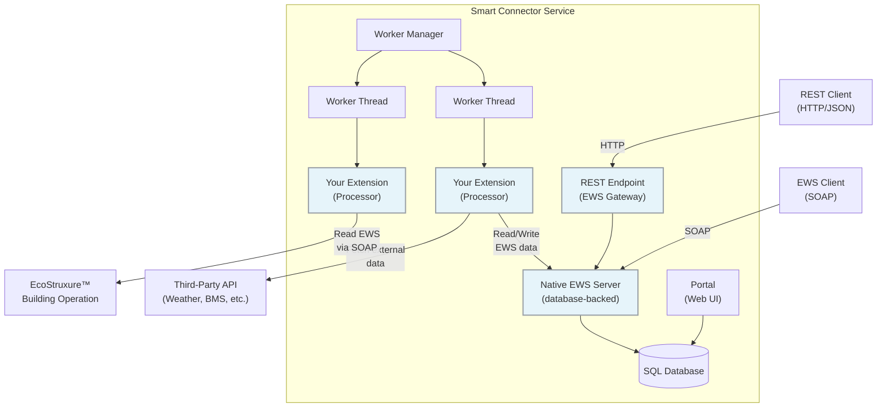
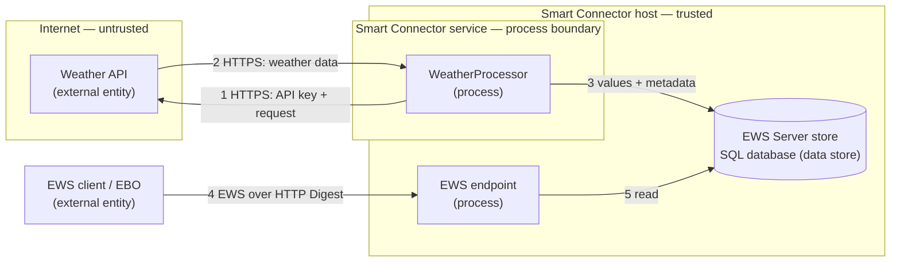
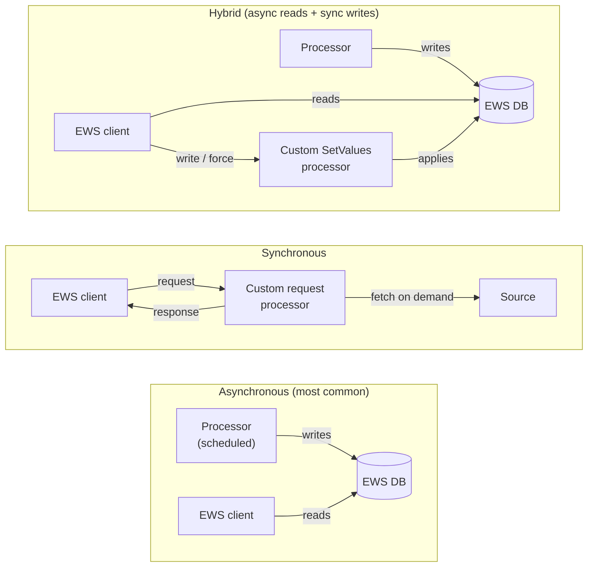
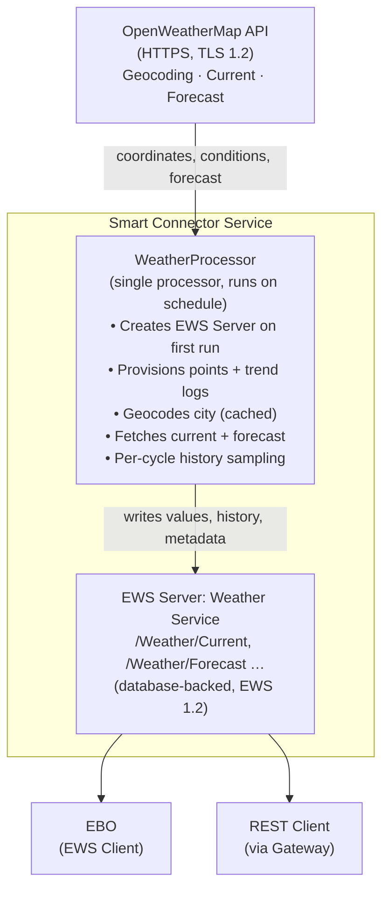
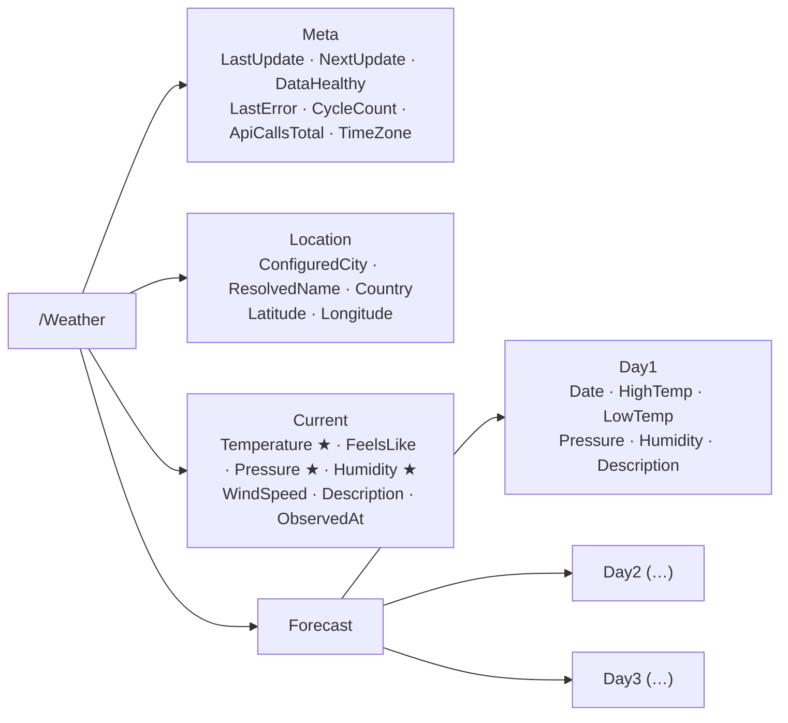

# EcoStruxure™ Smart Connector Developers Guide

<!-- Document: EcoStruxure™ Smart Connector Developers Guide -->
<!-- Applies to: Smart Connector SDK v2.6 -->
<!-- Revision: 7 -->
<!-- Date: June 2026 -->
<!-- Author: Karim Hussain -->
<!-- Audience: Extension developers — system integrators, third-party developers, building automation engineers -->

## Table of Contents

1. [Support](#1-support)
2. [Revision History](#2-revision-history)
3. [Quick Start](#3-quick-start)
   - 3.1 [Prerequisites](#31-prerequisites)
   - 3.2 [Configure the NuGet Feed (90 seconds)](#32-configure-the-nuget-feed-90-seconds)
   - 3.3 [Create the Project (3 minutes)](#33-create-the-project-3-minutes)
   - 3.4 [Write the Processor (5 minutes)](#34-write-the-processor-5-minutes)
   - 3.5 [Build, Deploy, Configure (5 minutes)](#35-build-deploy-configure-5-minutes)
   - 3.6 [You Did It! Now What?](#36-you-did-it-now-what)
4. [Overview](#4-overview)
   - 4.1 [Scope](#41-scope)
   - 4.2 [What is Smart Connector?](#42-what-is-smart-connector)
5. [Security Advisory for Production Deployments](#5-security-advisory-for-production-deployments)
   - 5.1 [Threat Modelling](#51-threat-modelling)
   - 5.2 [Credential Handling](#52-credential-handling)
   - 5.3 [Data Protection and Privacy](#53-data-protection-and-privacy)
   - 5.4 [Logging Guidelines](#54-logging-guidelines)
   - 5.5 [Validation as a Security Control](#55-validation-as-a-security-control)
   - 5.6 [Resource Disposal](#56-resource-disposal)
   - 5.7 [Cybersecure Defaults Checklist](#57-cybersecure-defaults-checklist)
   - 5.8 [Support Policy and Extension Author Responsibilities](#58-support-policy-and-extension-author-responsibilities)
6. [Common Data Flows](#6-common-data-flows)
   - 6.1 [Retrieving Data from an EWS Server](#61-retrieving-data-from-an-ews-server)
   - 6.2 [Providing Data to an EWS Client](#62-providing-data-to-an-ews-client)
   - 6.3 [Providing Data to a Third Party](#63-providing-data-to-a-third-party)
7. [Develop an Extension](#7-develop-an-extension)
   - 7.1 [Problem Statement](#71-problem-statement)
   - 7.2 [The Design](#72-the-design)
   - 7.3 [Configure NuGet Feed](#73-configure-nuget-feed)
   - 7.4 [Creating the Extension Project](#74-creating-the-extension-project)
   - 7.5 [The Base Class: Configuration and Validation](#75-the-base-class-configuration-and-validation)
   - 7.6 [The Processor: A Phased Execution Cycle](#76-the-processor-a-phased-execution-cycle)
   - 7.7 [The Supporting Classes](#77-the-supporting-classes)
   - 7.8 [Recommended Patterns for Production Extensions](#78-recommended-patterns-for-production-extensions)
8. [Testing an Extension](#8-testing-an-extension)
   - 8.1 [Install a Test Runner](#81-install-a-test-runner)
   - 8.2 [Install Smart Connector](#82-install-smart-connector)
   - 8.3 [Create Unit Testing Project](#83-create-unit-testing-project)
   - 8.4 [Add a Test Fixture Class](#84-add-a-test-fixture-class)
   - 8.5 [Test the Supporting Logic](#85-test-the-supporting-logic)
   - 8.6 [Runnable Example Test Projects](#86-runnable-example-test-projects)
9. [Deploying Your Extension](#9-deploying-your-extension)
   - 9.1 [Deploy Binary Files](#91-deploy-binary-files)
   - 9.2 [Add the Processor Configuration](#92-add-the-processor-configuration)
   - 9.3 [Schedule and Run](#93-schedule-and-run)
   - 9.4 [Change the City](#94-change-the-city)
10. [Licensing Your Extension](#10-licensing-your-extension)
   - 10.1 [Create SmartConnectorServer Entries](#101-create-smartconnectorserver-entries)
   - 10.2 [Update Extension Assembly](#102-update-extension-assembly)
   - 10.3 [Enable Licensing at the Processor](#103-enable-licensing-at-the-processor)
   - 10.4 [Updating Extension Assemblies](#104-updating-extension-assemblies)
11. [Appendix](#11-appendix)
   - 11.1 [NuGet Packages](#111-nuget-packages)
   - 11.2 [Smart Connector Interfaces](#112-smart-connector-interfaces)
   - 11.3 [Smart Connector Attributes](#113-smart-connector-attributes)
   - 11.4 [EwsServerDataAdapter](#114-ewsserverdataadapter)
   - 11.5 [Custom Licensing](#115-custom-licensing)
   - 11.6 [Sharing Data within Smart Connector](#116-sharing-data-within-smart-connector)
   - 11.7 [Managed Clients](#117-managed-clients)
   - 11.8 [Coordinating Actions](#118-coordinating-actions)
   - 11.9 [Logging](#119-logging)
   - 11.10 [Third Party Tools](#1110-third-party-tools)
   - 11.11 [Prerequisites and Target Framework](#1111-prerequisites-and-target-framework)
   - 11.12 [Cron Scheduling](#1112-cron-scheduling)
   - 11.13 [Metadata API](#1113-metadata-api)
   - 11.14 [Take Limit and Pagination](#1114-take-limit-and-pagination)
   - 11.15 [Security Configuration](#1115-security-configuration)
   - 11.16 [Syslog Logging](#1116-syslog-logging)
   - 11.17 [Dependency Injection](#1117-dependency-injection)
   - 11.18 [REST API Authentication and Throttling](#1118-rest-api-authentication-and-throttling)
   - 11.19 [Resource Disposal](#1119-resource-disposal)
   - 11.20 [Troubleshooting](#1120-troubleshooting)

## 1 Support

For development questions and peer-to-peer help, visit the [SmartConnector Forum](https://community.se.com/t5/SmartConnector-Forum/bd-p/smart-connector-developer) on the Schneider Electric Community.

For product-related enquiries, contact your local [Schneider Electric representative](https://www.se.com/ww/en/work/support/country-selector/distributors.jsp).

## 2 Revision History

| Date | Author | Revision | Changes Made |
|------|--------|----------|--------------|
| 10/21/2014 | MRS | 1 | Initial release |
| 02/16/2015 | MRS | 2 | Updated for v1.3 |
| 09/30/2015 | MRS | 3 | Updated for v2.0 |
| 04/11/2016 | MRS | 4 | Updated for v2.1 |
| 12/22/2016 | MRS | 5 | Updated for v2.2 |
| 12/15/2017 | MRS | 6 | Updated for v2.3 |
| 06/04/2026 | KH | 7 | Updated for v2.6. Target framework updated to .NET 4.8. NuGet feed migrated to GitHub Packages. AutoCommit bulk update pattern. Cron scheduling. Metadata API. Security hardening. |

<!-- © 2017-2026 Schneider Electric. All Rights Reserved. Schneider Electric, StruxureWare, SmartStruxure solution, and EcoStruxure™ are trademarks owned by Schneider Electric Industries SAS or its affiliated companies. All other trademarks are the property of their respective owners. -->

## 3 Quick Start

This chapter gets you from zero to a running Processor that writes a single value to an EWS server, in approximately 15 minutes. The goal is to validate your toolchain and prove the core SDK round-trip end-to-end. Once this works, the rest of the guide expands every step in depth.

> **What you build:** A Processor that creates its own EWS Server on the first run (no manual Portal setup) and, on every scheduled execution, writes the current UTC time as a string into a `ValueItem` on it. No external services, no third-party APIs, no licensing.

### 3.1 Prerequisites

| Item | Version | Notes |
|------|---------|-------|
| Windows | 10 / 11 / Server 2019+ | 64-bit |
| Visual Studio | 2019 or later | Community edition is sufficient |
| .NET Framework | 4.8 SDK | Required by all Smart Connector extensions |
| Smart Connector | 2.6 or later | Installed locally; the service should be running |
| GitHub PAT | `read:packages` scope | For the Smart Connector NuGet feed (see [Section 3.2](#32-configure-the-nuget-feed-90-seconds)) |

### 3.2 Configure the NuGet Feed (90 seconds)

Smart Connector libraries ship from GitHub Packages on the `SchneiderElectricBuildings` organisation. You need a GitHub Personal Access Token (PAT) with the `read:packages` scope. If you do not have one, see [Section 7.3 Generate a Personal Access Token](#73-configure-nuget-feed) for step-by-step instructions.

**Never write a PAT in plain text into `nuget.config`**. Instead, use one of the two patterns below.

#### Option 1: `dotnet nuget add source` (recommended for local Windows dev)

This registers the source and stores the PAT **DPAPI-encrypted** in the per-user `nuget.config` (`%APPDATA%\NuGet\NuGet.Config`). The encrypted entry can only be decrypted by the same Windows user on the same machine.

```powershell
dotnet nuget add source `
    https://nuget.pkg.github.com/SchneiderElectricBuildings/index.json `
    --name SmartConnector `
    --username YOUR_GITHUB_USERNAME `
    --password YOUR_GITHUB_PAT
```

No PAT ends up on disk in plain text.

#### Option 2: Environment-variable substitution (recommended for CI and teams)

Check in a project-level `nuget.config` that references an environment variable. The PAT lives only in the env var (sourced from a secrets vault, GitHub Actions secret, etc.) and is never written to disk in plain text.

```xml
<?xml version="1.0" encoding="utf-8"?>
<configuration>
  <packageSources>
    <clear />
    <add key="nuget.org" value="https://api.nuget.org/v3/index.json" />
    <add key="SmartConnector" value="https://nuget.pkg.github.com/SchneiderElectricBuildings/index.json" />
  </packageSources>
  <packageSourceCredentials>
    <SmartConnector>
      <add key="Username" value="%GITHUB_USERNAME%" />
      <add key="ClearTextPassword" value="%GITHUB_PACKAGES_PAT%" />
    </SmartConnector>
  </packageSourceCredentials>
</configuration>
```

Set the variables in the calling shell or CI job before running `dotnet restore`:

```powershell
$env:GITHUB_USERNAME = "your-github-handle"
$env:GITHUB_PACKAGES_PAT = "ghp_..."   # from a secrets vault, never committed
dotnet restore
```

> **Why not `ClearTextPassword` with a literal value?** Microsoft's NuGet documentation explicitly warns against this pattern: "Storing passwords in clear text is strongly discouraged." The env-var form uses the same XML key but resolves the value at run time from the environment, so no secret is written to disk.

> **Security:** Whichever option you choose, never commit a `nuget.config` containing a real PAT, and never paste a PAT into chat, screenshots, or commit messages. Add `nuget.config` to `.gitignore` if it could ever be modified to contain credentials, and check in a `nuget.config.template` instead. See [Section 5 Security Advisory](#5-security-advisory-for-production-deployments) for the full credential-handling rules. For more configuration options, see [Section 7.3 Configure NuGet Feed](#73-configure-nuget-feed).

### 3.3 Create the Project (3 minutes)

1. **File → New → Project → Class Library (.NET Framework)**.
2. Target **.NET Framework 4.8**.
3. Name it `Quickstart.HelloEws`.
4. Place the `nuget.config` from [Section 3.2](#32-configure-the-nuget-feed-90-seconds) in the solution root.
5. Right-click the project → **Manage NuGet Packages** → select the `SmartConnector` source → install **`Mongoose.Process`** (provides the `Processor` base class) and **`Mongoose.Ews.Server.Data`** (provides `EwsServerDataAdapter`). Their transitive dependencies install automatically.

### 3.4 Write the Processor (5 minutes)

Replace the contents of `Class1.cs` with the following. Every API used here is part of the Smart Connector SDK 2.6 NuGet packages:

```csharp
using System;
using System.Collections.Generic;
using System.ComponentModel;
using System.ComponentModel.DataAnnotations;
using System.Linq;
using Ews.Common;
using Mongoose.Common;
using Mongoose.Common.Attributes;
using Mongoose.Ews.Server.Data;
using Mongoose.Process;
using SxL.Common;

namespace Quickstart.HelloEws
{
    [ConfigurationDefaults("Hello EWS Processor",
        "Creates an EWS Server (if needed) and writes the current UTC time to "
        + "/Hello/LastSeen on every execution.")]
    public class HelloEwsProcessor : Processor
    {
        // Disable licensing for the quick start; see Section 10 to re-enable.
        public override bool IsLicensed => false;

        [Required]
        [DefaultValue("Hello EWS Server")]
        [Tooltip("Name of the EWS Server to create or connect to.")]
        public string ServerName { get; set; }

        [DefaultValue("SmartConnectorRealm")]
        [Tooltip("HTTP Digest authentication realm for the EWS Server.")]
        public string Realm { get; set; }

        [Required]
        [DefaultValue("http://localhost:5300/HelloEws")]
        [Tooltip("HTTP endpoint address for the EWS Server.")]
        public string EwsAddress { get; set; }

        [Required]
        [Tooltip("Username for the EWS Server.")]
        public string UserName { get; set; }

        [Required]
        [EncryptedString]
        [Tooltip("Password for the EWS Server. Stored encrypted in the database.")]
        public string Password { get; set; }

        private EwsServerDataAdapter _adapter;

        protected override IEnumerable<Prompt> Execute_Subclass()
        {
            var prompts = new List<Prompt>();

            var adapter = ConnectOrCreateServer();

            // Provision the structure. Ensure* helpers are idempotent: they
            // create the folder/value on the first run and return the existing
            // items on every run after that — so no manual Portal setup is needed.
            var hello = EnsureFolder(adapter, "/Hello", "Hello", null);
            EnsureValue(adapter, "/Hello/LastSeen", "LastSeen",
                EwsValueTypeEnum.String, hello);

            adapter.ModifyValueItemValue(
                "/Hello/LastSeen",
                DateTime.UtcNow.ToString("o"),
                EwsValueStateEnum.Good);

            Logger.LogInfo(LogCategory.Processor, "Wrote timestamp to /Hello/LastSeen");
            return prompts;
        }

        // Returns an adapter for the EWS Server, creating it on the first run.
        // ConnectExisting is tried first: on every run after the first it
        // succeeds. Only when it fails (the server does not yet exist) do we
        // ConnectNew — ConnectNew throws up front if the name is already in use,
        // so it must never run for an existing server.
        private EwsServerDataAdapter ConnectOrCreateServer()
        {
            try
            {
                _adapter = EwsServerDataAdapter.ConnectExisting(ServerName, UserName, Password);
                return _adapter;
            }
            catch (Exception ex)
            {
                Logger.LogDebug(LogCategory.Processor,
                    $"ConnectExisting failed ({ex.GetType().Name}); creating server "
                    + $"'{ServerName}'.");
            }

            // First run — create the server, then reconnect with a clean context.
            using (EwsServerDataAdapter.ConnectNew(
                name: ServerName, address: EwsAddress, realm: Realm,
                username: UserName, password: Password, autoStart: true))
            {
            }

            _adapter = EwsServerDataAdapter.ConnectExisting(ServerName, UserName, Password);
            return _adapter;
        }

        private static EwsContainerItem EnsureFolder(
            EwsServerDataAdapter adapter, string altId, string name, EwsContainerItem parent)
        {
            var existing = adapter.ContainerItems.FirstOrDefault(c => c.AlternateId == altId);
            return existing ?? adapter.AddContainerItem(
                altId, name, name, EwsContainerTypeEnum.Folder, parent);
        }

        private static EwsValueItem EnsureValue(
            EwsServerDataAdapter adapter, string altId, string name,
            EwsValueTypeEnum type, EwsContainerItem parent)
        {
            var existing = adapter.ValueItems.FirstOrDefault(v => v.AlternateId == altId);
            return existing ?? adapter.AddValueItem(
                altId, name, name, type,
                EwsValueWriteableEnum.Writeable, EwsValueForceableEnum.NotForceable,
                EwsValueStateEnum.Uncertain, null, parent);
        }

        protected override void Dispose(bool disposing)
        {
            if (disposing)
            {
                _adapter?.Dispose();
                _adapter = null;
            }
            base.Dispose(disposing);
        }
    }
}
```

> **Why these APIs?** `Processor` is the base class for all custom processors ([Section 7.5](#75-the-base-class-configuration-and-validation)). `EwsServerDataAdapter.ConnectNew` creates the EWS Server and starts its HTTP listener; disposing it and calling `ConnectExisting` returns a clean adapter ([Section 11.4](#114-ewsserverdataadapter)). The idempotent `EnsureFolder` / `EnsureValue` helpers provision the structure so the same code runs safely on every cycle — this is the recommended pattern ([Section 7.8](#78-recommended-patterns-for-production-extensions)). `ModifyValueItemValue` updates a single value, and `EwsValueStateEnum.Good` is the quality flag ([Section 11.4](#114-ewsserverdataadapter)). `EncryptedString` ensures the password is encrypted in the database ([Section 5.2](#52-credential-handling)).

### 3.5 Build, Deploy, Configure (5 minutes)

1. Set the build configuration to **Release**, then **Build → Build Solution**. Confirm the project compiles with zero errors.
2. **If you are redeploying** (the DLL already exists in the Extensions folder), stop the Smart Connector service first (Services console or `sc stop "Smart Connector"`). The service locks loaded DLLs, so you cannot overwrite them while it is running. Skip this step on a first-time deploy.
3. Copy `bin\Release\Quickstart.HelloEws.dll` into the Smart Connector `Extensions` folder (default: `C:\ProgramData\SmartConnector\Extensions`).
4. **Start (or restart) the Smart Connector service.**
5. Open the Smart Connector Portal in a browser.
6. Create a schedule (Portal → **Setup → Configuration Schedules → Add New**). Set it to run every minute.
7. Create a Processor Configuration (Portal → **Processors → Add**), select `Quickstart.HelloEws.HelloEwsProcessor`, fill in `UserName` and `Password` (the `ServerName`, `Realm`, and `EwsAddress` already have working defaults), and assign the schedule you created in step 6.
8. Wait one minute. The processor creates an EWS Server named **Hello EWS Server** with a `/Hello/LastSeen` value. Open **EWS Servers** in the Portal, select that server, and refresh — the value shows the current UTC timestamp. You never created the server or the value by hand.

### 3.6 You Did It! Now What?

You have just exercised the full Smart Connector round-trip: NuGet → Processor → EWS Server → Portal. From here:

- **Understand what you built:** [Section 4 Overview](#4-overview) explains every concept (Processor, EWS Server, Worker, etc.).
- **Read this before going further:** [Section 5 Security Advisory for Production Deployments](#5-security-advisory-for-production-deployments): the security rules every extension author must follow before deploying anywhere except a local dev machine.
- **Build a real extension:** [Section 7 Develop an Extension](#7-develop-an-extension) walks through a non-trivial weather-data example — a single self-provisioning processor that fetches from a third-party API and serves the data over EWS with trend history.
- **Test it:** [Section 8 Testing an Extension](#8-testing-an-extension) shows how to unit-test Processors with `IProcessorTestFixture<T>` so they never touch a real database.
- **Reference:** [Section 11 Appendix](#11-appendix) is the alphabetised reference for every interface, attribute, and helper.

> **Where is the RESTful EWS Gateway?** The REST gateway (used to expose Smart Connector EWS data over HTTP/JSON) is documented in a separate companion document: *Smart Connector RESTful EWS API Gateway Guide*. This developer guide focuses exclusively on the SDK.

## 4 Overview

### 4.1 Scope

This document is intended as a guide for developers using Smart Connector, the Windows service middleware, framework developed by Schneider Electric. This document assumes the reader has the requisite knowledge of C# or VB.NET® and is moderately comfortable developing class libraries in Visual Studio® .NET.

This document will not cover the details pertaining to installation, configuration, monitoring, and control of Smart Connector in a runtime environment. That information can be found in the *Smart Connector Installation and Configuration Guide*. It is assumed that this document has been reviewed and the topics contained within are fully understood before continuing.

### 4.2 What is Smart Connector?

When developing solutions, there is frequently a need for software that can bridge the gap between Schneider Electric systems and third-party systems and data sources. This software goes by varying names: protocol shims, glue logic, or more generally, middleware. As different projects are analyzed, patterns begin to emerge where this middleware performs similar actions with only minor variations from solution to solution. Smart Connector was conceived to be this middleware framework.

Smart Connector is an extensible and configurable application framework. At its simplest, Smart Connector is a multi-threaded Windows service. Threads are configured to execute custom code written by solution providers and integrators.



> **Figure 1 — Smart Connector high-level architecture.** Your extension code (blue boxes) runs inside the service as Processors executed by Worker threads. Data flows to and from EWS Servers, the REST Gateway, and external systems.

Smart Connector also provides the infrastructure to provision HTTP endpoints. These endpoints can either serve data to Schneider Electric systems and third-party clients via Schneider Electric's EcoStruxure™ Web Services (EWS) SOAP protocol or generic RESTful services.

#### 4.2.1 Processor

A Processor is custom code that is designed to accomplish a task. While Smart Connector does include some sample Processor classes for operational validation and demonstration purposes, Processors are written by others using Smart Connector's public libraries. These libraries are packaged into a Smart Connector Extension.

The scope of a Processor can vary from simple to very complicated. Often, several Processors are required to function cooperatively to accomplish the necessary tasks for a solution.

#### 4.2.2 Processor Configuration

While a Processor defines how work is accomplished, a Processor Configuration specifically dictates what gets accomplished. A Processor Configuration contains all of the information needed to instantiate a class at runtime, hydrate all properties of that class, and validate that everything is correct before finally executing the Processor. A Processor Configuration also links to the requisite scheduling information which determines when and how often Smart Connector will run a Processor.

#### 4.2.3 Smart Connector EWS Servers

Smart Connector provides the infrastructure to serve data to any EWS Client via native Smart Connector EWS Servers. Multiple EWS Servers can be provisioned, each with its own data isolated from the others. This data can be static data stored in Smart Connector's database or data dynamically obtained from a third party via a custom EWS Server. As with Processors, custom EWS Servers are written by third parties and packaged into a Smart Connector Extension.

#### 4.2.4 REST Endpoints

While EWS is useful for passing data to and from those Schneider Electric systems which support it, third parties interested in that same data do not know how to "speak EWS". To remedy this, Smart Connector includes a configurable RestProvider infrastructure. An EwsRestProvider class is configured with an Endpoint Configuration to serve data from either a native Smart Connector EWS Server or one based on the EWS SOAP protocol. Custom RestProviders can also be written by third parties and packaged into a Smart Connector Extension.

> **Note:** Prior versions also included an `SboEwsRestProvider` based on the SmartStruxure Building Operation (SBO) native CSP protocol. This provider is **deprecated** and no longer functional with EcoStruxure™ Building Operation (EBO) version 3.0 and later.

#### 4.2.5 Endpoint Configuration

In the same way a Processor Configuration defines how a Processor runs, an Endpoint Configuration defines how a REST Endpoint will be provisioned. An Endpoint Configuration contains all of the information needed to instantiate a class at runtime, hydrate all properties of that class, and validate that everything is correct before finally provisioning the REST Endpoint.

#### 4.2.6 Smart Connector Portal

Smart Connector includes an integrated web portal user interface which is installed along with the service. This portal is the primary method to configure Processors, Endpoints, and EWS Servers as well as monitor and control all aspects of SmartConnector. For more information please refer to the *Smart Connector Installation and Configuration Guide*.

#### 4.2.7 Worker Manager and Workers

Workers represent the threads in Smart Connector that execute Processors. The number of available Workers is configurable but is generally limited by the host system hardware. When not actively running a Processor, Workers are inactive, waiting for a command from the Worker Manager. In this state, Workers consume virtually no system resources.

The Worker Manager is responsible for selecting a Processor Configuration, instantiating its defined Processor and passing it off to an idle Worker for execution. The Worker Manager also listens to input to start or stop a Processor or EWS Server as required.

#### 4.2.8 Extension

The term "Extension" is used to define any class assembly which contains code which can run in SmartConnector. Extensions can contain Processors, EWS Server Hosts, RestProviders, and any combination of these. Extensions are written by Smart Connector Developers to solve an application problem.

#### 4.2.9 Persistent Data Store

Smart Connector is backed by a SQL database to persist all manner of data including setup parameters, configuration data, schedule data, and EWS server data. Smart Connector also provides a Processor Values data store that Processors can access directly. This data store can be used to save state between run iterations of the Processor or to enable collaboration between multiple Processors.

#### 4.2.10 In-Memory Cache

In addition to a persistent data store, Smart Connector provides a mechanism to have a volatile in-memory cache of data. A singleton class available to any Processor, RestProvider, or EWS Server which provides strongly typed access to any data the author wishes to store.

#### 4.2.11 Logging

Smart Connector provides an integrated logging framework. Logging levels of Info, Status, Error, Debug, and Trace are extensively used throughout the Smart Connector runtime and public libraries. The Logger is also available to Extension authors for adding their own log information to the common log file output.

Smart Connector supports forwarding all log output to a syslog server for centralised log management. See [Section 11.16 Syslog Logging](#1116-syslog-logging) for configuration details.

#### 4.2.12 Licensing

Smart Connector's framework is licensed. Commercial and development licenses can be obtained at www.SmartConnectorServer.com.

Additionally, Smart Connector provides all the hooks necessary for developers to license any Extension component. These Licenses are managed by the developers themselves also using www.SmartConnectorServer.com.

## 5 Security Advisory for Production Deployments

This chapter is mandatory reading before deploying any extension outside a local developer machine. Every rule below exists to protect the credentials, data, and infrastructure that your extension interacts with. Skipping any of them creates a real, production-grade vulnerability.

> **Scope:** This chapter covers what *extension authors* control. Service-side runtime knobs (account lockout thresholds, password complexity, syslog forwarding) are documented in [Section 11.15 Security Configuration](#1115-security-configuration) and [Section 11.16 Syslog Logging](#1116-syslog-logging).

### 5.1 Threat Modelling

A threat model is a structured analysis of who might attack your system, what they are after, and which parts of the system are most exposed. It is not a one-time exercise; it should be revisited whenever the extension's architecture, data flows, or external integrations change.

#### 5.1.1 Why It Matters

A Smart Connector extension runs as a Windows service with the privileges of the Smart Connector service account. It typically holds EWS server credentials, third-party API keys, end-user identifiers, and potentially sensitive building or operational data. Without a threat model, you are guessing which of these assets are at risk and which controls are missing.

#### 5.1.2 How to Create a Threat Model

Microsoft publishes the **Threat Modeling Tool**, a free desktop application that walks you through the STRIDE methodology (Spoofing, Tampering, Repudiation, Information Disclosure, Denial of Service, Elevation of Privilege):

> https://learn.microsoft.com/en-us/azure/security/develop/threat-modeling-tool

The recommended workflow:

1. **Draw a data-flow diagram** of your extension: which systems it talks to, which credentials it holds, where data is stored, and which network boundaries are crossed.
2. **Run the Threat Modeling Tool** against the diagram. It generates a list of potential threats categorised by STRIDE.
3. **Triage each threat:** decide whether to mitigate, accept, or transfer the risk.
4. **Document mitigations** alongside the extension's design documentation.
5. **Revisit** whenever you add a new API, a new data store, a new credential, or a new network path.

#### 5.1.3 What to Consider for Smart Connector Extensions

| Area | Questions to ask |
|------|------------------|
| Credentials | Which passwords, API keys, or tokens does the extension hold? Are they all marked `[EncryptedString]`? |
| Network exposure | Does the extension open new HTTP endpoints? Are they authenticated? |
| Data stores | Does the extension write to the Smart Connector database or to external stores? What happens if that data is read by an unauthorised party? |
| Log output | Could a log line reveal a credential, a personal identifier, or an internal URL? |
| Third-party APIs | What happens if the third-party API returns malicious or unexpected data? |
| Supply chain | Are all NuGet dependencies from trusted sources? Are their licences compatible? |

#### 5.1.4 Example: Weather Extension Threat Model

The Weather Extension from [Section 7 Develop an Extension](#7-develop-an-extension) connects to an external weather API and writes values to an EWS server. The data-flow diagram below identifies the elements and the **trust boundaries** they cross — the same lens the Microsoft Threat Modeling Tool uses. Each boundary crossing is then examined for STRIDE threats.



Applying STRIDE to the elements and flows yields, for example:

| Category | Threat | Mitigation |
| --- | --- | --- |
| **Spoofing** | A spoofed weather endpoint (flow 2) feeds false data; an unauthorised EWS client (flow 4) | TLS 1.2 with certificate validation; HTTP Digest auth on the EWS endpoint |
| **Tampering** | Data altered in transit (flows 2, 4) | TLS in transit; validate and bound API values before persisting |
| **Repudiation** | An action cannot be traced | Runtime audit log; the processor records last-update, health, and counters to `Meta/*` |
| **Information Disclosure** | The API key or EWS password leaks (flows 1, 4) | `[EncryptedString]` at rest; no credential in any log call; credentials only over TLS |
| **Denial of Service** | The API is unreachable or floods the worker; an oversized response (flow 2) | Fail gracefully (a `MayNotContinue` prompt, not an infinite retry); HTTP timeout; bounded response parsing; guard against overlapping runs |
| **Elevation of Privilege** | A crafted response or dependency runs as the service account | Treat all external data as untrusted and validate it; trusted dependencies only; least-privilege service account |

Each example extension ships a `SECURITY.md` with this diagram and table filled in for its specific API — use one as a template for your own (see [`examples/SmartConnector.WeatherExtension/SECURITY.md`](../../examples/SmartConnector.WeatherExtension/SECURITY.md)).

### 5.2 Credential Handling

#### 5.2.1 Never Hard-Code Credentials

The following is forbidden in every extension, sample, and test:

```csharp
// FORBIDDEN: hard-coded password
var adapter = EwsServerDataAdapter.ConnectExisting("Server1", "admin", "MyP@ssword1");
```

Credentials must come from configurable properties on your `Processor`, `EwsServiceHost`, or `RestProvider`. The runtime persists these properties through Processor Configurations stored in the Smart Connector database.

#### 5.2.2 Encrypt Sensitive Properties

Every property that holds a password, API key, OAuth token, client secret, or connection string must be decorated with `[EncryptedString]`:

```csharp
[Required]
[EncryptedString]
[Tooltip("Password for the EWS Server. Stored encrypted in the database.")]
public string Password { get; set; }
```

The runtime encrypts the value at write-time and decrypts it only when the property is read by your code. The Portal masks the field in the UI. The value never appears in plain text in the database, in configuration exports, or in audit log entries.

`[EncryptedString]` is in `Mongoose.Common.Attributes`. See [Section 11.3 Smart Connector Attributes](#113-smart-connector-attributes) for the full attribute reference.

#### 5.2.3 Never Read Encrypted Values into Local Logs

The decrypted value is intended for transport to the third-party system that needs it. Never log it, never write it to a file, never serialise it to a `Prompt` message, and never include it in an exception message that propagates upstream.

```csharp
// FORBIDDEN
Logger.LogDebug(LogCategory.Processor, $"Connecting with password={Password}");

// CORRECT
Logger.LogDebug(LogCategory.Processor, $"Connecting as user {UserName}");
```

#### 5.2.4 NuGet Personal Access Tokens

The PAT used to pull Smart Connector NuGet packages from GitHub Packages is itself a credential.

- **Scope it minimally:** `read:packages` only.
- **Set an expiry:** never use a PAT with no expiration.
- **Never write it in plain text on disk.** The two acceptable storage patterns are:
  - **Local Windows dev:** `dotnet nuget add source ... --username X --password Y` (NuGet stores the password DPAPI-encrypted, decryptable only by the same user on the same machine).
  - **CI/CD and team configs:** project-level `nuget.config` that uses environment-variable substitution (`%GITHUB_PACKAGES_PAT%`); the PAT is set in the CI job from a secrets vault and never written to disk.
- **Do not use the literal `<add key="ClearTextPassword" value="ghp_..." />` form.** Microsoft's NuGet documentation explicitly discourages it. See [Section 3.2 Configure the NuGet Feed](#32-configure-the-nuget-feed-90-seconds) for both supported patterns.
- **Do not commit `nuget.config` if it could ever contain a literal PAT.** Add it to `.gitignore` and check in a `nuget.config.template` with placeholder env-var references.
- **CI/CD:** store the PAT in a secrets vault (GitHub Actions secrets, Azure Key Vault, etc.) and inject at build time as an environment variable.
- **If a PAT is ever exposed** (committed by mistake, pasted into chat, screenshotted): revoke it immediately at GitHub → Settings → Developer settings → Personal access tokens, then issue a new one.

### 5.3 Data Protection and Privacy

Extension authors are responsible for the data their code handles. The Smart Connector runtime manages its own internal data (Portal user accounts, audit logs, HTTP access logs); you cannot change how that data is stored or logged. This section covers the data *you* control.

#### 5.3.1 Data Your Extension Controls

| Data type | Example | Your responsibility |
|-----------|---------|---------------------|
| Third-party API credentials | Weather-API key, OAuth client secret | Mark with `[EncryptedString]`; never log |
| EWS server credentials | Username, password passed to `EwsServerDataAdapter` | Mark with `[EncryptedString]`; never log |
| EWS value data | `ValueItem` values your Processor writes | If values contain personal identifiers (e.g. badge numbers, email addresses), document why and ensure downstream consumers are aware |
| Data fetched from external APIs | JSON payloads, XML responses | Validate and bound before persisting; do not log raw payloads at Info level |
| Processor Values | State saved between iterations via `ProcessorValueSource` | Do not store credentials or personal identifiers in Processor Values; they are not encrypted |

#### 5.3.2 What the Runtime Already Handles

The following are managed by the Smart Connector runtime. Extension code cannot change their behaviour and should not attempt to duplicate them:

- Portal user account storage and password hashing
- Audit log entries (username + action + timestamp)
- HTTP access logging (client IP, user agent, principal name)
- Account lockout and password complexity enforcement

#### 5.3.3 Data in Transit

All communication with external services must be encrypted. Enforce **TLS 1.2 or higher** for every outbound call your extension makes, and never accept an invalid or expired certificate. Set the protocol once before your first request:

```csharp
// Enforce TLS 1.2+ before the first outbound request
ServicePointManager.SecurityProtocol |= SecurityProtocolType.Tls12;
```

Use `https://` endpoints exclusively for third-party APIs; reject a downgrade to plain HTTP. The native EWS Server and REST Gateway transport security is configured at the service level — this rule covers the third-party endpoints your code calls.

### 5.4 Logging Guidelines

`Logger` is in `SxL.Common`. `LogCategory` is in `Mongoose.Common`. Both are available to your extension code.

The single overriding rule: **never log credentials or secrets at any log level.** Beyond that, use the guidance below for each level.

#### 5.4.1 What to Log at Each Level

| Level | Purpose | Appropriate content | Not appropriate |
|-------|---------|---------------------|-----------------|
| `LogError` | Operation failed; cannot continue | Exception type and message, operation name, affected resource identifier | Passwords, tokens, raw connection strings, full stack traces from third-party libraries that may embed credentials in query parameters |
| `LogInfo` | Normal operational messages an operator reads in production | "Connected to server X", "Wrote N values", "Processor completed in M ms" | User-supplied free-text values, email addresses, raw API responses |
| `LogStatus` | Heartbeat or progress | "Processing batch 3 of 10" | Detailed data values |
| `LogDebug` | Diagnostic detail (off by default in production) | State transitions, retry counts, configuration property names (not values), individual item identifiers (AlternateId) | Decrypted property values, authentication headers |
| `LogTrace` | Per-iteration detail (off by default) | Loop index, individual record keys, timing per item | Raw request/response bodies that may contain credentials or personal data |

#### 5.4.2 Credentials Are Forbidden at Every Level

Even `LogTrace` (which is off by default) must never contain a password, API key, token, or connection string. Log files may be collected for support, shared across teams, or forwarded to a SIEM. Assume every log line will eventually be read by someone who should not see the secret.

```csharp
// FORBIDDEN at any level
Logger.LogTrace(LogCategory.Processor, $"Token={ApiToken}");

// CORRECT
Logger.LogTrace(LogCategory.Processor, "Authenticating with token [REDACTED]");
```

#### 5.4.3 Centralise via Syslog

For any non-trivial deployment, forward Smart Connector logs to a centralised syslog target (Splunk, Graylog, Sentinel). This delivers tamper-evidence, retention, and access control that local log files cannot. See [Section 11.16 Syslog Logging](#1116-syslog-logging) for configuration.

### 5.5 Validation as a Security Control

Schematic and semantic validation are not just for usability. They are the first line of defence against malformed configuration that could be used to attack a downstream system. Apply them rigorously to every public property:

| Property type | Required validation |
|---------------|---------------------|
| URL or address | `[Url]` (DataAnnotations) plus your own scheme/host check in `Validate` |
| File path | `[Required]` + reject path traversal sequences (`..`, absolute paths outside data dir) |
| Username | `[Required]` + maximum length |
| Password | `[Required]` + `[EncryptedString]` + minimum length matching service policy |
| Free-form text | `[StringLength]` to bound memory consumption |
| Numeric ranges | `[Range]` to bound resource allocation downstream |

See [Section 7.5.4 Validation](#754-validation) for the validation framework and [Section 11.3 Smart Connector Attributes](#113-smart-connector-attributes) for the attribute reference.

### 5.6 Resource Disposal

Failing to dispose of an `EwsServerDataAdapter`, an `EwsClient`, or any `IDisposable` resource leaks SQL connections, sockets, and unmanaged handles. Under load this becomes a denial-of-service against your own service.

Use `using` blocks for short-lived resources (as shown in [Section 3.4](#34-write-the-processor-5-minutes)) and override `Processor.Dispose(bool)` for resources that span an entire Processor execution. See [Section 11.19 Resource Disposal](#1119-resource-disposal) for the full pattern.

Beyond disposal, **bound the work each execution can do** so a misconfiguration or a hostile upstream cannot exhaust the host or the third-party API:

- Cap query and result sizes (page sizes, row limits, and any history backfill window).
- If an execution can run longer than its schedule interval, guard against overlapping runs so the Worker pool cannot be saturated by a pile-up of long executions (see [How-To: Run a Self-Provisioning Processor Safely on a Schedule](../how-to-guides.md#12-run-a-self-provisioning-processor-safely-on-a-schedule)).
- Fail fast on an unreachable dependency rather than retrying indefinitely and starving other Workers.

### 5.7 Cybersecure Defaults Checklist

Before submitting any extension for deployment, walk this checklist:

- [ ] No hard-coded passwords, tokens, or connection strings anywhere in source.
- [ ] Every secret-bearing property has `[EncryptedString]` and `[Required]`.
- [ ] No `Logger.Log*` call interpolates a password, token, or PII field.
- [ ] Outbound calls to external services use TLS 1.2 or higher and reject invalid certificates.
- [ ] All `IDisposable` resources are wrapped in `using` or disposed in `Dispose`.
- [ ] Resource use is bounded — query/result sizes and any backfill window are capped, and a long-running execution is guarded against overlapping runs.
- [ ] All public properties have `[Required]`, `[StringLength]`, or `[Range]` as appropriate.
- [ ] `nuget.config` is gitignored and a `.template` is committed in its place.
- [ ] PAT used for NuGet has `read:packages` scope only and an expiry.
- [ ] Extension does not duplicate Smart Connector audit log entries to its own log files.
- [ ] `IsLicensed` is intentionally set (see [Section 10 Licensing Your Extension](#10-licensing-your-extension)).
- [ ] HTTP endpoints exposed by your extension enforce authentication ([Section 11.18 REST API Authentication and Throttling](#1118-rest-api-authentication-and-throttling)).
- [ ] Service settings reviewed for production: account lockout, password complexity, syslog ([Section 11.15 Security Configuration](#1115-security-configuration)).

### 5.8 Support Policy and Extension Author Responsibilities

Smart Connector is covered by the *Software Support Policy for EcoStruxure™ Smart Connector* (PA-01132). Extension authors should be familiar with the following points from that policy:

- **Custom-built extensions are not covered by the Smart Connector support policy.** They are supported under the respective extension author's own support policy. (Extensions developed and published by Schneider Electric are covered under their own product support policies.)
- **Extension authors are responsible for:** providing their own support policy and communicating it to their end users; testing and validating their extension against each new Smart Connector Runtime and SDK version; addressing defects, compatibility issues, and security vulnerabilities in their extension code; documenting any third-party dependencies; and clearly communicating which Smart Connector versions their extension supports.
- **Cybersecurity patches** are provided for reported vulnerabilities in the Smart Connector Runtime and SDK. They do not cover vulnerabilities introduced by extensions, third-party libraries, or custom code.
- **Documented SDK classes, APIs, and interfaces** will remain backward compatible within a major Smart Connector version wherever reasonably possible. Any breaking changes will be documented in the release notes and developer documentation.

For the full support timelines and scope of coverage, refer to the published *Software Support Policy for EcoStruxure™ Smart Connector* document.

**Regulatory considerations (EU Cyber Resilience Act).** The CRA sets cybersecurity obligations for products with digital elements placed on the EU market. The Smart Connector Runtime and Framework SDK are the product; an extension you build is a software component (a module) that runs within it. Schneider Electric is responsible for the conformity of the Runtime and SDK; you are responsible for the security and regulatory conformity of your extension and its third-party dependencies. Determine how the CRA (and any other applicable regulation) applies to your offering with your own legal and compliance function before placing an extension on the market.

## 6 Common Data Flows

Smart Connector was designed to bridge the gap between Schneider Electric systems and third-party systems and data sources. How one designs these systems depends on many factors beyond the scope of this document. However, the patterns and data flows that are required are frequently repeated from solution to solution. These patterns and recommendations on how to implement them will be discussed in the sections that follow.

### 6.1 Retrieving Data from an EWS Server

Any system that adheres to the EWS 1.1 or EWS 1.2 specification can serve data consumed by your Smart Connector solution.

Smart Connector provides the EwsClient class for this purpose. While EWS is not difficult to consume, Smart Connector has abstracted out common read-oriented tasks into higher-order helper classes. These tasks handle some of the idiosyncrasies in EWS, shielding the user from issues such as paging, subscribing and renewing, and knowing when to call GetAlarmEvents versus GetUpdatedAlarmEvents.

These classes are defined below.

#### 6.1.1 EwsClient

This class provides all methods and proxy data classes needed to consume any EWS 1.1/1.2 server.

#### 6.1.2 AlarmItemReader

This class provides the functionality to retrieve paged data sets of AlarmItem from any EWS 1.1/1.2 server.

#### 6.1.3 ValueItemReader

This class provides the functionality to retrieve paged data sets of ValueItem from any EWS 1.1/1.2 server.

#### 6.1.4 HistoryItemReader

This class provides the functionality to retrieve paged data sets of HistoryRecord from any EWS 1.1/1.2 server.

#### 6.1.5 SubscriptionReader

This class provides the functionality to receive subscription notifications from any EWS 1.2 server. All aspects of subscription management are handled for the consumer.

### 6.2 Providing Data to an EWS Client

Any system that can consume an EWS 1.1 or EWS 1.2 feed can be integrated with your Smart Connector solution. Smart Connector provides fast, EWS 1.2 compliant, database-backed EWS servers for this purpose.

Where the server data originates depends on which technique works best for your solution. Generally, there are three data management techniques used to manage EWS data: asynchronous data management, synchronous data management, or a hybrid approach which uses both asynchronous and synchronous methods. While each technique comes with its own complexities and pros and cons, asynchronous data management is the easiest method to implement and the more common technique used.



In **asynchronous** management a Processor refreshes the database on a schedule and clients read the stored values (fast reads, possibly stale between cycles). In **synchronous** management every client request is served live by a custom request processor (always fresh, slower, more code). The **hybrid** approach is asynchronous for reads but overrides just the methods that must be synchronous — typically write, force, and unforce.

#### 6.2.1 Asynchronous Data Management

Asynchronous data management involves provisioning a native Smart Connector EWS server via the portal or through code using the EwsServerDataAdapter class. Programmatic provisioning is often preferred because it eliminates manual Portal configuration steps:

```csharp
// Create a new EWS Server programmatically (on a processor's first run)
using (var adapter = EwsServerDataAdapter.ConnectNew(
    name: ServerName,
    address: EwsAddress,
    realm: Realm,
    username: UserName,
    password: Password))
{
    // Provision value items, alarm items, etc.
}
```

See [Section 11.4 EwsServerDataAdapter](#114-ewsserverdataadapter) for the full `ConnectNew` parameter list, and [Section 7.6](#76-the-processor-a-phased-execution-cycle) for a complete working example.

Regardless of the provisioning approach, the data served is stored in the Smart Connector database and managed asynchronously to the inbound client calls. This is typically done with one or more custom Processors which maintain the data using the aforementioned EwsServerDataAdapter class.

**Pros:**

- Serve performance is fast.
- Simpler to implement.

**Cons:**

- Served data may be stale between refresh cycles of the update Processor.

> **Performance Note (v2.6.37+):** When updating many values in a single Processor execution cycle, use the AutoCommit pattern on the `EwsServerDataAdapter` for significantly improved performance. Disable `AutoCommit`, perform all updates, then call `CommitChanges()` to persist in a single database transaction. This delivers up to 10× faster processing for bulk operations. See [Section 11.4 EwsServerDataAdapter](#114-ewsserverdataadapter) for details.

#### 6.2.2 Synchronous Data Management

Synchronous data management involves provisioning a native Smart Connector EWS server via the Portal or programmatically using the `EwsServerDataAdapter` class (see [Section 11.4 EwsServerDataAdapter](#114-ewsserverdataadapter)). Programmatic provisioning is often preferred because it eliminates manual Portal configuration steps. Once provisioned, all data is retrieved and served synchronous to the client request. This is accomplished by creating custom EWS Server request processors for every EWS method to be supported.

**Pros:**

- Greater customization is achievable.

**Cons:**

- Serve performance is typically slower.
- Harder to configure.
- More involved to implement.

#### 6.2.3 Hybrid Data Management

While synchronous data management offers a higher degree of customization, most solutions typically only require synchronous actions to support write, force, and unforce methods. In these or similar situations, a hybrid approach is usually the best.

Hybrid solutions are asynchronous solutions where only those method(s) which need to be performed synchronously are overridden from the base implementation.

**Pros:**

- Serve performance is fast for reads.
- Allows selective customization.

**Cons:**

- Served data may be stale between refresh cycles of the update Processor.
- Harder to configure.
- Incrementally more involved to implement.

### 6.3 Providing Data to a Third Party

The manner in which you provide data to third parties depends on the capabilities of the third party. If the third party can consume the EWS SOAP endpoint, no further customisation is needed. More commonly, the third party can be classified as either an active or passive participant.

#### 6.3.1 Active Third Party

An active third party is one that directly consumes either a SOAP or REST endpoint which Smart Connector will serve. If EWS is supported then no further customization is required beyond what is outlined in [Providing Data to an EWS Client](#62-providing-data-to-an-ews-client) above.

If EWS is not supported, there are still options available to you in SmartConnector.

##### 6.3.1.1 RESTful EWS Proxy

Smart Connector provides infrastructure to provision REST endpoints which can be used to serve data from either a native Smart Connector EWS Server or any EWS Server based on the standard SOAP protocol. To be clear, this is not a port of EWS to REST, rather it is a comprehensive and truly RESTful approach complete with throttling, authentication, and paging. See the *Smart Connector Installation and Configuration Guide* and *Smart Connector EWS REST API Gateway* for more information.

##### 6.3.1.2 Custom REST Endpoint

As with most of Smart Connector, you can also create your own customized REST server using the throttling, authentication, and paging components available from the framework.

#### 6.3.2 Passive Third Party

A passive third party is one that has its own API integrators are required to use to push data into it. This is typically implemented purely with Processors which perform all of the necessary read/write operations.

## 7 Develop an Extension

Regardless of whether you are writing a custom Processor, EWS Server, or REST Provider, you will need to create at least one Smart Connector Extension to contain it all. A Smart Connector Extension is a specially annotated .NET assembly which contains all of the pieces for your Smart Connector solution. If you prefer, you could create multiple Extensions to organize different solution components separately. Review the [Licensing Your Extension](#10-licensing-your-extension) section before deciding if one or multiple Extension assemblies are best for your situation.

The best way to describe how to develop an Extension is to actually develop one. The remainder of this chapter builds a complete, working extension step by step: the **Weather Extension**. We design it, write the code, unit-test it, deploy it to a Smart Connector runtime, configure it, and finally add licensing.

Some of the code steps below may seem obvious for seasoned developers. Have patience as the pace will quicken as you read on. All code syntax and steps are for C# using Visual Studio 2019 or later. Other languages and development environments may have slightly different steps.

The following methodology is by no means the only way to develop Extensions, but it is the preferred methodology used by Schneider Electric.

> **Working example:** The finished, tested source for everything in this chapter lives under [`examples/SmartConnector.WeatherExtension/`](../../examples/SmartConnector.WeatherExtension/). Every code block below is taken from that project, so you can build it as you read or open it alongside the guide and follow along. The companion [README](../../examples/SmartConnector.WeatherExtension/README.md) condenses the deployment and Portal-configuration steps and explains how to obtain an OpenWeatherMap API key.

### 7.1 Problem Statement

A requirement exists to obtain current weather data (temperature, "feels like" temperature, pressure, humidity, wind speed, and a text description) and a three-day forecast (date, high and low temperature, pressure, humidity, and description) for a configured city from a third-party weather service. The data must be served so it can be consumed by a generic EWS client, including EcoStruxure™ Building Operation. The extension must also:

- Resolve the configured city to coordinates and report the resolved location, so an operator can confirm the geocoded target.
- Maintain historical (trend) data for the current conditions so EWS clients can graph them over time.
- Expose its own operational health (last update, next update, error state, and counters) so operators can alarm on integration failures.
- Provision everything it needs on first run — no manual EWS Server or point creation.

We will pull weather data from the free OpenWeatherMap service at <https://openweathermap.org/api>. You must register for a free account and obtain your own API key; the [Weather Extension README](../../examples/SmartConnector.WeatherExtension/README.md) has step-by-step instructions for obtaining and activating one.

### 7.2 The Design

Earlier versions of this guide built this solution as two cooperating processors (a setup processor and an update processor) plus a customised EWS Server. The modern, recommended approach — and the one this chapter follows — is a **single, self-provisioning processor**. One processor that both provisions its EWS structure and updates it on a schedule avoids the configuration mismatch that two separate processors can drift into, where the update side expects points the setup side never created. See [Recommended Patterns for Production Extensions](#78-recommended-patterns-for-production-extensions) for why, and the larger `EntsoeExtension` and `GridStatusExtension` examples for the same pattern at scale.

The design has three parts:

- **`WeatherProcessorBase`** — an abstract base class holding the configuration properties (EWS Server details, API key, city, units), validation, the unit labels, and the `EwsServerDataAdapter` lifecycle.
- **`WeatherProcessor`** — the concrete processor. On every scheduled execution it provisions the EWS structure idempotently, fetches data from OpenWeatherMap, writes values and trend samples, and updates its health metadata — all in a fixed phase order, guarded against overlapping runs.
- **Helper classes** — `OpenWeatherMapClient` (HTTPS with TLS 1.2 and retry), `OpenWeatherMapResponseParser` (JSON to typed objects), `ForecastAggregator` (3-hour steps rolled into daily summaries), and `EwsStructure` (the EWS path constants). Keeping these separate keeps the processor readable and lets the pure logic be unit-tested without a Smart Connector runtime.

OpenWeatherMap has deprecated city-name weather queries, so the processor first resolves the city to latitude/longitude via the Geocoding API, then fetches weather by coordinates. The geocode result is cached in the EWS tree and only re-fetched when the configured city changes, which conserves the free-tier API budget.



> **Figure 2 — Weather extension architecture.** A single `WeatherProcessor` runs on a schedule. On first run it creates the EWS Server and provisions the data tree; on every run it geocodes the city (cached), fetches current conditions and the forecast from OpenWeatherMap, and writes values, trend samples, and health metadata. EWS clients such as EBO read the served data.

The processor provisions a single tree under `/Weather`, with a `Meta` container for health, a `Location` container for the geocoded coordinates, a `Current` container (whose temperature, pressure, and humidity points carry trend logs), and a `Forecast` container with one folder per forecast day:



The ★ points have a linked trend log (history item). Let's build it.

### 7.3 Configure NuGet Feed

Before we code anything, we need to configure Visual Studio to have access to Smart Connector's public libraries. These libraries are distributed via NuGet packages hosted on **GitHub Packages** within the Schneider Electric Buildings organisation.

#### Prerequisites

- A GitHub account with access to the `SchneiderElectricBuildings` organisation
- A GitHub Personal Access Token (PAT) with the `read:packages` scope

#### Generate a Personal Access Token

1. Log in to GitHub at https://github.com.
2. Navigate to **Settings → Developer settings → Personal access tokens → Tokens (classic)**.
3. Click **Generate new token (classic)**.
4. Provide a descriptive note (e.g., "Smart Connector NuGet").
5. Select the `read:packages` scope.
6. Click **Generate token**.
7. Copy the token immediately. It will not be shown again.

#### Add the NuGet Package Source

There are three ways to register the feed. All are equivalent — choose the one that fits your workflow:

| Method | Best for | Details |
|--------|----------|--------|
| `dotnet nuget add source` (CLI) | Local Windows dev | DPAPI-encrypted, no plain-text PAT on disk |
| Environment-variable `nuget.config` | CI pipelines and teams | PAT resolved at runtime from env var |
| Visual Studio UI | Developers who prefer GUI workflows | Prompted for credentials on first restore |

##### Option 1: `dotnet nuget add source` (recommended for local Windows dev)

```powershell
dotnet nuget add source `
    https://nuget.pkg.github.com/SchneiderElectricBuildings/index.json `
    --name SmartConnector `
    --username YOUR_GITHUB_USERNAME `
    --password YOUR_GITHUB_PAT
```

The PAT is stored **DPAPI-encrypted** in the per-user `nuget.config` (`%APPDATA%\NuGet\NuGet.Config`). It can only be decrypted by the same Windows user on the same machine.

##### Option 2: Environment-variable substitution (recommended for CI and teams)

Check in a project-level `nuget.config` that references environment variables:

```xml
<?xml version="1.0" encoding="utf-8"?>
<configuration>
  <packageSources>
    <clear />
    <add key="nuget.org" value="https://api.nuget.org/v3/index.json" />
    <add key="SmartConnector" value="https://nuget.pkg.github.com/SchneiderElectricBuildings/index.json" />
  </packageSources>
  <packageSourceCredentials>
    <SmartConnector>
      <add key="Username" value="%GITHUB_USERNAME%" />
      <add key="ClearTextPassword" value="%GITHUB_PACKAGES_PAT%" />
    </SmartConnector>
  </packageSourceCredentials>
</configuration>
```

Set the variables in the calling shell or CI job before running `dotnet restore`:

```powershell
$env:GITHUB_USERNAME = "your-github-handle"
$env:GITHUB_PACKAGES_PAT = "ghp_..."   # from a secrets vault, never committed
dotnet restore
```

##### Option 3: Visual Studio UI

1. From Visual Studio, select **Tools → Options → NuGet Package Manager → Package Sources**.
2. Click **+** to add a new source.
3. Enter:
   - **Name:** `SmartConnector`
   - **Source:** `https://nuget.pkg.github.com/SchneiderElectricBuildings/index.json`
4. Click **Update**, then **OK**.

When prompted for credentials during package restore:
- **Username:** Your GitHub username
- **Password:** The Personal Access Token generated above
> **Security note:** Never commit a PAT to source control. The literal `<add key="ClearTextPassword" value="ghp_..." />` pattern is explicitly discouraged by the official NuGet documentation. See [Section 3.2](#32-configure-the-nuget-feed-90-seconds) for a concise summary and [Section 5.2.4](#524-nuget-personal-access-tokens) for the full security rules.

### 7.4 Creating the Extension Project

An Extension is a .NET class library assembly that targets .NET Framework 4.8. We keep the extension code and the test code in separate projects so we never deploy test code to production; we add the test project later in [Testing an Extension](#8-testing-an-extension).

#### 7.4.1 Create the Solution and Project

1. Start Visual Studio and create a **Blank Solution** (for example, `SmartConnectorSamples`).
2. Add a new **Class Library** project to the solution named `SmartConnector.WeatherExtension`, targeting **.NET Framework 4.8**. All Smart Connector extensions must target .NET 4.8.

The Weather Extension uses an SDK-style project file, which keeps the package references and assembly metadata in one place. Replace the generated `.csproj` contents with the following:

```xml
<Project Sdk="Microsoft.NET.Sdk">
  <PropertyGroup>
    <TargetFramework>net48</TargetFramework>
    <RootNamespace>SmartConnector.WeatherExtension</RootNamespace>
    <AssemblyName>SmartConnector.WeatherExtension</AssemblyName>
    <AssemblyTitle>SmartConnector Weather Extension</AssemblyTitle>
    <Description>Smart Connector extension that integrates with the OpenWeatherMap API to publish current conditions and a 3-day forecast for a configured city to EWS clients.</Description>
    <Company>Schneider Electric</Company>
    <Product>EcoStruxure Smart Connector</Product>
    <Copyright>Copyright (c) Schneider Electric 2026</Copyright>
    <Version>1.0.0</Version>
    <IncludeSourceRevisionInInformationalVersion>false</IncludeSourceRevisionInInformationalVersion>
  </PropertyGroup>

  <ItemGroup>
    <PackageReference Include="Mongoose.Process" Version="2.6.*" />
    <PackageReference Include="Mongoose.Ews.Server.Data" Version="2.6.*" />
    <PackageReference Include="SxL.Common" Version="2.6.*" />
  </ItemGroup>

  <ItemGroup>
    <Reference Include="System.Net.Http" />
    <Reference Include="System.Web.Extensions" />
  </ItemGroup>
</Project>
```

The three `PackageReference` entries are the Smart Connector SDK packages this extension needs: `Mongoose.Process` (the `Processor` base class), `Mongoose.Ews.Server.Data` (the `EwsServerDataAdapter`), and `SxL.Common` (the `Logger` and attribute base classes). The two framework `Reference` entries supply `System.Net.Http` (the API client) and `System.Web.Extensions` (the `JavaScriptSerializer` used to parse JSON without an external dependency).

Run `dotnet restore` (or let Visual Studio restore on first build) and confirm all `Mongoose.*` and `SxL.*` packages resolve from the SmartConnector feed configured in [Section 7.3](#73-configure-nuget-feed).

#### 7.4.2 Assembly Metadata

The Portal displays assembly information to the user when adding Processor and Endpoint Configurations and EWS Servers. With an SDK-style project this information comes from the MSBuild properties shown above — `Description`, `Company`, `Copyright`, and `Version` — not from a separate `AssemblyInfo.cs` file. Set them to useful, descriptive values for your extension.

> **Note:** Set `IncludeSourceRevisionInInformationalVersion` to `false` so the build does not append a source-control hash to the version string the Portal displays.

### 7.5 The Base Class: Configuration and Validation

The extension has one concrete processor, `WeatherProcessor`, and an abstract base class, `WeatherProcessorBase`, that holds the configuration. We start with the base class.

#### 7.5.1 Add the Base Class

We split the *configuration* of the extension into an abstract base class, `WeatherProcessorBase`, so the concrete processor in [The Processor: A Phased Execution Cycle](#76-the-processor-a-phased-execution-cycle) is free to focus on execution logic. This also mirrors the larger examples, where a single base class is shared by more than one processor.

1. Add a class named `WeatherProcessorBase` to the project. By convention, processor class names end with "Processor".
2. Make it `public abstract` and subclass `Processor` (from `Mongoose.Process`, supplied by the package you referenced in [Creating the Extension Project](#74-creating-the-extension-project)).

```csharp
using System;
using System.Collections.Generic;
using System.ComponentModel;
using System.ComponentModel.DataAnnotations;
using Mongoose.Common;
using Mongoose.Common.Attributes;
using Mongoose.Ews.Server.Data;
using Mongoose.Process;
using SxL.Common;

namespace SmartConnector.WeatherExtension
{
    public abstract class WeatherProcessorBase : Processor
    {
        // Properties, validation, unit labels, and the adapter lifecycle follow.
    }
}
```

`Processor` is abstract; its key member is `Execute_Subclass`, the entry point the runtime calls on each execution. The concrete `WeatherProcessor` implements it in [Section 7.6](#76-the-processor-a-phased-execution-cycle).

#### 7.5.2 Licensing Opt-Out (IsLicensed)

By default, Smart Connector assumes you will license every component of your Extension. This is optional. If you do not wish to license the processor, override the `IsLicensed` property to return `false`. We override it once in the base class so both the concrete processor and the unit tests inherit it, and revisit licensing in [Licensing Your Extension](#10-licensing-your-extension).

```csharp
// Disable licensing for the sample extension.
// See the Licensing chapter to enable it.
public override bool IsLicensed => false;
```

> **Note:** `IsLicensed` is declared `public virtual bool IsLicensed => true;` on `Processor` (it implements `ILicensable`). Overrides must use `public override`, not `protected override`.

> **Configuration defaults:** A processor can also supply a default name and description for new Processor Configurations with the `ConfigurationDefaultsAttribute`. That attribute belongs on the *concrete* processor, so we add it to `WeatherProcessor` in [Section 7.6](#76-the-processor-a-phased-execution-cycle), not on this base class.

#### 7.5.3 Configurable Properties

As you write your code, you will almost always need input that is not available at design time. This information is obtained from the person configuring your code in the Portal. To facilitate this, **every public read/write property on your Processor is treated as a configurable property** and is extracted when a Processor Configuration is generated, for both value-type and reference-type properties. Use the `ConfigurationIgnoreAttribute` to hide a property that would otherwise be configurable (for example, an injected service — see [Section 11.17 Dependency Injection](#1117-dependency-injection)).

The Weather Extension needs the following inputs:

- **ServerName** — name of the EWS Server to create or connect to. Required.
- **UserName** — EWS Server user name. Required.
- **Password** — EWS Server password. Required, and sensitive.
- **ApiKey** — OpenWeatherMap API key. Required, and sensitive.
- **City** — the city to report on. Required.
- **Units** — measurement system (Metric, Imperial, or Standard). Required.
- **UpdateForecast** — whether to fetch the forecast. Optional.

Some are required, some optional, and two (`Password`, `ApiKey`) hold sensitive information. Smart Connector handles all of this through the validation and configuration-aid attributes described next; the complete property block, with its attributes, appears in [Section 7.5.5](#755-the-base-class-properties-in-full).

##### 7.5.3.1 DefaultValueAttribute

`DefaultValueAttribute` (from `System.ComponentModel`) seeds the initial value shown in the Portal when a Processor Configuration is first created — for strings, numbers, enumerations, or booleans. The value remains editable; you are only controlling the starting point. We use it to default `ServerName`, `EwsAddress`, `Realm`, `City`, `Units`, and `UpdateForecast`.

> **Security:** Do not use `[DefaultValue]` on properties that hold secrets (passwords, API keys, tokens). A default credential is a hard-coded credential that ships with your extension. Leave secret properties without a default so the Portal forces the operator to supply a value at configuration time.

##### 7.5.3.2 TooltipAttribute

`TooltipAttribute` (from `Mongoose.Common.Attributes`) renders help text in the Portal when the user clicks the icon next to a property. Use it to tell operators what each property does and what format it expects.

##### 7.5.3.3 EncryptedStringAttribute

`EncryptedStringAttribute` (from `Mongoose.Common.Attributes`) marks a property whose value is encrypted when written to the Smart Connector database and decrypted when read by your code. The Portal masks the field. Apply it to **both** `Password` and `ApiKey`.

#### 7.5.4 Validation

Because the state of a Processor is loaded from a Processor Configuration at runtime, validating it is critical. Smart Connector validation is based on the .NET `Validator` class and performs both schematic (attribute-based) and semantic (interface-based) validation.

##### 7.5.4.1 Schematic Validation

Schematic validation confirms that the instance holds values the author deems acceptable. Smart Connector makes extensive use of the .NET `System.ComponentModel.DataAnnotations` namespace; any attribute from it can annotate a property. Common ones are `Required`, `Range`, `MinLength`, `MaxLength`, and `StringLength`. The Weather Extension marks every mandatory property `[Required]`.

You can author your own validation attribute by subclassing `ValidationAttribute`, and Smart Connector will honor it. Smart Connector ships several specialised attributes this way; see the [Appendix](#113-smart-connector-attributes).

##### 7.5.4.2 Semantic Validation

Semantic validation is contextual — it needs meaning beyond a single attribute. It is based on the .NET `IValidatableObject` interface. Because `Processor` implements that interface, you can override `Validate` to add contextual checks. The Weather Extension enforces two rules: the EWS user name and password must differ (a common security best practice), and the city must not be blank.

```csharp
public override IEnumerable<ValidationResult> Validate(
    ValidationContext validationContext)
{
    foreach (var result in base.Validate(validationContext))
        yield return result;

    if (string.Equals(UserName, Password, StringComparison.Ordinal))
        yield return new ValidationResult(
            "UserName and Password must not be identical.");

    if (string.IsNullOrWhiteSpace(City))
        yield return new ValidationResult("City is required.");
}
```

##### 7.5.4.3 Deep Validation

Smart Connector extends the .NET `Validator` by performing a "deep" graph traversal of the entire Processor instance via its `GenericValidator`. It validates the Processor's own properties and also traverses into any reference-type property that implements `ITraversable` or `IEnumerable`.

#### 7.5.5 The Base Class Properties in Full

Putting the attributes together, here is the complete property block for `WeatherProcessorBase`. Note the `Units` enumeration, the absence of a default on the two secret properties, and `[EncryptedString]` on `Password` and `ApiKey`:

```csharp
/// <summary>OpenWeatherMap measurement system. Maps to the API's
/// `units` query parameter and the EWS unit labels.</summary>
public enum WeatherUnits
{
    Metric,    // °C, m/s
    Imperial,  // °F, mph
    Standard   // K, m/s
}

// -- EWS Server properties --
[Required]
[DefaultValue("Weather Service")]
[Tooltip("Name of the EWS Server to create or connect to.")]
public string ServerName { get; set; }

[Required]
[Tooltip("Username for the EWS Server.")]
public string UserName { get; set; }

[Required]
[EncryptedString]
[Tooltip("Password for the EWS Server. Stored encrypted in the database.")]
public string Password { get; set; }

// -- OpenWeatherMap configuration --
[Required]
[EncryptedString]
[Tooltip("OpenWeatherMap API key. Obtain a free key at "
    + "https://home.openweathermap.org/api_keys. Stored encrypted.")]
public string ApiKey { get; set; }

[Required]
[DefaultValue("London,GB")]
[Tooltip("City to report on, as \"City\", \"City,CountryCode\", or "
    + "\"City,StateCode,CountryCode\" (US).")]
public string City { get; set; }

[Required]
[DefaultValue(WeatherUnits.Metric)]
[Tooltip("Measurement system: Metric (°C, m/s), Imperial (°F, mph), "
    + "or Standard (Kelvin, m/s).")]
public WeatherUnits Units { get; set; }

[DefaultValue(true)]
[Tooltip("Enable fetching and publishing the 3-day forecast.")]
public bool UpdateForecast { get; set; }
```

> **Note:** `EwsAddress` and `Realm` are also configuration properties, but they describe how to *create* the EWS Server, so they live on the concrete `WeatherProcessor` (see [Section 7.6](#76-the-processor-a-phased-execution-cycle)) rather than the base class. The split is a matter of taste; all of them could equally sit on the base.

The base class derives the API value and the unit labels from `Units` so the rest of the code never switches on the enumeration directly:

```csharp
protected string TemperatureUnit
{
    get
    {
        switch (Units)
        {
            case WeatherUnits.Imperial: return "°F";
            case WeatherUnits.Standard: return "K";
            default: return "°C";
        }
    }
}

protected string WindSpeedUnit =>
    Units == WeatherUnits.Imperial ? "mph" : "m/s";

protected string UnitsApiValue
{
    get
    {
        switch (Units)
        {
            case WeatherUnits.Imperial: return "imperial";
            case WeatherUnits.Standard: return "standard";
            default: return "metric";
        }
    }
}
```

Finally, the base class owns the `EwsServerDataAdapter` lifecycle. The `DataAdapter` property lazily connects to an *existing* server; the concrete processor creates the server on first run (see [Section 7.6.6](#766-connecting-to-or-creating-the-ews-server)). Because `EwsServerDataAdapter` is `IDisposable`, the base class disposes it in a `Dispose` override:

```csharp
protected EwsServerDataAdapter _dataAdapter;

protected EwsServerDataAdapter DataAdapter
{
    get
    {
        if (_dataAdapter == null)
        {
            try
            {
                _dataAdapter = EwsServerDataAdapter.ConnectExisting(
                    ServerName, UserName, Password);
            }
            catch (Exception ex)
            {
                // Server does not exist yet on the first run; the
                // concrete processor will create it.
                Logger.LogDebug(LogCategory.Processor,
                    $"ConnectExisting failed: {ex.GetType().Name}: {ex.Message}");
            }
        }
        return _dataAdapter;
    }
}

protected override void Dispose(bool disposing)
{
    if (disposing)
    {
        _dataAdapter?.Dispose();
        _dataAdapter = null;
    }
    base.Dispose(disposing);
}
```

> **Why `ConnectExisting` is wrapped in try/catch:** `ConnectExisting` *throws* when the named server does not exist — it does not return `null`. The lazy property swallows that first-run failure and logs it at debug level; the concrete processor then creates the server. See [Section 11.4 EwsServerDataAdapter](#114-ewsserverdataadapter).

### 7.6 The Processor: A Phased Execution Cycle

The concrete `WeatherProcessor` subclasses `WeatherProcessorBase`, adds the `EwsAddress` and `Realm` properties (which describe how to create the EWS Server), and implements `Execute_Subclass`. Annotate it with `ConfigurationDefaultsAttribute` so new Processor Configurations get a sensible name and description:

```csharp
[ConfigurationDefaults("Weather Processor",
    "Provisions and updates current conditions and a 3-day forecast for a "
    + "configured city from OpenWeatherMap. Creates the EWS Server on first run.")]
public class WeatherProcessor : WeatherProcessorBase
{
    [DefaultValue("SmartConnectorRealm")]
    [Tooltip("HTTP Digest authentication realm value for the EWS Server.")]
    public string Realm { get; set; }

    [Required]
    [DefaultValue("http://localhost:5300/WeatherService")]
    [Tooltip("HTTP endpoint address for the EWS Server.")]
    public string EwsAddress { get; set; }

    // Execute_Subclass and its helpers follow.
}
```

The runtime calls `Execute_Subclass` on each execution; it is where all the work goes. Before the Weather-specific logic, here are the general rules that govern this method.

#### 7.6.1 Return Value and Prompts

The return type is a list of `Prompt` instances. Each `Prompt` conveys a message and a severity level back to the Smart Connector runtime. The runtime logs every `Prompt` automatically and uses the severity to determine whether execution succeeded or failed.

**`PromptSeverity` values:**

| Severity | Meaning | Runtime behaviour |
|----------|---------|-------------------|
| `MayNotContinue` | Fatal: the Processor cannot complete its task | Execution is marked as **failed**. If multiple Processors depend on this one, they should check the result. |
| `MayContinue` | Warning: something went wrong but the Processor can continue | Execution is marked as **successful** (as long as no `MayNotContinue` is present). |

**Usage patterns:**

```csharp
protected override IEnumerable<Prompt> Execute_Subclass()
{
    var prompts = new List<Prompt>();

    // Report a fatal error: execution will be marked as failed
    if (!CanConnect())
    {
        prompts.Add(new Prompt
        {
            Message = "Cannot connect to the target server.",
            Severity = PromptSeverity.MayNotContinue
        });
        return prompts;
    }

    // Report a non-fatal warning: execution continues
    if (staleDataDetected)
    {
        prompts.Add(new Prompt
        {
            Message = "Data is stale; using cached values.",
            Severity = PromptSeverity.MayContinue
        });
    }

    // No issues: return an empty list
    return prompts;
}
```

> **Tip:** If an unhandled exception escapes `Execute_Subclass`, the runtime catches it, logs the exception, and converts it into a `MayNotContinue` prompt automatically. You do not need to wrap your entire method in a try/catch. Only catch exceptions you can meaningfully handle or recover from.

#### 7.6.2 Responding to Cancellation

Loops in your Processor code are expected. Well written Processor code must still be responsive to external input from users, the operating system, or the Smart Connector runtime. To achieve this, the base class has a `CancellationToken` property that is managed by the Smart Connector runtime. Processor code must monitor this if loop constructs of any type are present, even if they are "short" loops. This can be done in two different ways:

**IsCancellationRequested**

The protected `IsCancellationRequested` property can be used to determine if a stop is pending. The method should then terminate as soon as possible after performing any required actions.

```csharp
foreach (var item in items)
{
    if (IsCancellationRequested) return prompts;
    // process item
}
```

**CheckCancellationToken()**

A somewhat less graceful albeit faster exit can be achieved by calling the protected `CheckCancellationToken` method. This approach should only be used if an uncontrolled and immediate termination of the method is acceptable as it will cause a `TaskCancelledException` to be thrown if a stop request is pending. Smart Connector will call the virtual `CleanupBeforeCancellation` method prior to throwing the exception if cleanup of any type is required.

```csharp
foreach (var item in items)
{
    CheckCancellationToken();
    // process item
}
```

**CleanupBeforeCancellation()**

When `CheckCancellationToken()` detects a pending cancellation, it calls the virtual `CleanupBeforeCancellation()` method before throwing the exception. Override this method to release resources or save partial state:

```csharp
protected override void CleanupBeforeCancellation()
{
    // Close open connections, flush buffers, save partial progress
    _dataAdapter?.Dispose();
    _dataAdapter = null;
}
```

**NoBusyWait()**

If your Processor needs to wait between operations (e.g., polling an external system), never use `Thread.Sleep()`. It blocks the thread and ignores cancellation requests. Instead, use the protected `NoBusyWait` method, which monitors the cancellation token during the wait:

```csharp
// Wait for 30 seconds, checking cancellation every 50ms.
// Throws OperationCanceledException if cancellation is requested.
NoBusyWait(30000);

// Wait for 30 seconds but exit gracefully (no exception) on cancellation.
NoBusyWait(30000, throwIfCancellationIsRequested: false);
```

This is especially important for `ILongRunningProcess` implementations that idle between work cycles.

#### 7.6.3 Long-Running Processors

A Processor is expected to complete its execution in a short, finite amount of time. This is required for a variety of reasons but most importantly so other Processors can also execute. Remember there are only a finite number of configurable threads for Processor execution and if there are several Processor Configurations hogging the available threads other work may not get executed as expected.

If a Processor has not completed in the time configured in the Portal Settings, the Smart Connector runtime will terminate the thread it is executing on.

For a variety of reasons, it may not always be practical to design a conforming Processor which runs in a short amount of time. Smart Connector runtime can accommodate this situation. Developers need only implement the `ILongRunningProcess` interface.

```csharp
public class MyProcessor : Processor, ILongRunningProcess
{
    // ...
}
```

#### 7.6.4 Execution Mode

The `Processor` base class exposes an `ExecutionMode` property that tells your code how it was triggered. This is useful when a Processor should behave differently depending on context. For example, performing a full synchronisation on startup but only a delta update on subsequent scheduled runs.

```csharp
protected override IEnumerable<Prompt> Execute_Subclass()
{
    if (ExecutionMode == ProcessorExecutionMode.OnServiceStartup)
    {
        // Full sync: rebuild all data from source
        return PerformFullSync();
    }

    // Delta sync: only update changes since last run
    return PerformDeltaSync();
}
```

| Mode | When it fires |
|------|---------------|
| `OnServiceStartup` | The Processor Configuration has "Runs On Start" set to True and the Smart Connector service is starting |
| `OnSchedule` | The Processor Configuration was triggered by its configured schedule (Interval, Weekly, Monthly, or Cron) |
| `OnDemand` | A user clicked **Start** in the Portal or an `IActionBroker` call started the configuration programmatically |

#### 7.6.5 The Execution Cycle and Re-entrancy Guard

`Execute_Subclass` runs the work in four explicit phases — provision, update values, sample history, update metadata — and is wrapped in a re-entrancy guard so a slow cycle cannot overlap the next scheduled trigger:

```csharp
protected override IEnumerable<Prompt> Execute_Subclass()
{
    var prompts = new List<Prompt>();
    var guardKey = ServerName;

    // Skip this trigger if a previous cycle is still running.
    if (!TryEnterExecution(guardKey))
    {
        Logger.LogInfo(LogCategory.Processor,
            "A previous Weather execution is still running; skipping this trigger.");
        return prompts;
    }

    try
    {
        var adapter = DataAdapter ?? ConnectOrCreateServer();
        if (adapter == null)
        {
            prompts.Add(new Prompt
            {
                Message = "Failed to connect to or create the EWS Server.",
                Severity = PromptSeverity.MayNotContinue
            });
            return prompts;
        }

        var now = DateTime.UtcNow;

        EnsureProvisioned(adapter);                       // Phase 1
        if (IsCancellationRequested) return prompts;

        bool healthy;
        string lastError;
        UpdateValues(adapter, now, out healthy, out lastError, prompts);   // Phase 2

        if (!IsCancellationRequested)
            AddCurrentHistorySamples(adapter, now);       // Phase 3

        UpdateMeta(adapter, now, healthy, lastError);     // Phase 4
    }
    catch (Exception ex) when (!(ex is OperationCanceledException))
    {
        Logger.LogError(LogCategory.Processor, $"Processor failed: {ex.Message}");
        prompts.Add(new Prompt
        {
            Message = $"Processor failed: {ex.Message}",
            Severity = PromptSeverity.MayNotContinue
        });
    }
    finally
    {
        ExitExecution(guardKey);   // always release the guard
    }

    return prompts;
}
```

The guard is a static dictionary keyed by server name, protected by a lock, with a timeout so a crashed run cannot block the processor forever:

```csharp
private static readonly object ExecutionLock = new object();
private static readonly Dictionary<string, DateTime> ExecutionsInProgress =
    new Dictionary<string, DateTime>(StringComparer.OrdinalIgnoreCase);
private const double MaxExecutionMinutes = 30;

private static bool TryEnterExecution(string key)
{
    if (string.IsNullOrEmpty(key)) key = "Weather";
    lock (ExecutionLock)
    {
        if (ExecutionsInProgress.TryGetValue(key, out var startedUtc)
            && (DateTime.UtcNow - startedUtc).TotalMinutes < MaxExecutionMinutes)
            return false;                       // a previous run is still active
        ExecutionsInProgress[key] = DateTime.UtcNow;
        return true;
    }
}

private static void ExitExecution(string key)
{
    if (string.IsNullOrEmpty(key)) key = "Weather";
    lock (ExecutionLock) { ExecutionsInProgress.Remove(key); }
}
```

The processor stays a normal scheduled processor — it still returns each cycle. The guard only prevents *concurrent* runs. The phases are covered next.

#### 7.6.6 Connecting to or Creating the EWS Server

The base-class `DataAdapter` getter tries `ConnectExisting`. On the first run that fails (the server does not exist yet), so `Execute_Subclass` falls through to `ConnectOrCreateServer`, which creates the server and then reconnects with a clean adapter:

```csharp
using System.Data.Entity.Infrastructure;   // DbUpdateException

private EwsServerDataAdapter ConnectOrCreateServer()
{
    try
    {
        // Create and start the server, then dispose this throwaway adapter.
        using (EwsServerDataAdapter.ConnectNew(
            name: ServerName, address: EwsAddress, realm: Realm,
            username: UserName, password: Password, autoStart: true))
        {
        }
    }
    catch (DbUpdateException dbEx) when (
        dbEx.InnerException?.InnerException?.Message?.Contains("duplicate key") == true)
    {
        // A row already exists (e.g. a race or a prior partial run); reuse it.
        Logger.LogDebug(LogCategory.Processor,
            $"Server '{ServerName}' row already exists; reusing.");
    }

    _dataAdapter = EwsServerDataAdapter.ConnectExisting(ServerName, UserName, Password);
    ConfigureServer(_dataAdapter);
    return _dataAdapter;
}
```

> **Note:** Because the base-class getter already attempted `ConnectExisting`, calling `ConnectNew` here is the first-run path. The `DbUpdateException` filter is a belt-and-braces guard for the rare case where the server row exists but the listener did not start. See [Recommended Patterns for Production Extensions](#78-recommended-patterns-for-production-extensions) for the general lifecycle rule, and [Section 11.4 EwsServerDataAdapter](#114-ewsserverdataadapter) for the factory signatures.

Immediately after connecting, `ConfigureServer` sets the server options. Enabling `GetHistory` and `GetHistoricalDataAggregation` is what allows EWS clients to read the trend logs:

```csharp
private static void ConfigureServer(EwsServerDataAdapter adapter)
{
    adapter.ModifyServerIsAutoStart(true);
    adapter.ModifyServerAllowCookies(true);
    adapter.ModifyServerPageSize(1000);
    adapter.ModifyServerSupportedMethods(new EwsServerMethods
    {
        GetContainerItems = true, GetItems = true, GetValues = true, SetValues = true,
        GetHistory = true, GetHistoricalDataAggregation = true,
        GetHierarchicalInformation = true, GetNotification = true, GetEnums = true,
        GetWebServiceInformation = true,
        // Advertise the alarm operations even though this extension has no alarms.
        GetAlarmEvents = true, GetAlarmEventTypes = true, GetAlarmHistory = true,
        GetUpdatedAlarmEvents = true, AcknowledgeAlarmEvents = true,
        Subscribe = true, Unsubscribe = true,
        Renew = true, ForceValues = false, UnforceValues = false
    });
}
```

> **Advertise alarm operations even with no alarms.** EWS clients such as EcoStruxure Building Operation poll for alarms. If the server does not advertise the alarm operations, that poll fails with an `OPERATION_NOT_SUPPORTED` fault, which EBO logs as a recurring "CWS Alarm Poll failed" system alarm. Enabling `GetAlarmEvents` (and the related alarm operations) makes the server return an empty alarm list instead, so the poll succeeds quietly. The supported-method set is stored when the server is created, so changing it later requires the server to be recreated.

#### 7.6.7 Phase 1 — Idempotent Provisioning

Provisioning runs on *every* cycle. Each create call is wrapped in an "ensure" helper that returns the existing item if it is already there, so re-running is harmless:

```csharp
private static EwsContainerItem EnsureFolder(
    EwsServerDataAdapter adapter, string altId, string name, EwsContainerItem parent)
{
    var existing = adapter.ContainerItems.FirstOrDefault(c => c.AlternateId == altId);
    return existing ?? adapter.AddContainerItem(
        altId, name, name, EwsContainerTypeEnum.Folder, parent);
}

private static EwsValueItem EnsureValue(
    EwsServerDataAdapter adapter, string altId, string name,
    EwsValueTypeEnum type, EwsContainerItem parent, string unit = null)
{
    var existing = adapter.ValueItems.FirstOrDefault(v => v.AlternateId == altId);
    return existing ?? adapter.AddValueItem(
        altId, name, name, type,
        EwsValueWriteableEnum.Writeable, EwsValueForceableEnum.NotForceable,
        EwsValueStateEnum.Uncertain, unit, parent);
}

private static void EnsureHistoryItem(
    EwsServerDataAdapter adapter, string trendId, string name, string valueId)
{
    var existing = adapter.HistoryItems.FirstOrDefault(h => h.AlternateId == trendId);
    if (existing != null)
    {
        if (!existing.IsActive) adapter.ModifyHistoryItemIsActive(existing, true);
        return;
    }
    var linkedValue = adapter.ValueItems.FirstOrDefault(v => v.AlternateId == valueId);
    if (linkedValue == null) return;
    adapter.AddHistoryItem(trendId, name, name, linkedValue, isActive: true, null);
}
```

`EnsureProvisioned` then builds the whole tree as a flat, re-runnable sequence. The paths come from the `EwsStructure` constants ([Section 7.7](#77-the-supporting-classes)); the temperature, pressure, and humidity points each get a linked trend log:

```csharp
private void EnsureProvisioned(EwsServerDataAdapter adapter)
{
    var root = EnsureFolder(adapter, EwsStructure.Root, "Weather", null);

    // Meta (health), Location, Current, Forecast containers and their points …
    var current = EnsureFolder(adapter, EwsStructure.Current, "Current", root);
    EnsureValue(adapter, EwsStructure.CurrentTemperature, "Temperature",
        EwsValueTypeEnum.Double, current, TemperatureUnit);
    // … FeelsLike, Pressure, Humidity, WindSpeed, Description, ObservedAt …

    var forecast = EnsureFolder(adapter, EwsStructure.Forecast, "Forecast", root);
    for (int day = 1; day <= EwsStructure.ForecastDays; day++)
    {
        var dayFolder = EnsureFolder(adapter,
            EwsStructure.ForecastDay(day), $"Day{day}", forecast);
        EnsureValue(adapter, EwsStructure.ForecastHighTemp(day), "HighTemp",
            EwsValueTypeEnum.Double, dayFolder, TemperatureUnit);
        // … Date, LowTemp, Pressure, Humidity, Description …
    }

    // Trend logs for the current-condition points.
    foreach (var trend in EwsStructure.TrendDefinitions)
        EnsureHistoryItem(adapter, trend.TrendId, trend.Name, trend.ValueId);
}
```

The complete `EnsureProvisioned` (including the `Meta` and `Location` containers) is in the example project; the elided lines follow exactly the same pattern.

#### 7.6.8 Phase 2 — Fetching and Writing Values

Phase 2 batches all writes into one database transaction with the `AutoCommit` pattern ([Section 11.4](#114-ewsserverdataadapter)), and fails softly: if a fetch throws, it discards the pending writes, records the error, and keeps the last good values rather than aborting the cycle:

```csharp
private void UpdateValues(
    EwsServerDataAdapter adapter, DateTime now,
    out bool healthy, out string lastError, List<Prompt> prompts)
{
    healthy = false;
    lastError = "";

    using (var client = new OpenWeatherMapClient(ApiKey))
    {
        adapter.AutoCommit = false;
        try
        {
            var location = ResolveLocation(adapter, client);
            if (location == null)
            {
                lastError = $"City '{City}' could not be resolved.";
                prompts.Add(new Prompt
                {
                    Message = lastError, Severity = PromptSeverity.MayNotContinue
                });
                adapter.CommitChanges();
                return;
            }

            FetchCurrent(adapter, client, location);
            if (UpdateForecast && !IsCancellationRequested)
                FetchForecast(adapter, client, location, now);

            healthy = true;
            adapter.CommitChanges();
        }
        catch (Exception ex) when (!(ex is OperationCanceledException))
        {
            adapter.DiscardChanges();
            lastError = ex.Message;
            prompts.Add(new Prompt
            {
                Message = $"Weather update failed: {ex.Message}",
                Severity = PromptSeverity.MayContinue
            });
        }
        finally
        {
            adapter.AutoCommit = true;
        }
    }
}
```

`ResolveLocation` caches the geocoded coordinates in the `Location` container and only calls the Geocoding API when the configured `City` changes, conserving the free-tier budget. `FetchCurrent` and `FetchForecast` parse the API responses and write each point with `ModifyValueItemValue`.

> **Match the value type when writing.** `ModifyValueItemValue` validates the supplied value against the `EwsValueTypeEnum` set at provisioning. Pass the matching CLR type — a `double` to a `Double` point, and a `DateTime?` to a `DateTime` point — not a pre-formatted string:
>
> ```csharp
> adapter.ModifyValueItemValue(EwsStructure.CurrentTemperature,
>     current.Temperature, EwsValueStateEnum.Good);            // double
> adapter.ModifyValueItemValue(EwsStructure.CurrentObservedAt,
>     (DateTime?)current.ObservedAtUtc, EwsValueStateEnum.Good); // DateTime?
> ```

#### 7.6.9 Phase 3 — Trend Samples

The EWS Server auto-samples a trend whenever a value *changes*. To make the trends grow every cycle — even when a value is unchanged — the processor appends the current value of each trended point at the cycle timestamp, but skips any point the server has already sampled this cycle so it does not write a duplicate:

```csharp
private void AddCurrentHistorySamples(EwsServerDataAdapter adapter, DateTime now)
{
    foreach (var trend in EwsStructure.TrendDefinitions)
    {
        if (IsCancellationRequested) return;

        var valueItem = adapter.ValueItems
            .FirstOrDefault(v => v.AlternateId == trend.ValueId);
        if (valueItem == null || string.IsNullOrEmpty(valueItem.Value)) continue;

        // Skip if the server already sampled this exact value this cycle.
        if (adapter.HistoryRecords.Any(r =>
                r.EwsHistoryItem.AlternateId == trend.TrendId
                && r.Value == valueItem.Value
                && r.Timestamp >= now))
            continue;

        adapter.AddHistoryRecordsManually(trend.TrendId,
            new List<Tuple<EwsValueStateEnum, DateTime, string>>
            {
                Tuple.Create(EwsValueStateEnum.Good, now, valueItem.Value)
            });
    }
}
```

> **No backfill here.** OpenWeatherMap's free tier has no historical endpoint, so the trends accumulate from the first run forward. Extensions whose data source provides history (such as the ENTSO-E and GridStatus examples) add a backfill phase last; see [How-To: Populate Trend Logs with Per-Cycle Samples and Backfill](../how-to-guides.md#11-populate-trend-logs-with-per-cycle-samples-and-backfill).

#### 7.6.10 Phase 4 — Health Metadata

The final phase stamps the `Meta` container so operators can alarm on integration health. `NextUpdate` is derived from the interval between runs, but the interval is **clamped** so a long idle gap during development cannot project the next-run time absurdly far into the future. The clamp is a pure, unit-tested method:

```csharp
// Public static so it can be unit tested without a Smart Connector runtime.
public static DateTime ComputeNextUpdate(DateTime? lastUpdate, DateTime now)
{
    var defaultInterval = TimeSpan.FromMinutes(5);
    var minInterval = TimeSpan.FromMinutes(1);
    var maxInterval = TimeSpan.FromHours(24);

    if (!lastUpdate.HasValue || lastUpdate.Value == DateTime.MinValue
        || lastUpdate.Value > now)
        return now + defaultInterval;

    var interval = now - lastUpdate.Value;
    if (interval < minInterval) interval = minInterval;
    if (interval > maxInterval) interval = maxInterval;
    return now + interval;
}
```

`UpdateMeta` writes `LastUpdate`, `NextUpdate`, `DataHealthy`, `LastError`, and the cycle/API counters in a single committed batch. With that, `WeatherProcessor` is complete.

### 7.7 The Supporting Classes

The processor delegates the non–Smart Connector work to four small classes. Keeping them separate keeps the processor readable and lets the pure logic be unit-tested without a runtime ([Testing an Extension](#8-testing-an-extension)). Their full source is in the example project; the responsibilities are:

| Class | Responsibility |
| --- | --- |
| `OpenWeatherMapClient` | Synchronous HTTPS client. Enforces TLS 1.2, passes the API key as the `appid` query parameter (never logged), and retries HTTP 429 with exponential backoff. Throws `WeatherApiException` (carrying the status code) on failure; does not retry 401/403. |
| `OpenWeatherMapResponseParser` | Parses the Geocoding, Current Weather, and Forecast JSON into typed `GeocodeResult`, `CurrentWeather`, and `ForecastResponse` objects using `JavaScriptSerializer` (from `System.Web.Extensions`, so no external dependency). |
| `ForecastAggregator` | Pure logic that rolls the API's 3-hour steps into daily highs/lows, average pressure and humidity, and a near-noon description, in the location's timezone. |
| `EwsStructure` | The EWS `AlternateId` path constants and the `TrendDefinitions` table (trend id → linked value id → name). Centralising the paths keeps the processor and the tests in agreement. |

> **Note:** The client targets the OpenWeatherMap **Geocoding**, **Current Weather 2.5**, and **5 day / 3 hour Forecast 2.5** endpoints, all on the free tier. Earlier OpenWeatherMap integrations queried weather by city name directly; that is deprecated, which is why the client geocodes first and then queries by coordinates.

With the extension built, we move on to testing.

### 7.8 Recommended Patterns for Production Extensions

The Weather Extension you just built already applies the core production patterns. This section gathers them as a checklist and notes the ones a free, history-less weather API does not exercise. The larger `SmartConnector.EntsoeExtension` and `SmartConnector.GridStatusExtension` examples apply all of them at scale.

**Use one self-provisioning processor.** A single processor that both provisions and updates avoids the configuration mismatch that two separate processors can drift into (the update side expecting points the setup side did not create). Make provisioning idempotent — wrap each create call in an "ensure" helper that returns the existing item if present — so the processor can run the provisioning step on every cycle harmlessly (see [Section 7.6.7](#767-phase-1--idempotent-provisioning)). See also [How-To: Run a Self-Provisioning Processor Safely on a Schedule](../how-to-guides.md#12-run-a-self-provisioning-processor-safely-on-a-schedule).

**Manage the EWS Server lifecycle defensively.** Try `EwsServerDataAdapter.ConnectExisting` first and only call `ConnectNew` when it fails — i.e. when the server does not yet exist. `ConnectNew` validates the server name up front and throws if it is already in use (`AssertEwsServerNameNotUsed`), *before* any row insert, so a name collision is **not** a `DbUpdateException` and cannot be caught as one. The reliable first-run sequence is: `ConnectNew` (starts the listener) → dispose it → `ConnectExisting` (returns a clean adapter). Gating `ConnectNew` behind a successful-or-failed `ConnectExisting` keeps a restart against an existing server harmless.

**Order each cycle in phases, with slow work last.** Provision → update values → sample history → update metadata → backfill. Running a multi-minute history backfill at the end means the live values and health metadata are already committed before it starts. Capture any backfill decision *before* you stamp the new `LastUpdate`, or the fresh timestamp will suppress the backfill you intended.

**Populate trend logs deterministically.** Enable `GetHistory` and `GetHistoricalDataAggregation` on the server, append the current value to each trend every cycle, and seed history on first run with an idempotent backfill keyed off a persisted timestamp. See [How-To: Populate Trend Logs with Per-Cycle Samples and Backfill](../how-to-guides.md#11-populate-trend-logs-with-per-cycle-samples-and-backfill).

**Advertise the alarm operations even with no alarms.** EWS clients such as EcoStruxure Building Operation poll every connected server for alarms. If `ModifyServerSupportedMethods` does not enable `GetAlarmEvents` and the related alarm operations, that poll fails with an `OPERATION_NOT_SUPPORTED` fault, which EBO logs as a recurring "CWS Alarm Poll failed" system alarm. Enable them so the server returns an empty alarm list and the poll succeeds quietly. The supported-method set is fixed when the server is created, so set it correctly up front (see [Section 7.6.6](#766-connecting-to-or-creating-the-ews-server)).

**Guard against overlapping runs.** If a cycle can outlast its schedule interval, hold a static, server-scoped lock for the duration of the cycle and skip a re-trigger while it is held; give the lock a timeout so a crashed run cannot block the processor permanently. This keeps the processor a normal scheduled processor — it still returns each cycle.

**Publish observability points.** Provision a `Meta/` container with `LastUpdate`, `NextUpdate`, `DataHealthy`, `LastError`, and cycle/row counters so operators can build EBO alarms on integration health without polling each value. When estimating `NextUpdate` from the interval between runs, clamp the interval to a sane range so a long idle gap cannot project it far into the future.

**Match the EWS value type when writing.** `ModifyValueItemValue` validates the supplied value against the `EwsValueTypeEnum` set at provisioning. Pass a real `DateTime` (or `DateTime?`) to a `DateTime` point, a `long` to a `Long` point, and so on — passing a pre-formatted string fails the type check.

**Fail each data group independently.** Fetch prices, load, generation, and so on in separate try/catch blocks. A failure in one group should set health to degraded and keep the last good values for the others, never abort the whole cycle.

## 8 Testing an Extension

Test-driven development is the norm in software development best practices these days. As such, this approach is strongly recommended when developing Smart Connector Extensions. Choosing which unit testing framework to use, however, is less clear. Whether you choose Visual Studio testing, NUnit, XUnit or another framework is largely a matter of developer preference and a discussion topic that is beyond the scope of this document.

For this guide, we will use the NUnit3 testing framework. As an incentive to using NUnit, Schneider Electric provides a NuGet package to facilitate test writing with NUnit.

Before we can begin writing tests, we will need to complete some housekeeping steps.

### 8.1 Install a Test Runner

In order to execute the tests we will be writing we need a "test runner". A "test runner" is an external application or Visual Studio integration that allows you to run or debug tests and view the results. If you use ReSharper (licensed Visual Studio productivity extension), you can skip the remainder of this section as ReSharper will be your test runner. If you don't use ReSharper, continue reading.

Add the following NuGet packages to your test project:

| Package | Purpose |
|---------|---------|
| `NUnit` | Test framework (attributes, assertions) |
| `NUnit3TestAdapter` | Integrates NUnit with the Visual Studio Test Explorer |
| `Microsoft.NET.Test.Sdk` | Required for VS Test Explorer discovery |

Install via the Package Manager Console:

```powershell
Install-Package NUnit
Install-Package NUnit3TestAdapter
Install-Package Microsoft.NET.Test.Sdk
```

Or via the .NET CLI:

```powershell
dotnet add package NUnit
dotnet add package NUnit3TestAdapter
dotnet add package Microsoft.NET.Test.Sdk
```

After installing these packages, the **Test Explorer** window (Test → Test Explorer) discovers and runs your NUnit tests automatically. No separate Visual Studio extension install is required.

### 8.2 Install Smart Connector

Smart Connector was designed to allow creation of Extensions and testing of them to occur completely outside the Smart Connector runtime environment. However, in order to fully test our Extensions, we must leverage some of the Dependency Injection, Inversion of Control design patterns, and managed functionality (caching, clients etc.) which Smart Connector provides.

In order to accomplish this, we will need a functional Smart Connector runtime. Follow the steps outlined in the *Smart Connector Installation and Configuration Guide* to install Smart Connector on your development computer. You must complete the entirety of section 4 in that guide.

#### 8.2.1 Add Reference to Extension Assembly

Our test project will need a reference to our Extension Assembly.

1. Right click the "References" icon for your Test Assembly in the Solution Explorer pane and select "Add Reference".
2. In the "Reference Manager" dialog, select "Projects" and "Solution".
3. Check the "SmartConnector.WeatherExtension" item listed.
4. Click "OK".

#### 8.2.2 Add Reference to Smart Connector

Our test project will also need a reference to the Smart Connector service EXE.

1. Right click the "References" icon for your Test Assembly in the Solution Explorer pane and select "Add Reference".
2. In the "Reference Manager" dialog, select "Browse" from the options on the left.
3. Click the "Browse" button.
4. Navigate to the installation folder for SmartConnector.
5. Select `Mongoose.Service.exe`.
6. Click "OK".

#### 8.2.3 Transpose Configuration Settings

When Extension code runs in a production environment, it runs in the process space of Smart Connector and as such, connection strings and encryption keys are read from the `Mongoose.Service.exe.config` file. However, in our unit test environment, Extension code is invoked from unit tests running in the process space of our Test Assembly. As a result, we need to copy the pertinent information to our Test Assembly configuration file.

1. Right click the project icon for your Test Assembly in the Solution Explorer pane and select "Add → New Item".
2. Select "General" from the navigation pane on the left.
3. Select "Application Configuration File" from the options on the right.
4. Click "Add".
5. Navigate to the installation folder for SmartConnector.
6. Locate the `Mongoose.Service.exe.config`.
7. Open it with any text editor.
8. Locate the `<connectionStrings>` element and copy the entire contents between the opening XML tag and the closing `</connectionStrings>`.
9. In Visual Studio, locate the `app.config` file we just added and double click it.
10. Paste the `connectionStrings` element.
11. Repeat steps 8-10 for the `encryptionKey` setting (include the `appSettings` element).

#### 8.2.4 Add NuGet Reference

One final step remains. Schneider Electric supplies a NuGet package specifically intended for test purposes.

1. Right click the "References" icon for your Test Assembly in the Solution Explorer pane and select **Manage NuGet Packages**.
2. Select the **Smart Connector** source.
3. Confirm that "Include prerelease" is not checked.
4. Click Browse.
5. Select `Mongoose.Test`.
6. Click "Install".

### 8.3 Create Unit Testing Project

We should always segregate test code from production code so that when it comes time to deploy our code to production, we won't include test code. For that we need a new class library project.

1. From the Solution Explorer, click "File → New → Project".
2. From the "New Project" dialog select "Installed → Templates → C#" from the tree on the left.
3. Choose the "Class Library (.NET Framework)" from the list on the right.
4. Select **.NET Framework 4.8** as the target framework.
5. Choose "Add to Solution" and choose the solution you created earlier.
6. Supply a "Name" for your Test Assembly (e.g. SmartConnector.WeatherExtension.Tests).
7. Click "OK".

### 8.4 Add a Test Fixture Class

Using the `Mongoose.Test` package we create a unit-test fixture for the `WeatherProcessor`.

1. Add a class named `ProcessorFixture` to the test project. By convention, fixture names end with "Fixture".
2. Make the class `public`.
3. Subclass `SmartConnectorTestFixtureBase` and implement `IProcessorTestFixture<WeatherProcessor>`.

Visual Studio will complain about the `IProcessorTestFixture` interface. Using CTRL + . tells us we are missing `using Mongoose.Test;` and `using Mongoose.Test.Processors;`. Adding those, we can CTRL + . one more time and "Implement Abstract Class". Add the `[Test]` attribute to each test method (with a `using NUnit.Framework;` directive).

Let's look at what's needed for each method.

#### 8.4.1 FixtureOneTimeSetup_Base

`SmartConnectorTestFixtureBase` declares `FixtureOneTimeSetup_Base()` as an abstract method. The base class wraps it with NUnit's `[OneTimeSetUp]` attribute and, before invoking your override, calls `MongooseObjectFactory.ConfigureDataDirectory()` to prepare the inversion-of-control container's data directory. You only need to add subclass-specific setup (e.g., mock IoC registrations, test data fixtures):

```csharp
protected override void FixtureOneTimeSetup_Base()
{
    // Subclass-specific setup goes here.
    // Leave empty if no extra setup is required for this fixture.
}
```

> **Note:** If your test needs the full Smart Connector service (including started EWS servers, REST endpoints, etc.), inherit from `Mongoose.Test.Core.ServiceFixtureBase` instead. It spins up the service in `FixtureOneTimeSetup_Base`. For pure Processor unit tests, `SmartConnectorTestFixtureBase` is sufficient.

#### 8.4.2 CreateTestableProcessor

`IProcessorTestFixture<TProcessor>` declares four members. The first, `CreateTestableProcessor()`, is your factory: it returns a fully populated `TProcessor` ready for validation, execution, or cancellation. The other three (`ValidateTest`, `ExecuteTest`, `CancelTest`) are NUnit `[Test]` methods that exercise the processor:

```csharp
public WeatherProcessor CreateTestableProcessor()
{
    return new WeatherProcessor
    {
        ServerName = "Test Weather Service",
        Realm = "TestRealm",
        EwsAddress = "http://localhost:5300/TestWeatherService",
        UserName = "YOUR_USERNAME",
        Password = "YOUR_PASSWORD",
        ApiKey = "YOUR_OPENWEATHERMAP_KEY",
        City = "London,GB",
        Units = WeatherUnits.Metric,
        UpdateForecast = true
    };
}
```

Construct your processor with valid values for every `[Required]` property; otherwise `ValidateTest` will surface validation failures that are not the focus of the test.

#### 8.4.3 ValidateTest

The `ValidateTest` method calls the `ValidateProcessor` extension method (in `Mongoose.Test.Processors.ExtensionMethods`) to run the processor through `GenericValidator`. First confirm the default returns no issues, then exercise specific validation rules:

```csharp
[Test]
public void ValidateTest()
{
    var processor = CreateTestableProcessor();
    var results = this.ValidateProcessor(processor);
    Assert.That(results, Is.Empty, "Default processor should validate cleanly");

    // Now test a validation failure
    processor.UserName = processor.Password;
    results = this.ValidateProcessor(processor);
    Assert.That(results, Is.Not.Empty, "Same UserName/Password should fail");
}
```

#### 8.4.4 ExecuteTest

`ExecuteTest` runs the processor end-to-end via the `RunExecuteTest` extension method, which invokes `Processor.Execute(...)` on a worker task and asserts that it completes successfully (or, for `ILongRunningProcess` implementations, completes within the configured timeout):

```csharp
[Test]
public void ExecuteTest()
{
    this.RunExecuteTest();   // default timeout 60_000 ms
}
```

`RunExecuteTest` internally calls `CreateTestableProcessor()` to obtain the instance under test, so you do not need to instantiate one in this method.

#### 8.4.5 CancelTest

`CancelTest` exercises the cancellation path. The `RunCancelTest` extension method starts execution, cancels the token after ~2 seconds, and asserts the processor surfaces a `TaskCanceledException`:

```csharp
[Test]
public void CancelTest()
{
    this.RunCancelTest();
}
```

If you need to inspect the prompts emitted before cancellation, use the lower-level `RunTestableProcessor` extension method instead. It returns the `List<Prompt>` produced before the cancellation timeout fires.

#### 8.4.6 Debugging Your Tests

Debugging your tests is as easy as opening the Test Explorer in Visual Studio (**Test → Test Explorer**) to browse all detected unit tests. It will be useful later when we have tests with the same name to group them by fixture. This is accomplished by clicking the "Group By" icon located in the top left corner of the Test Explorer and choosing "Class".

Once displayed you can either "Run" or "Debug" a single test, all tests in your fixture, or all tests in your project. Debugging will allow you to set breakpoints in your code and step through to find any issues in either your test code or processor code.

### 8.5 Test the Supporting Logic

The processor fixture covers validation and (when a runtime is available) execution. The pure helper classes — `OpenWeatherMapResponseParser`, `ForecastAggregator`, and the `ComputeNextUpdate` clamp — take plain inputs and return plain outputs, so they are tested directly without any Smart Connector runtime. The Weather Extension's test project includes `ResponseParserFixture`, `ForecastAggregatorFixture`, `EwsStructureFixture`, and `NextUpdateFixture` for exactly this.

### 8.6 Runnable Example Test Projects

The `examples/` folder ships four buildable test projects that apply the patterns above. Each pairs with its extension, references `Mongoose.Test`, and splits fast validation tests from `[Explicit]` integration tests so `dotnet test` passes without a Smart Connector instance:

| Test project | Demonstrates |
| --- | --- |
| `QuickStart.HelloEws.Tests` | The minimal shape: a single `ProcessorFixture` with validation tests (clean configuration plus missing-required cases) and the two `[Explicit]` integration tests. Start here. |
| `SmartConnector.WeatherExtension.Tests` | Adds pure-logic fixtures — response parser, forecast aggregator, EWS paths, and the `NextUpdate` clamp. |
| `SmartConnector.EntsoeExtension.Tests` | A larger suite: area mapping, price/load analysers, the backfill planner, and parser fixtures. |
| `SmartConnector.GridStatusExtension.Tests` | Signal derivation, response parsing, the backfill planner, and EWS structure. |

The validation fixture is the same in every project — instantiate the processor, call `ValidateProcessor`, and assert on the result. `QuickStart.HelloEws.Tests/ProcessorFixture.cs` is the smallest complete example:

```csharp
[TestFixture]
public class ProcessorFixture : SmartConnectorTestFixtureBase,
    IProcessorTestFixture<HelloEwsProcessor>
{
    protected override void FixtureOneTimeSetup_Base() { }

    public HelloEwsProcessor CreateTestableProcessor() =>
        new HelloEwsProcessor
        {
            ServerName = "Test Hello EWS Server",
            Realm = "TestRealm",
            EwsAddress = "http://localhost:5300/TestHelloEws",
            UserName = "YOUR_USERNAME",
            Password = "YOUR_PASSWORD"
        };

    [Test]
    public void ValidateTest()
    {
        var results = this.ValidateProcessor(CreateTestableProcessor());
        Assert.That(results, Is.Empty, "Default processor should validate cleanly");
    }

    [Test]
    public void ValidateTest_MissingPassword_Fails()
    {
        var processor = CreateTestableProcessor();
        processor.Password = null;
        Assert.That(this.ValidateProcessor(processor), Is.Not.Empty);
    }

    // Integration tests require the Smart Connector runtime (StructureMap).
    [Test, Explicit("Requires SmartConnector runtime (StructureMap)")]
    [Category("Integration")]
    public void ExecuteTest() => this.RunExecuteTest();

    [Test, Explicit("Requires SmartConnector runtime (StructureMap)")]
    [Category("Integration")]
    public void CancelTest() => this.RunCancelTest();
}
```

Run the fast validation tests, excluding the integration category:

```powershell
dotnet test --filter "TestCategory!=Integration"
```

## 9 Deploying Your Extension

Now that we have tested our Extension Assembly in a unit testing environment, we can deploy our code to an actual Smart Connector runtime and confirm it is functional in a simulated production environment.

### 9.1 Deploy Binary Files

Since our development is in .NET, deploying our Extension Assembly is straightforward. Simply copy the binary output generated from a Release configuration, into the same folder location that the Smart Connector Service EXE (`Mongoose.Service.exe`) is located.

For our sample this means that we only need to copy the `SmartConnector.WeatherExtension.dll` file to the Smart Connector service folder. If your actual Extension Assembly includes references to third-party DLLs, you need to include them as well.

### 9.2 Add the Processor Configuration

To confirm the Extension works, create a Processor Configuration for the `WeatherProcessor`.

1. Open a browser and navigate to `http://localhost:8082` (or your Portal address).
2. Authenticate with your Portal credentials.
3. Click **Configurations → Processor**.
4. Click **Add New**. You should see your Extension listed. If you do NOT see "SmartConnector.WeatherExtension", examine the log files (ensure "Portal" logging is not filtered out).
5. Select "SmartConnector.WeatherExtension", click **Next**.
6. Select "SmartConnector.WeatherExtension.WeatherProcessor", click **Next**, then **Finish**.
7. Click the **Details** tab and set the properties:

   Table – WeatherProcessor configuration properties

   | Property | Example | Notes |
   | --- | --- | --- |
   | ServerName | `Weather Service` | EWS Server name (created on first run) |
   | Realm | `SmartConnectorRealm` | HTTP Digest realm |
   | EwsAddress | `http://localhost:5300/WeatherService` | EWS endpoint address |
   | UserName | *(choose one)* | EWS Server user |
   | Password | *(choose a strong one)* | Stored encrypted |
   | ApiKey | *(your OpenWeatherMap key)* | Stored encrypted |
   | City | `London,GB` | City to report on |
   | Units | `Metric` | Metric, Imperial, or Standard |
   | UpdateForecast | `True` | Fetch the 3-day forecast |

8. Click **Save**, then **Validate**. Correct any issues — for example, the user name and password must differ, and the city must not be blank.

### 9.3 Schedule and Run

The processor provisions everything on its first run and refreshes on every run, so it is designed to run on a schedule.

1. Create a schedule (Portal → **Setup → Configuration Schedules → Add New**) — for example a Cron schedule of `*/15 * * * *` (every 15 minutes). See [Section 11.12 Cron Scheduling](#1112-cron-scheduling).
2. On the Processor Configuration's **Control** tab, set **Runs On Schedule** to "True" and select the schedule. Creating the schedule alone is not enough — the processor must be told to run on it.
3. Click **Save**, then **Start** to run immediately rather than waiting for the first scheduled trigger.

To confirm the first run succeeded:

1. Click the **EWS Servers** tab and confirm an entry named "Weather Service" exists and is running (a "Stop" button is shown).
2. Click its edit icon to open the EWS Server detail page and browse the tree from the root ContainerItem.
3. Confirm the values are populated, for example:
   - `/Weather/Meta/DataHealthy` = `True`
   - `/Weather/Location/ResolvedName` = `London`
   - `/Weather/Current/Temperature` = a numeric value
   - `/Weather/Forecast/Day1/HighTemp` = a numeric value

> **Note:** A freshly created OpenWeatherMap key can take a couple of hours to activate; until then the API returns HTTP 401, which the processor reports through `Meta/LastError` and a `MayContinue` prompt while keeping its last good values rather than failing the cycle.

### 9.4 Change the City

The processor caches the geocoded coordinates and only re-resolves them when the `City` property changes. To see this:

1. On the Processor Configuration's **Details** tab, change `City` (for example to `Paris,FR`).
2. Click **Save**, then **Start** (or wait for the next scheduled run).
3. On the EWS Server detail page, confirm `/Weather/Location/ResolvedName` now shows the new city and the current conditions have refreshed for the new location.

In production you would leave the processor running on its schedule, choosing an interval that balances data freshness against the OpenWeatherMap free-tier budget (see the budget note in the [Weather Extension README](../../examples/SmartConnector.WeatherExtension/README.md)).

## 10 Licensing Your Extension

Smart Connector supports licensing for any portion of your Extension Assembly. If you as the Smart Connector Developer wish to protect your intellectual property and/or derive revenue from the sale of your Smart Connector-based solution, licensing is a prudent endeavour.

Smart Connector licenses are created and managed entirely by you in your personal Tenant at www.SmartConnectorServer.com. Once generated, the license itself is immutable. Additionally, once a license is added to the Smart Connector runtime, the data cannot be altered even though it is stored in the Smart Connector database. Any edits to either the physical file or the database license fields will render the license unusable.

Licenses can be created with the following restrictions. Multiple restrictions will behave in a logical "OR" fashion:

- **Time based licensing.** License will expire at an absolute date in the future.
- **Machine based licensing.** Licenses can be generated that allow code to run on only a specific machine.
- **Version based licensing.** Licenses can be generated that will only allow specific versions of the extension assembly to execute.
- **Custom feature licensing.** Licenses can be generated with custom features that are enforced at runtime from the Extension itself. See [Section 11.5 Custom Licensing](#115-custom-licensing) for more details.

### 10.1 Create SmartConnectorServer Entries

Licensing is a two-step process. The first step involves generating the necessary records on www.SmartConnectorServer.com: Extension, License Template, and a License. Once created, your Extension Assembly requires minor modifications to associate it with the Smart Connector runtime licensing enforcement.

#### 10.1.1 Create Extension

The "Extension" we are creating here is a logical representation of your actual Extension Assembly.

1. Go to www.SmartConnectorServer.com and login with your chosen authentication provider.
2. Click the **Extensions** tab.
3. Click **Add New**.
4. Enter a **Name**. Names should be considered public facing so you should create a descriptive one. For our Extension Assembly, we will enter "Smart Connector Sample WeatherExtension".
5. Enter an optional **Description**. Descriptions are for your internal use.
6. Enter the **Assembly Name**. This is the actual Extension Assembly file name (e.g. `SmartConnector.WeatherExtension.dll`).
7. Enter the **Assembly Id**. This value must match the GUID assigned to your Extension Assembly (the assembly's `Guid` attribute — see [Section 10.2](#102-update-extension-assembly)). It must be unique within SmartConnectorServer, which prevents another developer from creating fraudulent licenses for your assemblies.
8. Click **Save**.

You will notice a new **Public Key** field. This is one half of a public/private key pair that SmartConnectorServer uses to create license files. We will use this Public Key shortly to update our Extension Assembly.

#### 10.1.2 Create License Template

For each logical "Extension", you can create any number of different "License Template" instances. A License Template defines how individual Licenses files will be generated.

1. From the Extension Detail page, click **New License Template**.
2. Enter a **Name** (e.g. "Smart Connector Weather Extension DEMO").
3. Enter an optional **Description**.
4. **Assembly Version** is optional. If used, the License Template would be associated with a specific version. Wild carding is supported (e.g. `1.0.*`: major version 1, minor version 0, revision any).
5. Click **Save**.

#### 10.1.3 Create License

For each logical "License Template", any number of different "License" instances can be created. A License is the actual immutable license which you will provide to consumers.

1. From the License Template Detail page, click **New License**.
2. Enter a **Name** representing the actual file name (e.g. `SmartConnector.WeatherExtension.lic`).
3. Enter an optional **Description**.
4. Click **Save**.
5. Click the **Download License** button.

> **Note:** By not providing an Expires value or requiring a Thumbprint, anyone with access to the license file would be able to use it. This is not practical for a real-world Extension. www.SmartConnectorServer.com supports more intelligent and scalable workflows. Please review the FAQ page on that site.

### 10.2 Update Extension Assembly

Now that we have created the licensing infrastructure, we update our Extension Assembly so it reports to the Smart Connector runtime that a license file is required. The SDK-style project in this guide has no `AssemblyInfo.cs`; assembly-level attributes can live in any source file. Add a small file (for example `Properties/AssemblyInfo.cs`) containing the PublicKey attribute, and paste in the PublicKey value from the SmartConnectorServer Extension you created earlier:

```csharp
[assembly: SxL.Common.PublicKey("PASTE_YOUR_PUBLIC_KEY_HERE")]
```

If you have not already assigned your assembly a GUID (the **Assembly Id** from [Section 10.1.1](#1011-create-extension)), add one in the same file. The value must be a valid GUID — replace the zero GUID below with your own (for example from Visual Studio's **Tools → Create GUID**):

```csharp
[assembly: System.Runtime.InteropServices.Guid("00000000-0000-0000-0000-000000000000")]
```

### 10.3 Enable Licensing at the Processor

The prior step only allows Smart Connector to perform license enforcement on any licensable item in the Extension Assembly. If we stopped now, nothing would change as all of the code we have written so far included an `IsLicensed` which returned `false`. To enable enforcement:

1. Open `WeatherProcessorBase`.
2. Locate the `IsLicensed` override.
3. Comment out or delete the override (the base class defaults to `true`).
4. Rebuild the solution.

We now have licensing. Let's test it out.

### 10.4 Updating Extension Assemblies

Updating Extension assemblies after initial deployment is performed in the same manner as initial deployment. If the Extension being updated was being used, the .NET framework will put a file lock on the DLL which will prevent it from being overwritten. You will need to stop the Smart Connector service prior to updating your Extension assemblies.

After updating your deployed Extension Assembly and restarting the Smart Connector service, we can verify our licensing requirements:

1. From the Portal, click **Configurations → Processor**.
2. Click the edit icon for the Weather Processor Configuration.
3. Click **Validate**. You will notice a "No license found" prompt.
4. Click **Setup → Licenses**.
5. Click **Add**.
6. Browse to the location of the license file we downloaded earlier.
7. Click **Open**.
8. Repeat steps 1-3. Validation is successful!

## 11 Appendix

### 11.1 NuGet Packages

Smart Connector provides the following NuGet packages to facilitate Extension development and testing. All packages are published to the GitHub Packages feed (see [Section 7.3 Configure NuGet Feed](#73-configure-nuget-feed)).

#### Framework Packages

| Package | Description |
|---------|-------------|
| `SxL.Common` | Low-level support classes: logging framework, attribute base classes, common utilities |
| `SxL.Licensing` | Licensing infrastructure for extension licence validation |
| `Ews.Common` | EWS data constructs used when serving or consuming EWS endpoints |
| `Ews.Client` | Full EWS v1.1/1.2 client: all classes and proxy data constructs needed to consume any compliant endpoint |
| `Ews.Server.Contract` | Fully customisable MVC-style EWS Server implementation for custom SOAP servers |
| `Ews.RestExtensions` | RESTful implementation based on an EWS-like data model. Includes controllers, models, and provider interfaces |
| `Mongoose.Common` | Low-level support classes for the Smart Connector runtime: attributes, scheduling, API middleware, helpers |
| `Mongoose.Configuration` | Data classes for creating and managing Smart Connector Processor and Endpoint Configurations |
| `Mongoose.Csp` | Native CSP protocol client for EcoStruxure™ Building Operation servers (AS/ES). **Licence required. Deprecated: incompatible with EBO 3.0+.** |
| `Mongoose.Ews.Server` | Standard Smart Connector EWS Server implementation. Customisable via subclassing |
| `Mongoose.Ews.Server.Data` | Classes for managing native Smart Connector EWS Server data (`EwsServerDataAdapter`) |
| `Mongoose.Process` | Core Smart Connector framework library. Required for all custom Processor development |
| `Mongoose.Test` | Test support: base fixtures, extension methods, and helpers for writing NUnit-based unit tests |
| `Mongoose.Process.Sample` | Sample classes illustrating how to extend and consume Smart Connector Processors |
| `Mongoose.Ews.Server.Sample` | Sample classes illustrating how to extend and consume Smart Connector EWS Servers |

#### Utility Packages

| Package | Description |
|---------|-------------|
| `SmartConnector.Utilities` | Utility classes for Smart Connector development |
| `SmartConnector.Utilities.Redundancy` | Redundancy utility classes for Smart Connector development |

#### Package Selection Guide

| Your Task | Required Packages |
|-----------|-------------------|
| Write a Processor that reads from an EWS server | `Mongoose.Process`, `Ews.Client` |
| Write a Processor that writes to a native Smart Connector EWS server | `Mongoose.Process`, `Mongoose.Ews.Server.Data` |
| Create a custom EWS Server | `Mongoose.Process`, `Mongoose.Ews.Server`, `Mongoose.Ews.Server.Data` |
| Create a custom REST provider | `Mongoose.Common`, `Ews.RestExtensions` |
| ~~Connect to Building Operation via CSP~~ | ~~`Mongoose.Process`, `Mongoose.Csp`~~ — **Deprecated: incompatible with EBO 3.0+** |
| Write unit tests | `Mongoose.Test` (plus `NUnit` and `NUnit3TestAdapter`) |

### 11.2 Smart Connector Interfaces

The following is a list of some of the more common and widely used interfaces found in the Smart Connector libraries.

#### 11.2.1 ITraversable

Any class decorated as `ITraversable` will allow graph traversal by the `ObjectExaminer` class for deep analysis. This is specifically used for Validation and to extract configuration information from a Processor or REST Endpoint. If a reference type property is added to a Processor which will require exposure via the configuration engine, you need to decorate those classes with this interface so that child properties will be exposed.

#### 11.2.2 ILongRunningProcess

A Processor should perform its work as efficiently as possible and terminate. This allows the finite number of Workers to be reused as other Processors need to be executed. For cases where a Processor cannot be written in such a manner (e.g. opening a socket and "listening" for traffic indefinitely), the `ILongRunningProcess` interface should be used to assure the Smart Connector Runtime that the Processor has not become unresponsive.

Failure to implement this interface for long-running Processors may cause the Worker Manager to terminate the Processor thread because it appears unresponsive.

#### 11.2.3 IEndpoint

The `IEndpoint` interface defines the properties needed to connect to any HTTP endpoint (including an EWS Server). Extension methods exist to instantiate an `EwsClient` instance based on the credentials of an implementing class. Smart Connector's native EWS readers and writers implement this interface.

#### 11.2.4 IStaThreadedProcessor

If a Processor contains references to COM assemblies the Processor may be required to execute in an STA thread. To instruct the Worker Manager to handle threading using STA threads, the author should include the sub-class directive for this interface.

### 11.3 Smart Connector Attributes

The following is a list of some of the more common and widely used attributes found in the Smart Connector libraries.

#### 11.3.1 CollectionLengthAttribute

Found in the `Mongoose.Common.Attributes` namespace. This attribute specifies the minimum and/or maximum number of items that can be in any `IEnumerable`.

#### 11.3.2 ConfigurationDefaultsAttribute

Found in the `Mongoose.Common.Attributes` namespace. When attributed to a Processor sub-class, a newly created `ProcessorConfiguration` or `EndpointConfiguration` will automatically populate the Name and Description with the supplied values.

#### 11.3.3 ConfigurationIgnoreAttribute

Found in the `Mongoose.Common.Attributes` namespace. Processor properties with this attribute will be ignored by Smart Connector for the purposes of configuration and will not be displayed to the user in the Portal.

#### 11.3.4 EncryptedStringAttribute

Found in the `Mongoose.Common.Attributes` namespace. Configuration properties derived from items with this attribute will be encrypted when they are written to the Smart Connector database and decrypted when they are read from the database.

#### 11.3.5 RandomStringDefaultValueAttribute

Found in the `Mongoose.Common.Attributes` namespace. Smart Connector includes a sub-class of the `System.ComponentModel.DefaultValueAttribute` which will generate a random string value rather than one the extension author defines.

#### 11.3.6 TooltipAttribute

Found in the `Mongoose.Common.Attributes` namespace. A Processor author can decorate any configurable property with the `TooltipAttribute`. The contents of the "tip" will be rendered in the Smart Connector Portal when the user clicks on the icon. This can be useful to provide context-based instructions and guidance to Portal users.

#### 11.3.7 VisibleWhenAttribute

Found in the `Mongoose.Common.Attributes` namespace. A Processor/Endpoint author can decorate any configurable property with the `VisibleWhenAttribute`. This attribute specifies a property and an array of values that the property must contain for this property to be visible to the user while viewing the configuration in the Portal.

**Signature:**

```csharp
[AttributeUsage(AttributeTargets.Property, AllowMultiple = true)]
public class VisibleWhenAttribute : Attribute
{
    public VisibleWhenAttribute(string propertyName, string[] visibleValues)
    public string PropertyName { get; }
    public List<string> VisibleValues { get; }
}
```

**Basic usage:**

```csharp
public enum ConnectionMode { Soap, Rest, File }

[Required]
public ConnectionMode Mode { get; set; } = ConnectionMode.Soap;

// Only visible when Mode is "Soap"
[VisibleWhen(nameof(Mode), new[] { "Soap" })]
[Required]
public string WsdlEndpoint { get; set; }

// Only visible when Mode is "Rest"
[VisibleWhen(nameof(Mode), new[] { "Rest" })]
[Required]
public string RestBaseUrl { get; set; }
```

**Multiple values (OR logic):** A single `VisibleWhenAttribute` with multiple values creates an OR condition:

```csharp
// Visible when Mode is "Soap" OR "Rest"
[VisibleWhen(nameof(Mode), new[] { "Soap", "Rest" })]
[Required]
public string ServerUrl { get; set; }
```

**Multiple attributes (OR logic):** Multiple `VisibleWhenAttribute` decorations on the same property are also evaluated as a logical OR:

```csharp
// Visible when Protocol is "https" OR Authentication is "Certificate"
[VisibleWhen(nameof(Protocol), new[] { "https" })]
[VisibleWhen(nameof(Authentication), new[] { "Certificate" })]
public string CertificateThumbprint { get; set; }
```

**Portal behaviour notes:**

- When a property is hidden by `VisibleWhen`, its value is **retained** in the database. It is not cleared.
- Validation attributes (e.g., `[Required]`) still apply to hidden properties. Use `[Required]` together with `[VisibleWhen]` carefully.
- The visibility check uses string comparison against the current displayed value of the controlling property.

### 11.4 EwsServerDataAdapter

Managing native Smart Connector EWS Server data and data relationships is done with the `EwsServerDataAdapter` class. This class provides access and full CRUD capabilities to all aspects of native Smart Connector EWS Servers.

#### Obtaining an Instance

There is no public constructor. Use one of the static factory methods:

```csharp
// Connect to an existing EWS Server by name and credentials
EwsServerDataAdapter adapter = EwsServerDataAdapter.ConnectExisting(
    ewsServerName: "My EWS Server",
    userName: "YOUR_USERNAME",
    password: "YOUR_PASSWORD");

// Connect to an existing EWS Server by encrypted token and initialization vector
EwsServerDataAdapter adapter = EwsServerDataAdapter.ConnectExisting(
    "ENCRYPTED-TOKEN", "INITIALIZATION-VECTOR");

// Create a new EWS Server
EwsServerDataAdapter adapter = EwsServerDataAdapter.ConnectNew(
    name: "My New Server",
    address: "http://localhost:5300/MyService",
    realm: "MyRealm",
    username: "YOUR_USERNAME",
    password: "YOUR_PASSWORD",
    autoStart: true,
    allowCookies: false,
    assemblyFile: "MyExtension.dll",       // optional
    className: "MyNamespace.MyServiceHost"  // optional
);
```

#### AutoCommit Pattern (v2.6.37+)

By default, every modification made through the `EwsServerDataAdapter` is immediately committed to the database. This behaviour is controlled by the `AutoCommit` property.

For **bulk operations** (updating many values in a single processor execution), the default auto-commit-per-operation behaviour causes significant performance overhead. The AutoCommit pattern allows batching multiple changes into a single database transaction.

```csharp
// Disable auto-commit before bulk operations
DataAdapter.AutoCommit = false;

// Perform multiple updates: none are written to the database yet
foreach (var item in itemsToUpdate)
{
    DataAdapter.ModifyValueItemValue(item.AlternateId, newValue, EwsValueStateEnum.Good);
}

// Commit all changes in a single transaction
DataAdapter.CommitChanges();

// Re-enable auto-commit for subsequent operations
DataAdapter.AutoCommit = true;
```

**Properties and Methods:**

| Member | Type | Description |
|--------|------|-------------|
| `AutoCommit` | `bool` (get/set) | When `true` (default), each modification is immediately persisted. Set to `false` before bulk operations. |
| `HasPendingChanges` | `bool` (get) | Indicates whether uncommitted changes exist. |
| `CommitChanges()` | `void` | Persists all pending changes in a single transaction. |
| `DiscardChanges()` | `void` | Discards all pending changes and recreates the database context. |
| `CreateDatabaseContext()` | `void` | Refreshes the IoC-resolved database connections. |

**Performance:** The AutoCommit pattern provides up to **10× faster processing** for bulk value updates. The gain scales with the number of items updated per execution cycle.

See `Mongoose.Ews.Server.Data.EwsServerDataAdapter` for a comprehensive list of all supported methods and properties.

### 11.5 Custom Licensing

Custom license features can be used to provide highly granular control of specific aspects of an Extension. Custom license features are represented as a `Dictionary<string, string>`. For the majority of scenarios this should suffice. However, if more complicated design scenarios are required, you can store a serialized object in the value and deserialize it at runtime.

Enforcement of the custom licensing features is the responsibility of the Extension author. This enforcement is accomplished by overriding the `ValidateCustomLicenseFeatures` method and returning the appropriate `Prompt` instance in the response.

```csharp
// ExtensionLicense is in Mongoose.Common.Data.Licensing.
public override IEnumerable<Prompt> ValidateCustomLicenseFeatures(ExtensionLicense license)
{
    // license.Features is the Dictionary<string, string> of custom features.
    if (license.Features.TryGetValue("MaxSleep", out var maxSleepStr)
        && int.TryParse(maxSleepStr, out var maxSleep)
        && SleepDuration > maxSleep)
    {
        yield return new Prompt
        {
            Message = $"License restricts MaxSleep to {maxSleep}ms. Current: {SleepDuration}ms.",
            Severity = PromptSeverity.MayNotContinue
        };
    }
}
```

The custom license feature in this example is called "MaxSleep" and represents the maximum allowed sleep value which the Processor can be configured for. By deferring this validation from design time (using attribute validation) to runtime, different customers can operate the same Processor under different constraints.

### 11.6 Sharing Data within Smart Connector

When solutions require data to be shared across Processors, EWS SOAP Processors, or EWS REST Controllers, there are two options available: in-memory cache or ProcessorValue.

#### 11.6.1 In-Memory Cache

The in-memory cache is a volatile (all data is lost on a service restart), thread-safe approach to storing value type or reference type data. Once added to the cache, any thread in the Smart Connector execution environment can access this data.

> **Important:** The actual references for reference type data do not persist through the cache. All data is XML serialized inbound and deserialized outbound. Objects stored must be XML serializable.

Cached data can be segregated into logical silos or "tenants" with optional expiration times.

Access to the in-memory cache is done via a dependency-injected instance of the `ICache` interface:

```csharp
public class MyProcessor : Processor
{
    [ConfigurationIgnore]
    public ICache Cache { get; set; }

    protected override IEnumerable<Prompt> Execute_Subclass()
    {
        // Store data — AddOrUpdateItem(item, key, tenantId, minutesUntilExpiry).
        Cache.AddOrUpdateItem(currentWeather, "weatherData", "myTenant", 60);

        // Retrieve data — RetrieveItem(key, tenantId) returns object; cast to your type.
        var cached = (WeatherData)Cache.RetrieveItem("weatherData", "myTenant");

        return new List<Prompt>();
    }
}
```

#### 11.6.2 Processor Values

A `ProcessorValue` is a reference type which can be persisted to the Smart Connector database for use across executions of the same Processor configuration. Use this to remember things between runs (e.g., a "last sync timestamp", a watermark, or a cached cursor).

`Processor` and all EWS Server Processor base classes implement `IProcessorValueHelper`, which exposes a `ProcessorValueSource` property of type `IProcessorValueDataSource`. The base class injects and disposes this property automatically. You do not need to declare it yourself.

The correct usage pattern is:

1. Call the `FindOrCreateProcessorValue(...)` extension method on the Processor to obtain (or lazily create) a `ProcessorValue`.
2. Mutate the `Value` property (always a `string`).
3. Call `ProcessorValueSource.Save()` (no arguments) to persist all pending changes.

```csharp
using Mongoose.Common.Data;   // for FindOrCreateProcessorValue extension method

public class MyProcessor : Processor
{
    public override bool IsLicensed => false;

    protected override IEnumerable<Prompt> Execute_Subclass()
    {
        // 1. Get or create the ProcessorValue (named "lastRunTime").
        ProcessorValue lastRun = this.FindOrCreateProcessorValue("lastRunTime");

        // 2. Update its string Value.
        lastRun.Value = DateTime.UtcNow.ToString("O");

        // 3. Persist all pending changes (no arguments).
        ProcessorValueSource.Save();

        return new List<Prompt>();
    }
}
```

> **Note:** Other overloads of `FindOrCreateProcessorValue` accept `group`, `aggregate`, and `valueType` parameters when you need to namespace your values or constrain their type (`DataPointValueType.String`, `Decimal`, etc.).

### 11.7 Managed Clients

The `EwsClient` class is used to create and hold open a connection to an EWS Server. Since `EwsClient` is `IDisposable`, it is appropriate to dispose of references when done using them. Doing so terminates and closes the connection. Unfortunately, some EWS Servers have only a limited pool of connections and using dispose too often can deplete them.

Smart Connector provides a managed pool of `EwsClient` connections which works around this issue. Access to the pool is done via a dependency-injected instance of the `IManagedEwsClient` interface. Unlike a raw `EwsClient`, this interface does NOT return a client object. Instead, you call EWS operations directly on the interface, passing an `IEndpoint` parameter. The pool transparently selects (and reuses) an underlying connection for the call.

```csharp
public class MyProcessor : Processor
{
    [ConfigurationIgnore]
    public IManagedEwsClient ManagedEwsClient { get; set; }

    [ConfigurationIgnore]
    public IEndpoint Endpoint { get; set; }   // injected via your endpoint config

    protected override IEnumerable<Prompt> Execute_Subclass()
    {
        // Call EWS operations directly on IManagedEwsClient with the IEndpoint.
        // Do NOT cache or dispose anything returned. The pool owns the lifecycle.
        var serverVersion = ManagedEwsClient.ServerVersion(Endpoint);
        var itemsResponse = ManagedEwsClient.GetItems(Endpoint, new[] { "Building1/Floor2/RoomTemp" });
        return new List<Prompt>();
    }
}
```

`IManagedEwsClient` exposes the full set of EWS operations as direct methods (each taking an `IEndpoint` as the first parameter), including: `ServerVersion`, `ServerId`, `Namespace`, `GetWebServiceInformation`, `GetItems`, `GetContainerItems`, `GetEnums`, `GetValues`, `ForceValues`, `GetHistory`, `GetAlarmEvents`, `AcknowledgeAlarmEvents`, `GetAlarmEventTypes`, `GetSystemEvents`, `Subscribe`, `Unsubscribe`, `GetNotification`, and others. Refer to the `Ews.Client.IManagedEwsClient` interface for the complete list.

> **Deprecated:** The `CspClient` and `IManagedCspClient` interface used the native CSP protocol to communicate with SmartStruxure Building Operation servers. This protocol is **no longer supported** by EcoStruxure™ Building Operation (EBO) version 3.0 and later. Do not use `Mongoose.Csp` for new development targeting EBO 3.0+. Migrate any existing CSP-based integrations to the EWS SOAP or REST protocols.

### 11.8 Coordinating Actions

From time to time, circumstances may arise in your Extension development where one Processor needs to spawn another. Smart Connector supports this functionality via a dependency-injected instance of the `IActionBroker` interface. Additionally, all Processor and EWS Server Processor sub-classes have an `ActionBroker` property available to them:

```csharp
// Start another Processor Configuration by its configuration id
ActionBroker.StartConfiguration(configurationId, DerivedFromConfigurationType.Processor);

// Stop a running Processor Configuration
ActionBroker.StopConfiguration(configurationId, DerivedFromConfigurationType.Processor);
```

See `Mongoose.Common.IActionBroker` interface for all available properties and methods.

### 11.9 Logging

Smart Connector extensively logs all activity. The Portal and Smart Connector Service log every request and response in addition to all errors. Additionally, this NLog-based logging framework is available to all extension developers so they too can log to the same location.

What gets logged is determined by a combination of the global Logging Level Service Setting and Logging Filters.

All Smart Connector logs are written to the `%PROGRAMDATA%\SmartConnector\Logs` folder.

```csharp
using SxL.Common;

// In your Processor code:
Logger.LogInfo(LogCategory.Processor, "Weather data updated successfully.");
Logger.LogError(LogCategory.Processor, "Failed to connect to weather API.", ex);
Logger.LogDebug(LogCategory.Processor, $"Processing {items.Count} items.");
```

See `SxL.Common.Logger` class for available methods.

See *Smart Connector Installation and Configuration Guide* on how to configure Smart Connector logging.

For centralised log forwarding to a syslog server, see [Section 11.16 Syslog Logging](#1116-syslog-logging).

### 11.10 Third Party Tools

#### 11.10.1 SoapUI

SoapUI is a free and open-source application available at http://www.soapui.org/. By creating queries it can be used to test EWS Server endpoints, SoapUI is helpful for verifying passwords, validating object IDs, and confirming proper SOAP formatting.

The process for using SoapUI:

1. Create a new project referencing the EWS Server's WSDL file (insert the actual endpoint exactly as shown in EWS Server Detail Page, e.g. `http://localhost:57621/DataExchange?singleWsdl`).
2. Select the "Create Requests" option to generate base queries for each EWS method available.

#### 11.10.2 Fiddler

Fiddler can be downloaded for free from http://www.telerik.com/download/fiddler. Fiddler is a web debugging proxy which allows you to view the HTTP communication between any two endpoints. Additionally, you can "fiddle" with the request and even create your own requests using the Composer.

#### 11.10.3 Postman

Postman is available at https://www.postman.com/. It supports both SOAP and REST API testing in a single tool, making it suitable for testing EWS SOAP endpoints as well as the REST API gateway. Postman provides built-in OAuth2 authentication flows, request history, collections for organising test suites, and team collaboration features.

### 11.11 Prerequisites and Target Framework

#### Development Environment

- **Visual Studio 2019** or later (2022 recommended)
- **.NET Framework 4.8 Developer Pack**: required for building extensions
- **NuGet Package Manager**: included with Visual Studio
- **NUnit 3 Test Adapter**: for running unit tests (or ReSharper)

#### Target Framework

All Smart Connector extension assemblies **must** target **.NET Framework 4.8**.

When creating a new Class Library project:
1. Select **Class Library (.NET Framework)**: not .NET Standard or .NET Core.
2. Set the target framework to **.NET Framework 4.8**.

If you set a different target framework, your extension will fail to load at runtime with a `FileLoadException` or version mismatch error.

> **Note:** Earlier versions of Smart Connector (prior to v2.5.5.93) targeted .NET 4.7.2. If you are building extensions for Smart Connector v2.5.4.x, target .NET 4.7.2 instead.

#### Supported Operating Systems

| Operating System | Architecture | Status |
|-----------------|--------------|--------|
| Windows 10 | 64-bit | Supported |
| Windows 11 | 64-bit | Supported |
| Windows Server 2016 | 64-bit | Supported |
| Windows Server 2019 | 64-bit | Supported |
| Windows Server 2022 | 64-bit | Supported |

Smart Connector runs as a 64-bit process on 64-bit Windows installations.

#### Supported Database Servers

| Database Server | Status |
|----------------|--------|
| LocalDB | Supported (development only) |
| Microsoft SQL Server 2016 | Supported |
| Microsoft SQL Server 2016 Express | Supported |
| Microsoft SQL Server 2019 | Supported |
| Microsoft SQL Server 2019 Express | Supported |
| Microsoft SQL Server 2022 | Supported |
| Microsoft SQL Server 2022 Express | Supported |

### 11.12 Cron Scheduling

Smart Connector supports cron expressions as an alternative to interval-based, weekly, or monthly scheduling patterns. Cron scheduling allows fine-grained control over when a Processor executes.

#### Schedule Types

Smart Connector provides four scheduling patterns, selected via the `ScheduleType` enumeration:

| ScheduleType | Description |
|-------------|-------------|
| `Interval` | Run at fixed time intervals (e.g., every 5 minutes) |
| `Weekly` | Run on specific days of the week |
| `Monthly` | Run on specific days of the month |
| `Cron` | Run according to a cron expression |

#### Cron Expression Format

When `ScheduleType` is set to `Cron`, the `CronPattern.CronExpression` property defines the schedule. Smart Connector supports both **5-part** (minute-level) and **6-part** (second-level) cron expressions:

A 5-part expression (`* * * * *`) has minute granularity; a 6-part expression (`* * * * * *`) prepends a seconds field:

| Position (5-part) | Position (6-part) | Field | Allowed values |
| --- | --- | --- | --- |
| — | 1 | Second | 0–59 |
| 1 | 2 | Minute | 0–59 |
| 2 | 3 | Hour | 0–23 |
| 3 | 4 | Day of month | 1–31 |
| 4 | 5 | Month | 1–12 |
| 5 | 6 | Day of week | 0–6 (Sunday = 0) |

#### Examples

| Expression | Meaning |
|-----------|---------|
| `*/5 * * * *` | Every 5 minutes |
| `0 */2 * * *` | Every 2 hours, on the hour |
| `0 8 * * 1-5` | 08:00 every weekday |
| `0 0 1 * *` | Midnight on the 1st of each month |
| `30 * * * * *` | Every minute at 30 seconds (6-part) |

#### Validation

The `CronPattern` class validates that the expression has exactly 5 or 6 space-separated tokens and is parsable by the NCrontab library. Invalid expressions produce a `ValidationResult` error during Processor Configuration validation in the Portal.

#### Portal Configuration

In the Smart Connector Portal, when editing a Processor Configuration's schedule:
1. Set the **Schedule Type** to "Cron".
2. Enter the cron expression in the **Cron Expression** field.
3. Click **Validate** to confirm the expression is valid.

### 11.13 Metadata API

Smart Connector supports semantic metadata on EWS entities. Metadata provides contextual information about data points, such as building automation semantics, categories, and classification, that goes beyond the raw value.

#### Data Model

| Class | Namespace | Description |
|-------|-----------|-------------|
| `IMetadataModel` | `Ews.RestExtensions.Models` | Interface that entities implement to support metadata |
| `Metadata` | `Ews.RestExtensions.Models` | Container holding a list of `MetadataModel` instances |
| `MetadataModel` | `Ews.RestExtensions.Models` | Single metadata model with Id, version, and categories |
| `MetadataCategory` | `Ews.RestExtensions.Models` | Category within a metadata model |

#### REST API Usage

All retrieval endpoints that return model items accept an optional `includeMetadata` query parameter:

```
GET /api/values/{id}?includeMetadata=true
GET /api/trends/{id}?includeMetadata=true
GET /api/alarms/{id}?includeMetadata=true
GET /api/containers/{id}/children?includeMetadata=true
```

When `includeMetadata=true`, the response includes the `Metadata` property. When `false` (default), the property is omitted entirely.

**Dedicated metadata endpoints:**

```
GET /api/values/{id}/Metadata
GET /api/trends/{id}/Metadata
GET /api/alarms/{id}/Metadata
```

#### Custom IEwsRestProvider Impact

If you implement a custom `IEwsRestProvider`, retrieval methods include the `includeMetadata` parameter that your implementation should honour.

### 11.14 Take Limit and Pagination

#### Maximum Page Size

All list/query endpoints in the EWS REST API enforce a maximum page size of **5,000 items**. This limit applies to the `take` parameter across all controllers.

If a client requests more than 5,000 items in a single request, the value is silently capped to 5,000. A log message is written at the Info level:

```
Take=10000 is too high. Limiting to 5000.
```

#### Pagination Pattern

Clients that previously requested large result sets in a single call must now paginate using `skip` and `take`:

```
GET /api/values?take=5000&skip=0      → items 1-5,000
GET /api/values?take=5000&skip=5000   → items 5,001-10,000
GET /api/values?take=5000&skip=10000  → items 10,001-15,000
```

#### Impact on Custom Providers

If you implement a custom `IEwsRestProvider`, the framework caps the `take` value before your provider receives the request. Your provider will never receive a `take` value greater than 5,000.

### 11.15 Security Configuration

Smart Connector v2.5.6 introduced several security hardening features configured via Service Settings in the Smart Connector Portal.

#### Account Lockout

After a configurable number of failed login attempts, a user account is temporarily locked.

| Setting | Default | Description |
|---------|---------|-------------|
| `MaxFailedAccessAttemptsBeforeLockout` | 3 | Consecutive failed attempts before lockout |
| `AccountLockoutTimeInMinutes` | 10 | Duration (minutes) the account remains locked |

**Behaviour:**
- After the configured number of failed attempts, the account is locked for the specified duration.
- The lockout counter resets after a successful authentication.
- Lockout applies to both Portal logins and REST API token requests.

#### Password Complexity

New and changed passwords must meet complexity requirements:

| Setting | Default | Description |
|---------|---------|-------------|
| `PasswordRequiredLength` | 6 | Minimum number of characters |
| `PasswordRequireDigit` | True | Must contain at least one digit (0-9) |
| `PasswordRequireLowercase` | True | Must contain at least one lowercase letter |
| `PasswordRequireUppercase` | True | Must contain at least one uppercase letter |
| `PasswordRequireNonLetterOrDigit` | True | Must contain at least one special character |

These settings are enforced when creating a new Portal user, changing a password, or creating EWS Server credentials.

#### Authentication Timing

Smart Connector introduces a randomised delay on failed authentication responses to prevent timing-based username enumeration attacks. This behaviour is automatic and not configurable.

#### Implications for Extension Developers

1. **Test accounts may lock out** during development if automated tests use incorrect credentials. Wait for the lockout period or adjust settings in a development environment.
2. **EWS Server passwords** created via `EwsServerDataAdapter.ConnectNew()` must meet the password complexity requirements.
3. **Never log passwords or tokens** at any log level in your extension code.

### 11.16 Syslog Logging

Smart Connector supports forwarding log output to a syslog server via the NLog Syslog target (`NLog.Targets.Syslog` v6.0.3). This allows integration with centralised log management systems (SIEM, Splunk, Graylog, etc.).

#### How It Works

At startup, the `Logger` checks for an external `NLog.config` file in the Smart Connector data directory:

```
%PROGRAMDATA%\SmartConnector\NLog.config
```

If this file exists, its targets and rules are merged into the runtime NLog configuration. This file is **not** included in the Smart Connector installation. It must be created by an administrator.

#### Configuration

Create an `NLog.config` file in the data directory:

```xml
<?xml version="1.0" encoding="utf-8" ?>
<nlog xmlns="http://www.nlog-project.org/schemas/NLog.xsd"
      xmlns:xsi="http://www.w3.org/2001/XMLSchema-instance">

  <extensions>
    <add assembly="NLog.Targets.Syslog"/>
  </extensions>

  <targets>
    <target xsi:type="Syslog" name="syslog">
      <sl:messageCreation>
        <sl:facility>Local0</sl:facility>
        <sl:rfc>Rfc5424</sl:rfc>
        <sl:rfc5424>
          <sl:appName>SmartConnector</sl:appName>
        </sl:rfc5424>
      </sl:messageCreation>
      <sl:messageSend>
        <sl:protocol>Udp</sl:protocol>
        <sl:udp>
          <sl:server>YOUR_SYSLOG_SERVER</sl:server>
          <sl:port>514</sl:port>
        </sl:udp>
      </sl:messageSend>
    </target>
  </targets>

  <rules>
    <logger name="*" minlevel="Info" writeTo="syslog" />
  </rules>

</nlog>
```

Replace `YOUR_SYSLOG_SERVER` with the hostname or IP address of your syslog server. Adjust the `minlevel` to control which messages are forwarded.

#### Supported Protocols

- **UDP** (default, port 514)
- **TCP** (port 514 or custom)
- **TLS over TCP** (for encrypted syslog transport)

### 11.17 Dependency Injection

Smart Connector uses [StructureMap](https://structuremap.github.io/) as its Inversion of Control (IoC) container, wrapped in the `MongooseObjectFactory` singleton. The runtime pre-registers all framework services at startup. Extension developers consume these services. You never need to register your own services or interact with the container directly.

#### How Services Are Injected

Smart Connector injects services into your `Processor`, `EwsServiceHost`, or `RestProvider` through **public settable properties** marked with `[ConfigurationIgnore]`. The runtime's configuration engine scans your class for public read/write properties. Any property whose type matches a registered IoC interface is automatically resolved and injected before `Execute_Subclass` is called.

```csharp
using Mongoose.Common;            // ICache, IActionBroker
using Mongoose.Common.Attributes; // ConfigurationIgnore

public class MyProcessor : Processor
{
    // The Processor base class already injects ProcessorValueSource, Cache, and ActionBroker.
    // Declare additional services like this:

    [ConfigurationIgnore]
    public IManagedEwsClient ManagedEwsClient { get; set; }

    protected override IEnumerable<Prompt> Execute_Subclass()
    {
        // Use base-class members directly:
        Cache.AddOrUpdateItem("payload", "myKey", "tenantA", expiresInMinutes: 60);

        // Use the injected IManagedEwsClient:
        var info = ManagedEwsClient.GetWebServiceInformation(Endpoint);

        return new List<Prompt>();
    }
}
```

#### Available Services

The following interfaces are registered in the IoC container and available for injection:

| Interface | Singleton | Description |
|-----------|-----------|-------------|
| `ICache` | Yes | Thread-safe in-memory cache with tenant isolation and expiration |
| `IManagedEwsClient` | Yes | Managed pool of `EwsClient` connections: **do not dispose** |
| `IActionBroker` | No | Start/stop Processor Configurations and EWS Servers |
| `IProcessorValueDataSource` | No | CRUD access to persistent `ProcessorValue` storage: **is `IDisposable`** |
| `IExtensionLicenseDataSource` | No | Read-only access to installed extension licenses |
| `IProcessConfigurationDataSource` | No | Read-only access to Processor Configuration records |
| `IEwsServerDataSource` | No | Read-only access to EWS Server records |
| `IEwsUserDataSource` | No | Read-only access to EWS user records |
| `ILoggerFilterProvider` | No | Access to log category filter settings |

> **Important:** The `Processor` base class already exposes `Cache`, `ProcessorValueSource`, and `ActionBroker` as lazily-resolved protected properties. You do not need to declare these yourself. Just use them directly in your code (e.g., `Cache.AddOrUpdateItem(...)`).

#### Rules

1. **Never instantiate framework services with `new`**: always consume them via property injection or the base class properties.
2. **Mark injected properties with `[ConfigurationIgnore]`**: otherwise they will appear as configurable properties in the Portal.
3. **Singleton services (`ICache`, `IManagedEwsClient`) must not be disposed**: they are shared across all threads and Processors.
4. **Non-singleton services** (`IProcessorValueDataSource`) create a new database context per resolution. The `Processor` base class disposes its `ProcessorValueSource` automatically in its `Dispose` method.

### 11.18 REST API Authentication and Throttling

Smart Connector REST endpoints use OAuth2 bearer token authentication and configurable rate limiting. This section covers how these work for both API consumers and custom REST provider developers.

#### OAuth2 Bearer Token Authentication

All REST endpoints are secured with OAuth2 Resource Owner Password Credentials flow (RFC 6749 §6.3). Clients obtain a bearer token by posting credentials to the token endpoint.

**Obtaining a token:**

```http
POST /GetToken HTTP/1.1
Content-Type: application/x-www-form-urlencoded

grant_type=password&username=YOUR_USERNAME&password=YOUR_PASSWORD
```

**Response:**

```json
{
  "access_token": "eyJhbGciOiJIUzI...",
  "token_type": "bearer",
  "expires_in": 299
}
```

**Using the token:**

```http
GET /api/values HTTP/1.1
Authorization: Bearer eyJhbGciOiJIUzI...
```

#### Configuration Properties

The following properties on `RestHttpConfigurationBase` control authentication behaviour:

| Property | Default | Description |
|----------|---------|-------------|
| `TokenEndpointPath` | `/GetToken` | Relative path clients use to obtain a bearer token |
| `AccessTokenExpireTimeSpanMinutes` | `5` | Token validity period in minutes (1–60) |

These are configurable per Endpoint Configuration in the Portal.

#### Rate Limiting (Throttling)

Smart Connector uses the [WebApiThrottle](https://github.com/stefanprodan/WebApiThrottle) library to enforce rate limits on REST endpoints. Throttling is configured per Endpoint Configuration through the `ThrottlingPolicy` property.

**Default rates:**

Rate limits can be set at five granularities: per-second, per-minute, per-hour, per-day, and per-week.

**Configuration options:**

| Property | Description |
|----------|-------------|
| `ThrottlingPolicy.DefaultRates` | Base rate limits applied to all callers |
| `ThrottlingPolicy.WhiteListIpAddresses` | IP addresses exempt from throttling |
| `ThrottlingPolicy.IpOverrides` | Custom rate limits for specific IP addresses |
| `ThrottlingPolicy.ClientOverrides` | Custom rate limits for specific API keys |

**Portal configuration:**

In the Smart Connector Portal, when editing an Endpoint Configuration:
1. Navigate to the **ThrottlingPolicy** section.
2. Set the default rates (per-second, per-minute, etc.).
3. Optionally add IP whitelist entries or per-client overrides.

> **Note:** If no throttling policy is configured, throttling is disabled and no rate limits are enforced.

> **Important:** The throttling policy described above applies only to REST endpoints hosted by Smart Connector itself. If your extension communicates with an external system that sits behind a Web Application Firewall (WAF), API gateway, or reverse proxy, that infrastructure may enforce its own rate limits independently. These external rate limits are outside the control of the Smart Connector framework. When your Processor receives HTTP 429 (Too Many Requests) or HTTP 403 (Forbidden) responses from an upstream system, the cause is likely the external throttling policy, not Smart Connector. Design your Processor to handle these responses gracefully: implement retry logic with exponential back-off, and consult the external system's documentation for its rate-limit headers and quotas.

#### Swagger / OpenAPI Documentation

REST endpoints automatically generate Swagger documentation when `ServeSwaggerMetadata` is `true` (the default). The Swagger UI is available at:

```
http://<endpoint-address>/swagger
```

The Swagger UI includes an OAuth2 authorization flow so you can authenticate and test API calls directly from the browser.

### 11.19 Resource Disposal

Correct disposal of resources prevents connection pool exhaustion, memory leaks, and database lock contention. Smart Connector manages most resource lifetimes for you, but you must follow these rules.

#### What to Dispose

| Resource | Dispose? | Why |
|----------|----------|-----|
| `EwsServerDataAdapter` | **Yes**: in your `Dispose` override | Holds a database context |
| `EwsClient` (created directly by you) | **Yes**: standard `using` or `Dispose` | Holds an HTTP connection |
| `IProcessorValueDataSource` | **Automatic**: `Processor` base class handles it | Database context |
| Any custom `IDisposable` resources | **Yes**: in your `Dispose` override | Your responsibility |

#### What NOT to Dispose

| Resource | Why |
|----------|-----|
| `IManagedEwsClient` connections | **Pooled**: returned to the managed pool; disposing kills the shared connection |
| `ICache` | **Singleton**: shared across all threads |
| `IActionBroker` | **Not disposable** |

#### The Correct Pattern

Override `Dispose(bool)` in your Processor to clean up owned resources. Always call the base implementation:

```csharp
public class MyProcessor : Processor
{
    private EwsServerDataAdapter _dataAdapter;

    protected override void Dispose(bool disposing)
    {
        if (disposing)
        {
            _dataAdapter?.Dispose();
            _dataAdapter = null;
        }
        base.Dispose(disposing);  // Disposes ProcessorValueSource automatically
    }
}
```

> **Warning:** Never dispose an `IManagedEwsClient` instance. The IoC container owns its lifecycle and shares it across Processors. Likewise, do NOT dispose values returned by its operations: they are pool-owned. Disposing a managed connection will cause `ObjectDisposedException` errors for other Processors sharing the same pool.

### 11.20 Troubleshooting

This section covers common problems encountered during extension development and deployment, along with their diagnosis and resolution.

#### Log Files

All Smart Connector logs are written to:

```
%PROGRAMDATA%\SmartConnector\Logs
```

Log files are named by date (e.g., `2026-05-12.log`). Each line contains a timestamp, log category, and message. Filter by category to find relevant entries:

| Category | What it covers |
|----------|---------------|
| `Processor` | Processor execution, validation, and errors |
| `Portal` | Portal UI requests, extension discovery |
| `RestServe` | REST endpoint requests and responses |
| `EwsServe` | EWS SOAP server requests |
| `Service` | Service startup, shutdown, worker management |
| `Api` | HTTP configuration, OAuth, CORS |

#### Common Errors

##### Extension Not Appearing in Portal

**Symptom:** After deploying your DLL to the Smart Connector service folder, your Extension does not appear when adding a new Processor Configuration.

**Diagnosis:**
1. Check the log file for errors during assembly scanning. Filter for "Portal" category.
2. Verify the DLL is in the same folder as `Mongoose.Service.exe`.
3. Verify the DLL targets **.NET Framework 4.8** (not .NET Standard or .NET Core).
4. Verify the project's assembly metadata is set. For an SDK-style project this comes from MSBuild properties in the `.csproj` — confirm `<Description>` and `<Company>` are defined (see [Section 7.4.2](#742-assembly-metadata)) — not from a legacy `AssemblyInfo.cs` file.
5. Verify the DLL is not blocked by Windows (right-click → Properties → Unblock).

##### MissingMethodException or TypeLoadException

**Symptom:** `MissingMethodException: Method not found` or `TypeLoadException` at runtime.

**Cause:** Your extension was compiled against a different version of the Smart Connector NuGet packages than the runtime version installed.

**Fix:** Ensure the major and minor version of your NuGet packages matches the installed Smart Connector runtime. For example, if the runtime is v2.6.x, use v2.6.x NuGet packages. Rebuild and redeploy.

##### FileLoadException

**Symptom:** `FileLoadException: Could not load file or assembly` at runtime.

**Cause:** Your extension targets a different .NET Framework version than the runtime.

**Fix:** Ensure your extension project targets **.NET Framework 4.8**. In Visual Studio, right-click the project → Properties → Application → Target Framework.

##### ObjectDisposedException

**Symptom:** `ObjectDisposedException: Cannot access a disposed object` when using EWS clients.

**Cause:** You called `Dispose()` on an `EwsClient` obtained from `IManagedEwsClient`. Managed clients are pooled and must not be disposed by extension code.

**Fix:** Only dispose `EwsClient` instances you created directly (via `new EwsClient(...)` or `IEndpoint.CreateClientConnection()`). Never dispose clients obtained from the managed pool.

##### Processor Times Out

**Symptom:** Your Processor is terminated by the runtime before completing its work.

**Cause:** The Processor exceeded the configured timeout in Portal Settings.

**Fix options:**
1. Optimise the Processor to complete within the timeout period.
2. Implement `ILongRunningProcess` to signal to the runtime that the Processor is intentionally long-running.
3. Increase the Processor timeout in Portal Settings (not recommended for production).

##### Validation Fails with "No license found"

**Symptom:** Processor Configuration validation reports "No license found" after deploying a new or updated Extension.

**Cause:** The `IsLicensed` property returns `true` (the default) but no matching license file has been installed.

**Fix:** Either override `IsLicensed` to return `false` (for unlicensed extensions) or install the license file via **Setup → Licenses** in the Portal. See [Section 10 Licensing Your Extension](#10-licensing-your-extension).

##### Account Lockout During Testing

**Symptom:** Automated tests or repeated manual attempts lock out the test account.

**Cause:** The `MaxFailedAccessAttemptsBeforeLockout` setting (default: 3) was exceeded.

**Fix:** Wait for the lockout period to expire (default: 10 minutes), or adjust the lockout settings in the Portal for your development environment. See [Section 11.15 Security Configuration](#1115-security-configuration).

##### HTTP 429 or 403 from an External System

**Symptom:** Your Processor receives HTTP 429 (Too Many Requests) or HTTP 403 (Forbidden) responses when calling an external API, even though Smart Connector's own throttling policy is not configured or has not been exceeded.

**Cause:** The external system is behind a Web Application Firewall (WAF), API gateway, or reverse proxy that enforces its own rate limits. These limits are independent of Smart Connector and cannot be adjusted from the Portal.

**Fix:**
1. Check the response headers for rate-limit information (e.g., `Retry-After`, `X-RateLimit-Remaining`).
2. Implement retry logic with exponential back-off in your Processor.
3. Reduce the polling frequency of your Processor schedule to stay within the external system's quotas.
4. Contact the external system administrator to confirm the applicable rate limits.

##### EWS Server Password Rejected

**Symptom:** `EwsServerDataAdapter.ConnectNew()` fails when creating an EWS Server with a simple password.

**Cause:** The password does not meet the configured complexity requirements.

**Fix:** Ensure the password meets all requirements: minimum length, uppercase, lowercase, digit, and special character. See [Section 11.15 Security Configuration](#1115-security-configuration).

*© 2017–2026 Schneider Electric. All rights reserved.*
