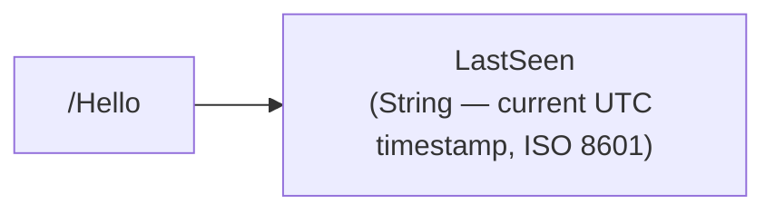
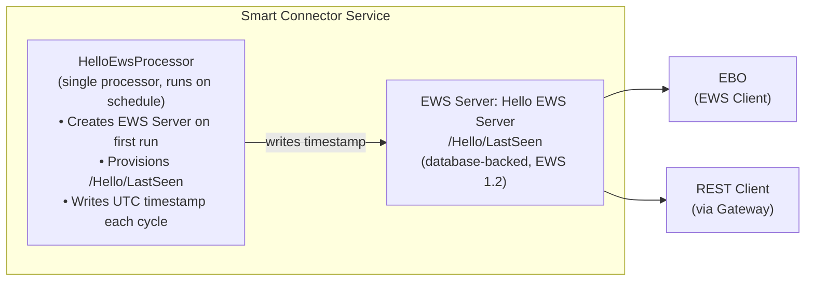

# Quick Start Sample: HelloEwsProcessor

A minimal, runnable Smart Connector extension that **creates its own EWS Server** on the first run and writes the current UTC timestamp to a value on it every execution. No manual EWS Server setup is required.

This is the same code built in the [Developer Guide — Quick Start](../../docs/developer-guide/smartconnector-developers-guide.md#3-quick-start), packaged as a buildable project. It is the smallest complete example of the self-provisioning processor pattern that the Weather, Grid Status, and ENTSO-E extensions apply at scale.

## What This Extension Does

| Data Category | Values Published | Use Case |
| --- | --- | --- |
| **Heartbeat** | `LastSeen` (UTC timestamp, updated every execution) | Validate the SDK round-trip end to end: NuGet → Processor → EWS Server → Portal |

## Prerequisites

| Item | Version | Notes |
| --- | --- | --- |
| Windows | 10 / 11 / Server 2019+ | 64-bit |
| Visual Studio | 2019 or later | Community edition is sufficient |
| .NET Framework | 4.8 SDK | Required by all Smart Connector extensions |
| Smart Connector | 2.6 or later | Installed locally; the service must be running |
| GitHub PAT | `read:packages` scope | For the Smart Connector NuGet feed |

## Build

1. Configure the Smart Connector NuGet feed ([instructions](../../docs/developer-guide/smartconnector-developers-guide.md#32-configure-the-nuget-feed-90-seconds)):

   ```powershell
   dotnet nuget add source `
       https://nuget.pkg.github.com/SchneiderElectricBuildings/index.json `
       --name SmartConnector `
       --username YOUR_GITHUB_USERNAME `
       --password YOUR_GITHUB_PAT
   ```

2. Build the extension:

   ```powershell
   dotnet restore
   dotnet build --configuration Release
   ```

## Deploy

1. **Stop** the Smart Connector service (if updating an existing deployment):

   ```powershell
   Stop-Service SmartConnectorService
   ```

2. Copy `bin\Release\net48\Quickstart.HelloEws.dll` to the SmartConnector installation folder, next to `Mongoose.Service.exe` (by default `C:\Program Files (x86)\Schneider Electric\SmartConnector`). The Portal lists the extensions it finds in that folder.
3. **Start** the Smart Connector service:

   ```powershell
   Start-Service SmartConnectorService
   ```

## Portal Configuration

### Step 1 — Configure the Processor

1. Open the Smart Connector Portal (`http://localhost:8082`).
2. Authenticate with your portal credentials.
3. Navigate to **Configurations → Processor → Add New**.
4. Select **Quickstart.HelloEws**.
5. Select **HelloEwsProcessor**.
6. Click **Finish**.
7. Click the **Details** tab and configure:

   | Property | Value | Description |
   | --- | --- | --- |
   | **ServerName** | `Hello EWS Server` | Name of the EWS Server (created on first run) |
   | **Realm** | `SmartConnectorRealm` | HTTP Digest authentication realm |
   | **EwsAddress** | `http://localhost:5300/HelloEws` | EWS endpoint address |
   | **UserName** | *(choose a username)* | EWS server authentication |
   | **Password** | *(choose a strong password)* | Stored encrypted |

8. Click **Save** → **Validate**.

### Step 2 — Create a Schedule

1. Navigate to **Setup → Configuration Schedules**.
2. Click **Add New**.
3. Enter a **Description** (e.g., `Runs every minute`).
4. Set the **Start Date** to the current date/time.
5. In the **Type** section, select **Cron**.
6. Enter the cron expression: `* * * * *`.
7. Click **Save**.

### Step 3 — Assign the Schedule and Start

1. Navigate back to **Configurations → Processor** and select the Hello EWS Processor.
2. Click the **Control** sub-tab.
3. Set **Runs On Schedule** to `True`. *(Required — without this the processor will not run on the schedule.)*
4. Select the schedule created in Step 2.
5. Click **Save** → **Start**.

On the first run, the processor creates the EWS Server (if it does not already exist) and provisions the `/Hello/LastSeen` value.

### Step 4 — Verify

1. Wait for the first scheduled execution (or click **Start** to run immediately).
2. Navigate to **EWS Servers** → click the edit icon for `Hello EWS Server`.
3. Browse the value tree. You should see `/Hello/LastSeen` holding the current UTC timestamp, refreshed on every execution.

## EWS Data Structure

The processor provisions a single folder with one value under it.



Table – /Hello

| Point | Type | Description |
| --- | --- | --- |
| LastSeen | String | UTC timestamp written on every execution (ISO 8601 round-trip format) |

## Consuming from EcoStruxure™ Building Operation

1. In WorkStation, add a new EWS Data Source pointing at the `EwsAddress` value (e.g. `http://<host>:5300/HelloEws`) with the configured credentials.
2. Browse the value tree and map `/Hello/LastSeen` to confirm the integration is live and updating.

## Running Tests

The companion [`QuickStart.HelloEws.Tests`](../QuickStart.HelloEws.Tests) project uses NUnit and the `Mongoose.Test` helpers, following the same split as the full example extensions.

### Unit Tests (no Smart Connector required)

The validation tests instantiate the processor and check its data-annotation attributes — they run without the Smart Connector runtime:

```powershell
dotnet test --filter "TestCategory!=Integration"
```

### Integration Tests (Smart Connector required)

`ExecuteTest` and `CancelTest` are marked `[Explicit]` and require a running Smart Connector instance (StructureMap container, database, EWS infrastructure):

```powershell
dotnet test --filter "FullyQualifiedName~ExecuteTest"
```

## Architecture



## Security

Credentials are stored encrypted (`[EncryptedString]`), the sample makes no outbound network calls, and only a server-generated timestamp is persisted. See [SECURITY.md](SECURITY.md) for the full posture, including a STRIDE threat model and data-flow diagram.

## What This Demonstrates

- `Processor` base class and `Execute_Subclass` lifecycle
- Self-provisioning: `ConnectExisting` first, falling back to `ConnectNew` only when the server does not yet exist (so a scheduled restart is harmless)
- Idempotent provisioning with the `EnsureFolder` / `EnsureValue` pattern (no manual Portal setup)
- `[EncryptedString]` for secure credential storage
- `[Required]`, `[DefaultValue]`, and `[Tooltip]` configuration attributes
- `Dispose` pattern for the `EwsServerDataAdapter`
- `Logger` usage for operational logging

## Project Structure

Table – Extension source (`QuickStart.HelloEws/`)

| File | Responsibility |
| --- | --- |
| `HelloEwsProcessor.cs` | The complete processor — self-provisioning, idempotent `Ensure*` helpers, timestamp write, and `Dispose` |
| `nuget.config.template` | NuGet feed template (no credentials committed) |
| `QuickStart.HelloEws.csproj` | SDK-style project targeting `net48` |
| `README.md` / `SECURITY.md` | Usage documentation and security posture |

Table – Test project (`QuickStart.HelloEws.Tests/`)

| File | Coverage |
| --- | --- |
| `ProcessorFixture.cs` | Validation tests (clean configuration plus missing-required cases) and the `[Explicit]` integration tests |

## References

- [Developer Guide — Quick Start](../../docs/developer-guide/smartconnector-developers-guide.md#3-quick-start)
- [Developer Guide — Develop an Extension](../../docs/developer-guide/smartconnector-developers-guide.md#7-develop-an-extension)
