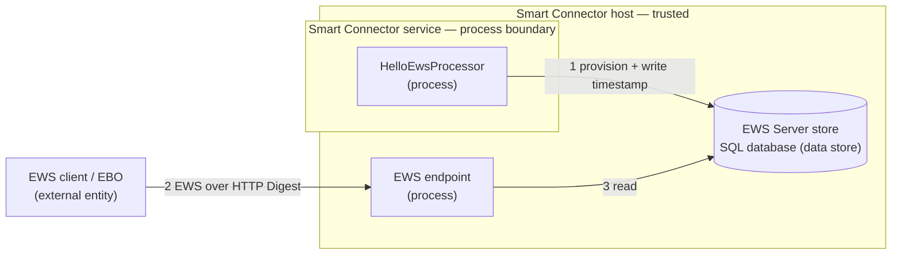

# Security

This document describes the security posture of the HelloEws quick-start sample. It is intentionally minimal: the processor creates its own EWS Server and writes a UTC timestamp to a single value. It holds **no third-party API credentials and makes no outbound network calls**, so the posture is narrower than the full example extensions.

## Credential Management

| Credential | Storage | Attribute | Notes |
| --- | --- | --- | --- |
| EWS Password | SmartConnector database | `[EncryptedString]` | Encrypted at rest; never logged or exported in plain text |
| EWS UserName | SmartConnector database | `[Required]` | Used for EWS Server authentication |

- No hardcoded credentials exist anywhere in the source code.
- No default passwords are used. Credentials must be configured by the operator during Portal setup.
- The `[EncryptedString]` attribute stores the value encrypted in the database. Portal users can display it, so grant Portal access only to people trusted with the credentials it holds.

## Network Security

| Connection | Protocol | Authentication |
| --- | --- | --- |
| EWS Server | HTTP, or HTTPS with a certificate binding | HTTP Digest (realm + username + password) |

- The sample makes **no outbound calls** to any third-party service.
- The EWS Server is created at the configured `EwsAddress`. Its listener accepts connections on every network interface of the host, whatever host name `EwsAddress` uses, so allow the port in the Windows Firewall only for the EBO servers and other EWS clients that need it. It uses HTTP Digest authentication with a configurable realm.

## Input Validation

| Property | Constraint | Attribute |
| --- | --- | --- |
| ServerName | Non-empty | `[Required]`, `[DefaultValue]` |
| EwsAddress | Non-empty | `[Required]`, `[DefaultValue]` |
| UserName | Non-empty | `[Required]` |
| Password | Non-empty, encrypted | `[Required]`, `[EncryptedString]` |

The only data persisted is a server-generated UTC timestamp — no external or user-supplied payload is written to the EWS Server.

## Logging Practices

- No `Logger.Log*` call includes `Password` or any credential value.
- The single informational log line records the target AlternateId (`/Hello/LastSeen`), not any credential.

## Resource Management

- `EwsServerDataAdapter` implements `IDisposable` and is cleaned up in the processor's `Dispose(bool)` override.
- The `ConnectNew → Dispose → ConnectExisting` pattern ensures a clean database context on every run; a duplicate-key `DbUpdateException` is caught when the server already exists.

## Threat Model

This threat model follows the STRIDE methodology used by the Microsoft Threat Modeling Tool. Because the sample has no external API, there is **no Internet trust boundary** — the only boundaries are the network boundary to the EWS client and the process boundary to the data store.

### Data Flow Diagram

### Trust Boundaries

- **Network boundary** — between the EWS client/EBO and the EWS endpoint (flow 2). Authenticated with HTTP Digest over the configured realm.
- **Process / machine boundary** — between the processor and the EWS data store (flows 1, 3), mediated by the Smart Connector runtime on the same host.
- There is **no Internet boundary**: the sample makes no outbound calls.

### STRIDE Analysis

| Category | Threat (element / flow) | Mitigation | Status |
| --- | --- | --- | --- |
| **Spoofing** | An unauthorised EWS client reads or writes data (2) | The EWS endpoint requires HTTP Digest authentication | Mitigated |
| **Tampering** | EWS values modified by an unauthorised client (2) | EWS writes require authentication; the value is server-generated, not externally supplied | Mitigated |
| **Repudiation** | An action cannot be traced to a cause | The Smart Connector application log records failed Portal sign-ins when the `Portal` log category is included, and syslog forwarding retains it; the processor logs each write | Partly mitigated |
| **Information Disclosure** | The EWS password leaks via logs or configuration export | `[EncryptedString]` at rest; no credential in any `Logger` call | Mitigated |
| **Denial of Service** | A very frequent schedule writes the value repeatedly | One value write per cycle, no external calls, no unbounded history growth (the sample provisions no trend logs) | Mitigated |
| **Elevation of Privilege** | The extension runs with the Smart Connector service account | No external input and no dynamic code loading; run the service under a least-privilege account | Mitigated (deployment) |

## Compliance

This sample follows the security practices documented in the [Smart Connector Developer Guide — Security Advisory for Production Deployments](../../docs/developer-guide/smartconnector-developers-guide.md#5-security-advisory-for-production-deployments).
