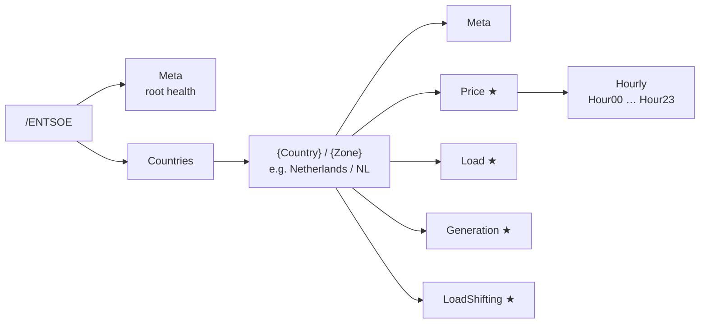
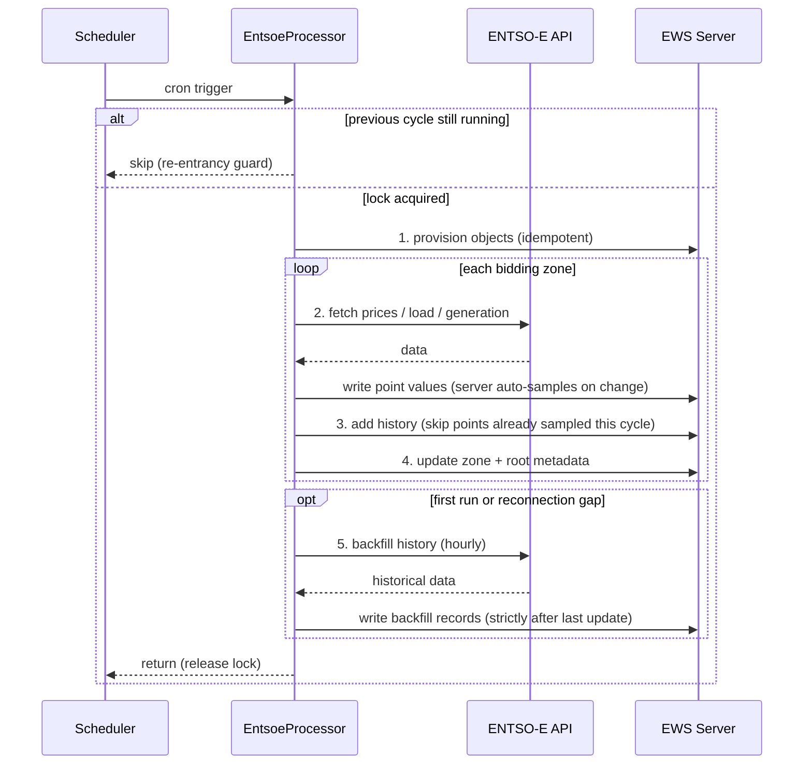
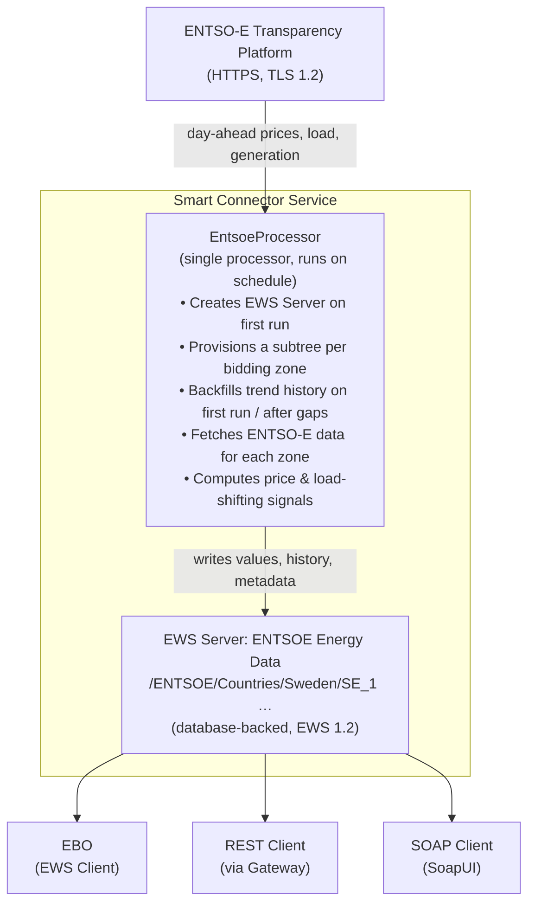

# ENTSO-E Transparency Platform Integration for Smart Connector

A Smart Connector extension that integrates with the [ENTSO-E Transparency Platform](https://transparency.entsoe.eu/) to provide real-time European electricity market data to EWS clients, including EcoStruxure™ Building Operation (EBO).

## What This Extension Does

The extension fetches the following data from the ENTSO-E API and publishes it to a Smart Connector EWS Server:

| Data Category | Values Published | Use Case |
| --- | --- | --- |
| **Day-Ahead Prices** | Current price, min/max/average, 24 hourly prices, currency | Cost monitoring, energy reporting |
| **Price Classification** | Cheap/Normal/Expensive category, thresholds | Load shifting, demand response |
| **Load Shifting Signals** | IsCurrentlyCheap, IsCurrentlyExpensive, hours until next cheap/expensive window, cheap/expensive hours list | HVAC preconditioning, battery charging, EV scheduling |
| **Actual Load** | Current grid load (MW) | Peak demand avoidance, grid stability |
| **Load Peak** | Forecast peak today (MW), peak hour, peak risk level (0–2) | Predictive peak shaving |
| **Generation Forecast** | Total, wind, and solar generation forecast (MW) | Renewable energy following |
| **Trend Logs** | 11 trend logs with auto-sampling plus historical backfill | Historical analysis, EBO trend viewer, energy reporting |

## Use Cases

1. **Load Shifting** — Schedule flexible loads (HVAC preheating, water heating, EV charging) during cheap electricity hours.
2. **Peak Shaving** — Reduce grid demand during expensive hours to lower energy costs.
3. **Renewable Following** — Align consumption with periods of high wind/solar generation.
4. **Cost Optimization** — Use price signals to automate HVAC preconditioning during cheap hours.
5. **Demand Response** — React to real-time price signals in the BMS control strategy.
6. **Energy Reporting** — Provide live electricity market data on BMS dashboards.

## Prerequisites

| Item | Version | Notes |
| --- | --- | --- |
| Windows | 10 / 11 / Server 2019+ | 64-bit |
| Visual Studio | 2019 or later | Community edition is sufficient |
| .NET Framework | 4.8 SDK | Required by all Smart Connector extensions |
| Smart Connector | 2.6 or later | Installed locally; the service must be running |
| GitHub PAT | `read:packages` scope | For the Smart Connector NuGet feed |
| ENTSO-E API Token | — | See [Obtain an ENTSO-E API Token](#obtain-an-entso-e-api-token) below |

### Obtain an ENTSO-E API Token

Obtaining a security token is a multi-step process that involves registration, email approval, and token generation. Allow up to **3 working days** for the approval step.

1. Navigate to <https://transparency.entsoe.eu> and click **Sign In**.
2. Click the **Register** link and complete the registration form.
3. Verify your account via the URL sent to your registered email address.
4. Send an email to [transparency@entsoe.eu](mailto:transparency@entsoe.eu) with:
   - **Subject:** `RESTful API access`
   - **Body:** Your registered email address
5. Wait for a confirmation email granting API access (up to 3 working days).
6. Log in to <https://transparency.entsoe.eu> and click **My Account Settings**.
7. Scroll to the **Web API Security Token** section and click **Generate a (new) token**.
8. Copy the token. You will enter it as the `ApiToken` property when configuring the processor.

> **Tip:** A test environment is available at <https://iop-transparency.entsoe.eu> (contains less data than production). The same registration process applies.
>
> For the full walkthrough with screenshots, see [How to get security token?](https://transparencyplatform.zendesk.com/hc/en-us/articles/12845911031188-How-to-get-security-token) on the Transparency Platform Help Center.

> **Security:** The API token is stored encrypted in the Smart Connector database via the `[EncryptedString]` attribute. The extension never writes it to a log. Portal users can display it, so grant Portal access only to people trusted with it.

## Build

1. Configure the Smart Connector NuGet feed ([instructions](../../docs/developer-guide/smartconnector-developers-guide.md#32-configure-the-nuget-feed-90-seconds)):

   ```powershell
   dotnet nuget add source `
       https://nuget.pkg.github.com/SchneiderElectricBuildings/index.json `
       --name SmartConnector `
       --username YOUR_GITHUB_USERNAME `
       --password YOUR_GITHUB_PAT
   ```

2. Build the extension:

   ```powershell
   dotnet restore
   dotnet build --configuration Release
   ```

## Deploy

1. **Stop** the Smart Connector service (if updating an existing deployment):

   ```powershell
   Stop-Service SmartConnectorService
   ```

2. Copy `bin\Release\net48\SmartConnector.EntsoeExtension.dll` to the SmartConnector installation folder, next to `Mongoose.Service.exe` (by default `C:\Program Files (x86)\Schneider Electric\SmartConnector`). The Portal lists the extensions it finds in that folder.
3. **Start** the Smart Connector service:

   ```powershell
   Start-Service SmartConnectorService
   ```

## Portal Configuration

### Step 1 — Configure the Processor

1. Open the Smart Connector Portal (`http://localhost:8082`).
2. Authenticate with your portal credentials.
3. Navigate to **Configurations → Processor → Add New**.
4. Select **SmartConnector.EntsoeExtension**.
5. Select **EntsoeProcessor**.
6. Click **Finish**.
7. Click the **Details** tab and configure:

   | Property | Value | Description |
   | --- | --- | --- |
   | **ServerName** | `ENTSOE Energy Data` | Name of the EWS Server (created automatically) |
   | **Realm** | `SmartConnectorRealm` | HTTP authentication realm |
   | **EwsAddress** | `http://localhost:5300/EntsoeEnergyData` | EWS endpoint address |
   | **UserName** | *(choose a username)* | EWS server authentication |
   | **Password** | *(choose a strong password)* | Stored encrypted |
   | **Country** | `Netherlands` | Select from the drop-down. Multi-zone countries (e.g. Sweden, Norway) include all zones automatically. See [Supported Countries](#supported-countries) |
   | **ApiToken** | *(your ENTSO-E token)* | Stored encrypted |
   | **CheapPercentile** | `25` | Bottom 25% of prices = Cheap |
   | **ExpensivePercentile** | `75` | Top 25% of prices = Expensive |
   | **BackfillDays** | `30` | Days of history to backfill into trend logs on first run. `0` disables backfill |
   | **UpdatePrices** | `True` | Enable day-ahead price updates |
   | **UpdateLoad** | `True` | Enable load data updates |
   | **UpdateGeneration** | `True` | Enable generation forecast updates |

8. Click **Save** → **Validate**.

### Step 2 — Create a Schedule

1. Navigate to **Setup → Configuration Schedules**.
2. Click **Add New**.
3. Enter a **Description** (e.g., `Runs every 15 minutes`).
4. Set the **Start Date** to the current date/time or a future date.
5. In the **Type** section, select **Cron**.
6. Enter the cron expression: `*/15 * * * *`.
7. Click **Save**.

### Step 3 — Assign the Schedule and Start

To ensure the extension actually runs on the schedule, you must enable **Runs On Schedule** on the processor's **Control** sub-tab — creating the schedule in Step 2 alone is not enough.

1. Navigate back to **Configurations → Processor** and select the ENTSO-E Processor.
2. Click the **Control** sub-tab.
3. Set **Runs On Schedule** to `True`. *(Required — without this the processor will not run on the schedule.)*
4. Select the schedule created in Step 2.
5. Click **Save** → **Start**.

On the first run, the processor creates the EWS Server (if it does not already exist), provisions the data hierarchy for the selected country, backfills trend history (see [Trend Logs](#trend-logs)), and starts fetching data. Subsequent runs only fetch and update values.

> **Multi-zone countries:** Selecting a country with several bidding zones (Sweden, Norway, Denmark) automatically provisions all of its zones. Each zone gets its own subtree under `/ENTSOE/Countries/{Country}/{Zone}/` — for example `/ENTSOE/Countries/Sweden/SE_1/` through `/ENTSOE/Countries/Sweden/SE_4/`.

### Step 4 — Verify

1. Wait for the first scheduled execution (or click **Start** to run immediately).
2. Navigate to **EWS Servers** → click the edit icon for `ENTSOE Energy Data`.
3. Browse the value tree. For Netherlands (single zone `NL`) you should see:
   - `/ENTSOE/Meta/DataHealthy` = `True` (root-level health)
   - `/ENTSOE/Countries/Netherlands/NL/Meta/DataHealthy` = `True`
   - `/ENTSOE/Countries/Netherlands/NL/Price/CurrentPrice` = a numeric value
   - `/ENTSOE/Countries/Netherlands/NL/LoadShifting/IsCurrentlyCheap` = `True` or `False`

## EWS Data Structure

The tree is organised as `/ENTSOE/Countries/{Country}/{Zone}/`, with a root-level `/ENTSOE/Meta` container for overall integration health. Multi-zone countries repeat the zone subtree for each bidding zone (e.g. `Sweden/SE_1` … `Sweden/SE_4`).



Containers marked ★ hold trend logs. The points in each container are listed below.

Table – Root observability (/ENTSOE/Meta)

| Point | Type | Description |
| --- | --- | --- |
| LastUpdate | DateTime | Last successful cycle |
| NextUpdate | DateTime | Derived next run time |
| DataHealthy | Bool | True if the last cycle succeeded |
| LastError | String | Most recent error message |
| CycleCount | Long | Completed cycles since service start |
| RowsConsumed | Long | Total data points fetched |
| TimeZone | String | Service local timezone |

Table – Zone points (/ENTSOE/Countries/{Country}/{Zone}); ★ marks trend logs

| Point | Type | Description |
| --- | --- | --- |
| Meta/LastUpdate | DateTime | Last successful update |
| Meta/Country | String | Zone description |
| Meta/BiddingZone | String | EIC domain code |
| Meta/DataHealthy | Bool | True if the last cycle succeeded |
| Meta/TimeZone | String | Zone timezone ID |
| Price/CurrentPrice | Analog (EUR/MWh) | Current hour price |
| Price/CurrentPriceHistory ★ | Trend | Auto-sampled + backfilled |
| Price/NextHour | Analog (EUR/MWh) | Next hour price |
| Price/Level | Int (0-2) | 0=cheap, 1=normal, 2=expensive |
| Price/PriceCategory | String | "Cheap", "Normal", or "Expensive" |
| Price/RankToday | Int (1..N) | Rank among today's hours |
| Price/PercentileToday | Analog (0-100) | Percentile of the current hour |
| Price/NegativeActive | Bool | True if the current price < 0 |
| Price/Currency | String | EUR, GBP, etc. |
| Price/Unit | String | MWh |
| Price/DayMinimum | Analog (EUR/MWh) | Lowest price today |
| Price/DayMinimumHistory ★ | Trend | Auto-sampled |
| Price/DayMaximum | Analog (EUR/MWh) | Highest price today |
| Price/DayMaximumHistory ★ | Trend | Auto-sampled |
| Price/DayAverage | Analog (EUR/MWh) | Average price today |
| Price/DayAverageHistory ★ | Trend | Auto-sampled |
| Price/CheapThreshold | Analog (EUR/MWh) | Computed cheap boundary |
| Price/ExpensiveThreshold | Analog (EUR/MWh) | Computed expensive boundary |
| Price/Hourly/Hour00 … Hour23 | Analog (EUR/MWh) | Price for each hour of the day |
| Load/Current | Analog (MW) | Current grid load |
| Load/CurrentHistory ★ | Trend | Auto-sampled + backfilled |
| Load/ForecastPeakToday | Analog (MW) | Peak of today's load forecast |
| Load/ForecastPeakHour | DateTime | Hour the forecast peak occurs |
| Load/PeakRiskLevel | Int (0-2) | Current load vs. forecast peak |
| Generation/ForecastTotal | Analog (MW) | Total generation forecast |
| Generation/ForecastTotalHistory ★ | Trend | Auto-sampled + backfilled |
| Generation/Wind | Analog (MW) | Wind generation forecast |
| Generation/WindHistory ★ | Trend | Auto-sampled |
| Generation/Solar | Analog (MW) | Solar generation forecast |
| Generation/SolarHistory ★ | Trend | Auto-sampled |
| LoadShifting/IsCurrentlyCheap | Bool | True if the current hour is cheap |
| LoadShifting/IsCurrentlyCheapHistory ★ | Trend | Auto-sampled |
| LoadShifting/IsCurrentlyExpensive | Bool | True if the current hour is expensive |
| LoadShifting/IsCurrentlyExpensiveHistory ★ | Trend | Auto-sampled |
| LoadShifting/HoursUntilCheap | Int | Hours until next cheap window, -1 if none today |
| LoadShifting/HoursUntilExpensive | Int | Hours until next expensive window, -1 if none today |
| LoadShifting/CheapHoursToday | String | Comma-separated cheap hours (e.g. "00,01,02") |
| LoadShifting/ExpensiveHoursToday | String | Comma-separated expensive hours (e.g. "17,18,19") |
| LoadShifting/RenewablePercent | Analog (%) | Renewable share of generation |
| LoadShifting/RenewablePercentHistory ★ | Trend | Auto-sampled |

Items marked ★ are **Trend Logs**: the Smart Connector service captures a historical sample (TrendSample) and the processor adds the current value each cycle plus seeds history on first run (see [Trend Logs](#trend-logs)). Trend names include the country and zone (e.g. `Current Price History Sweden SE_1`) so they remain unique when one server hosts multiple zones. They can be queried via the REST API (`GET /TrendSamples?trendId=...`) or consumed directly from EBO as Trend Log objects.

## OpenADR 3.0 Signal Mapping

The Standard Energy Market Interface aligns EWS points with [OpenADR 3.0](https://www.openadr.org/) signal semantics. This mapping enables EBO programs and graphics to use consistent signal types across the ENTSO-E (Europe) and GridStatus (North America) extensions.

| EWS Point | OpenADR Signal Type | OpenADR Event Type | QUDT Unit URI | Notes |
| --- | --- | --- | --- | --- |
| Price/CurrentPrice | `ELECTRICITY_PRICE` | `PRICE` | `qudt:CCY_EUR-PER-KiloW-HR` | Day-ahead price, current hour (EUR/MWh scaled) |
| Price/NextHour | `ELECTRICITY_PRICE` | `PRICE` | `qudt:CCY_EUR-PER-KiloW-HR` | Day-ahead price, next hour |
| Price/Level | `SIMPLE` | `SIMPLE` | — | 0=cheap, 1=normal, 2=expensive (OpenADR SimpleLevel) |
| Price/PriceCategory | — | — | — | Human-readable label for Level |
| Price/RankToday | — | — | — | Rank of current price among today's hours (1=cheapest) |
| Price/PercentileToday | — | — | `qudt:PERCENT` | Percentile position of current price (0-100) |
| Price/NegativeActive | — | — | — | True when current price < 0 |
| Price/CheapThreshold | `ELECTRICITY_PRICE` | `PRICE` | `qudt:CCY_EUR-PER-KiloW-HR` | Computed percentile boundary |
| Price/ExpensiveThreshold | `ELECTRICITY_PRICE` | `PRICE` | `qudt:CCY_EUR-PER-KiloW-HR` | Computed percentile boundary |
| Price/Hourly/Hour00..23 | `ELECTRICITY_PRICE` | `PRICE` | `qudt:CCY_EUR-PER-KiloW-HR` | Full 24-hour price curve |
| LoadShifting/IsCurrentlyCheap | `LOAD_DISPATCH` | `DISPATCH_SETPOINT` | — | Boolean DR trigger |
| LoadShifting/RenewablePercent | — | — | `qudt:PERCENT` | Renewable generation share |
| Load/Current | `LOAD_DISPATCH` | `DISPATCH_SETPOINT` | `qudt:MegaW` | Actual grid load |
| Load/ForecastPeakToday | `LOAD_DISPATCH` | `DISPATCH_SETPOINT` | `qudt:MegaW` | Peak of today's load forecast |
| Load/PeakRiskLevel | `SIMPLE` | `SIMPLE` | — | 0=low, 1=medium, 2=high (current load vs. peak) |
| Generation/ForecastTotal | — | — | `qudt:MegaW` | Total generation forecast |
| Generation/Wind | — | — | `qudt:MegaW` | Wind generation forecast |
| Generation/Solar | — | — | `qudt:MegaW` | Solar generation forecast |

**QUDT unit notes:**

- `qudt:CCY_EUR-PER-KiloW-HR` is the closest standard QUDT unit for EUR/MWh (scaled by 1000). QUDT defines EUR as `qudt:CCY_EUR` and energy units separately.
- `gCO₂/kWh` has no standard QUDT URI. If carbon intensity is added in a future version, it will be reported as a raw numeric value.
- Full QUDT unit catalogue: <https://qudt.org/doc/DOC_VOCAB-UNITS.html>

**Brick Schema note:** Brick Schema defines building-side equipment and point classes (`brick:Electrical_Meter`, `brick:Power_Sensor`) but does not model grid-market signals. The OpenADR mapping applies at the SmartConnector extension level; Brick applies at the EBO consumption side when mapping EWS points to equipment models.

## Trend Logs

The extension provisions 11 trend logs per zone that capture historical data for timeline analysis and BMS dashboards:

| Trend Log | Linked Value | Data Type | Use Case |
| --- | --- | --- | --- |
| Price/CurrentPriceHistory | Price/CurrentPrice | Analog | Electricity price timeline |
| Price/DayMinimumHistory | Price/DayMinimum | Analog | Daily price floor tracking |
| Price/DayMaximumHistory | Price/DayMaximum | Analog | Daily price peak tracking |
| Price/DayAverageHistory | Price/DayAverage | Analog | Average price over time |
| Load/CurrentHistory | Load/Current | Analog | Grid load pattern analysis |
| Generation/ForecastTotalHistory | Generation/ForecastTotal | Analog | Generation forecast timeline |
| Generation/WindHistory | Generation/Wind | Analog | Wind generation tracking |
| Generation/SolarHistory | Generation/Solar | Analog | Solar generation tracking |
| LoadShifting/IsCurrentlyCheapHistory | LoadShifting/IsCurrentlyCheap | Bool | Cheap period occurrence analysis |
| LoadShifting/IsCurrentlyExpensiveHistory | LoadShifting/IsCurrentlyExpensive | Bool | Expensive period occurrence analysis |
| LoadShifting/RenewablePercentHistory | LoadShifting/RenewablePercent | Analog | Renewable share trend |

### How Trend Logs Are Populated

Trend logs are filled two ways:

1. **Per-cycle sample.** Every cycle, after updating the point values, the processor writes the current value of each trended point as a history record at the cycle timestamp (Phase 3 below), so the trends grow on every run rather than only when a value happens to change. The EWS Server already auto-samples a trend whenever the linked value *changes*, so the processor skips its manual write for any point the server has already sampled this cycle — this avoids a duplicate record with the same value and timestamp.
2. **Historical backfill.** On first run, the processor backfills the **CurrentPrice**, **Current Load**, and **ForecastTotal** trends with up to `BackfillDays` days (default 30) of hourly history fetched from ENTSO-E, written at their original timestamps via `AddHistoryRecordsManually`. After a reconnection gap of more than about an hour, only the missed window is backfilled. The window is derived from the persisted `Meta/LastUpdate` timestamp, so a service restart does not re-backfill data that already exists. Set `BackfillDays` to `0` to disable backfill.

> **Note:** All 11 trends receive a per-cycle sample. Backfill seeds only the three continuous series (CurrentPrice, Current Load, ForecastTotal); the boolean, derived, and wind/solar trends start accumulating from first run.

### Cycle Data Strategy

Each cycle runs in five explicit phases so the long-running backfill always happens last, after live data and metadata are already committed:

1. **Provision** — create all folders, points, and history items (idempotent).
2. **Update point values** — fetch ENTSO-E data and write every point.
3. **Add history samples** — append the current value of each point to its trend.
4. **Update metadata** — stamp `Meta/LastUpdate`, `DataHealthy`, `CycleCount`, and the other observability points.
5. **Backfill** — seed/repair historical trend data (may take minutes).

Because backfill can exceed a short schedule interval, a re-entrancy guard prevents overlap: if the schedule re-triggers while a previous cycle is still running (typically inside a backfill), the new trigger logs a message and returns immediately. A stale lock is released automatically after 30 minutes so a crashed run cannot block the processor permanently.



### Accessing Trend Data in EBO

In EcoStruxure Building Operation WorkStation:

1. Navigate to the EWS Data Source configured for the Smart Connector.
2. Browse to the container of the value you want to trend (e.g., `/ENTSOE/Countries/Netherlands/NL/Price`).
3. The trend log object (e.g., `CurrentPriceHistory`) appears as a sibling of the value.
4. Right-click the trend log and select **View Trend** to open the graphical trend viewer.
5. Use trend logs in **Reports** or **Schedules** for energy cost analysis.

### Accessing Trend Data via REST API

Retrieve trend samples using the Smart Connector REST API:

```bash
# Get the last 50 price samples (most recent first)
curl -X GET "http://YOUR_HOST:YOUR_PORT/TrendSamples?trendId=TREND_ID&take=50&orderBy=1" \
  -H "Authorization: Bearer YOUR_ACCESS_TOKEN" \
  -H "Accept: application/json"

# Get samples for a specific date range
curl -X GET "http://YOUR_HOST:YOUR_PORT/TrendSamples?trendId=TREND_ID&sampleOnOrAfter=2026-06-01T00:00:00Z&sampledBefore=2026-06-02T00:00:00Z" \
  -H "Authorization: Bearer YOUR_ACCESS_TOKEN" \
  -H "Accept: application/json"
```

> **Note:** The `trendId` must include the `03` DataType prefix (e.g., `03/ENTSOE/Countries/Netherlands/NL/Price/CurrentPriceHistory`). Double URL encode the ID for REST API calls. See the [RESTful EWS Gateway Guide](../../docs/developer-guide/smartconnector-restful-ews-gateway.md#10-api-reference--trends-and-trend-samples) for the full Trend and TrendSample API reference.

## Consuming from EcoStruxure™ Building Operation

Once the EWS Server is running with data, configure an EWS client connection in EBO:

1. In WorkStation, add a new EWS Data Source.
2. Set the EWS Server address to the value configured in `EwsAddress` (e.g., `http://<smart-connector-host>:5300/EntsoeEnergyData`).
3. Enter the EWS server credentials.
4. Browse the value tree to find the ENTSO-E data points.
5. Map values to your control strategy:
   - Use `IsCurrentlyCheap` as a condition for enabling flexible loads.
   - Use `CheapHoursToday` to plan preconditioning schedules.
   - Use `CurrentPrice` for energy cost dashboards.
   - Use trend logs (e.g., `CurrentPriceHistory`) for historical analysis and reporting.

## Observability

A root-level `/ENTSOE/Meta` container reports overall integration health, and each zone subtree includes its own `Meta/` container:

| Point | Scope | Use |
| --- | --- | --- |
| **DataHealthy** | Root + per-zone | Boolean (`True`/`False`) — use for EBO alarms |
| **LastUpdate** | Root + per-zone | Timestamp of the most recent successful fetch |
| **NextUpdate** | Root | Derived next expected run time |
| **LastError** | Root | Most recent error message |
| **CycleCount** | Root | Completed cycles since the service started |
| **RowsConsumed** | Root | Total data points fetched |
| **TimeZone** | Root + per-zone | Timezone identifier |

## Error Handling

| Condition | Behaviour |
| --- | --- |
| Network failure | Keeps last good values, sets `DataHealthy` to `False`, logs the error |
| HTTP 401 (invalid token) | Reports as configuration error. Does not retry |
| HTTP 429 (rate limit) | Logs a warning and waits for next cycle |
| Partial failure | Each data type (prices, load, generation) fails independently per zone |
| XML parse error | Logged; affected values remain unchanged |
| Initial setup | Backfills up to `BackfillDays` (default 30) of trend history per zone |
| Gap on reconnection | Backfills only the missed window, capped at `BackfillDays` |

## Supported Countries

Select a country from the **Country** drop-down. Countries with multiple bidding zones expand automatically into per-zone subtrees (shown below as code ranges).

| Code | Country / Zone | Code | Country / Zone |
| --- | --- | --- | --- |
| `AT` | Austria | `LT` | Lithuania |
| `BE` | Belgium | `LV` | Latvia |
| `BG` | Bulgaria | `NL` | Netherlands |
| `CH` | Switzerland | `NO_1`–`NO_5` | Norway (5 zones) |
| `CZ` | Czech Republic | `PL` | Poland |
| `DE_LU` | Germany-Luxembourg | `PT` | Portugal |
| `DK_1` | Denmark West | `RO` | Romania |
| `DK_2` | Denmark East | `RS` | Serbia |
| `EE` | Estonia | `SE_1`–`SE_4` | Sweden (4 zones) |
| `ES` | Spain | `SI` | Slovenia |
| `FI` | Finland | `SK` | Slovakia |
| `FR` | France | `GB` | Great Britain |
| `GR` | Greece | `IE_SEM` | Ireland (SEM) |
| `HR` | Croatia | `IT_NORD` | Italy North |
| `HU` | Hungary | | |

## Running Tests

The test project includes two categories of tests:

### Unit Tests (no Smart Connector required)

These test the pure logic components (area mapping, price analysis, XML parsing):

```powershell
dotnet test --filter "TestCategory!=Integration"
```

### Integration Tests (Smart Connector required)

These test the processor lifecycle and require a running Smart Connector instance:

1. Install Smart Connector on your development machine.
2. Copy `Mongoose.Service.exe.config` connection strings and encryption key to the test project's `app.config`.
3. Update the `CreateTestableProcessor()` method with valid EWS and ENTSO-E credentials.
4. Run:
   ```powershell
   dotnet test
   ```

## Architecture



## Security

This extension follows all security practices from the [Developer Guide — Security Advisory for Production Deployments](../../docs/developer-guide/smartconnector-developers-guide.md#5-security-advisory-for-production-deployments). For a detailed breakdown of credential handling, network security, input validation, logging practices, and threat model, see [SECURITY.md](SECURITY.md).

Summary:

- API token and EWS password are marked with `[EncryptedString]` — stored encrypted, never logged.
- All public properties have `[Required]`, `[Range]`, or `[StringLength]` validation.
- No credentials appear in any `Logger.Log*` call.
- `EwsServerDataAdapter` is wrapped in a `Dispose` pattern with `ConnectNew → Dispose → ConnectExisting` lifecycle.
- TLS 1.2 is enforced for ENTSO-E API communication.
- Input from the ENTSO-E API is validated and bounded before writing to the EWS Server.

## What This Demonstrates

- Standard Energy Market Interface aligned with GridStatus extension (same paths, types, semantics)
- OpenADR 3.0 signal semantics: Price → `EventType.Price`, Level → `EventType.Simple`
- Single `Processor` combining setup and scheduled updates (eliminates configuration mismatch)
- Country drop-down (enum) that auto-expands multi-zone countries into per-zone EWS subtrees (`/ENTSOE/Countries/{Country}/{Zone}/...`)
- `ConnectNew → Dispose → ConnectExisting` lifecycle for EWS server management (avoids duplicate-key errors)
- `ConfigureServer` with `GetHistory = true` for trend log support via EWS REST API
- Idempotent provisioning with `EnsureFolder`, `EnsureValue`, `EnsureHistoryItem` helpers
- Five-phase cycle (provision → values → history → metadata → backfill) that defers the long-running backfill to the end
- Static re-entrancy guard that skips overlapping triggers when a backfill outlasts the schedule interval
- Per-cycle history sampling via `AddHistoryRecordsManually` for deterministic trend population
- Trend history backfill made idempotent via the persisted `Meta/LastUpdate` timestamp
- `DbUpdateException` handling for server-already-exists on reconnect
- `AutoCommit` pattern for efficient bulk value updates
- `[EncryptedString]` for secure credential storage
- `[Required]`, `[Range]`, `[DefaultValue]`, `[Tooltip]` configuration attributes
- Semantic validation via `Validate` override
- `IsCancellationRequested` for responsive cancellation handling
- `PromptSeverity.MayNotContinue` and `MayContinue` for error reporting
- `IProcessorTestFixture<T>` for unit testing
- Dispose pattern for resource cleanup
- Proper logging with `Logger` (no credential exposure)

## Project Structure

Table – Extension source (`SmartConnector.EntsoeExtension/`)

| File | Responsibility |
| --- | --- |
| `EntsoeProcessor.cs` | Main processor — five-phase cycle, provisioning, history, backfill, observability, re-entrancy guard |
| `EntsoeProcessorBase.cs` | Configuration properties, semantic validation, `EwsServerDataAdapter` lifecycle |
| `EntsoeApiClient.cs` | Synchronous HTTPS client for the ENTSO-E REST API (TLS 1.2, URL building, timeout) |
| `EntsoeResponseParser.cs` | Parses ENTSO-E XML into typed time series; PsrType-aware (wind/solar) |
| `AreaMapping.cs` | `SupportedCountry` enum and country → zone / EIC code / timezone mapping |
| `EwsStructure.cs` | Per-zone EWS AlternateId paths, root Meta constants, trend definitions |
| `PriceAnalyzer.cs` | Price classification, percentile thresholds, load-shifting signals |
| `LoadAnalyzer.cs` | Forecast peak and peak-risk-level derivation |
| `BackfillPlanner.cs` | Backfill window decision, point filtering, hourly resampling, NextUpdate helper inputs |
| `nuget.config.template` | NuGet feed template (no credentials committed) |
| `SmartConnector.EntsoeExtension.csproj` | SDK-style project targeting `net48` |
| `README.md` / `SECURITY.md` | Usage documentation and security posture |

Table – Test project (`SmartConnector.EntsoeExtension.Tests/`)

| File | Coverage |
| --- | --- |
| `ProcessorFixture.cs` | Validation, area-mapping, and `[Explicit]` integration tests |
| `EwsStructureFixture.cs` | EWS path generation and trend definitions |
| `BackfillPlannerFixture.cs` | Backfill window, point filtering, hourly resampling |
| `LoadAnalyzerFixture.cs` | Forecast peak and peak-risk-level logic |
| `NextUpdateFixture.cs` | `NextUpdate` interval clamping |
| `AreaMappingTests.cs` | Zone code → EIC / timezone lookups |
| `EntsoeResponseParserTests.cs` | XML parsing (uses `TestData/` fixtures) |
| `PriceAnalyzerTests.cs` | Price analysis and signal derivation |
| `TestData/` | Sample ENTSO-E XML responses for parser tests |
