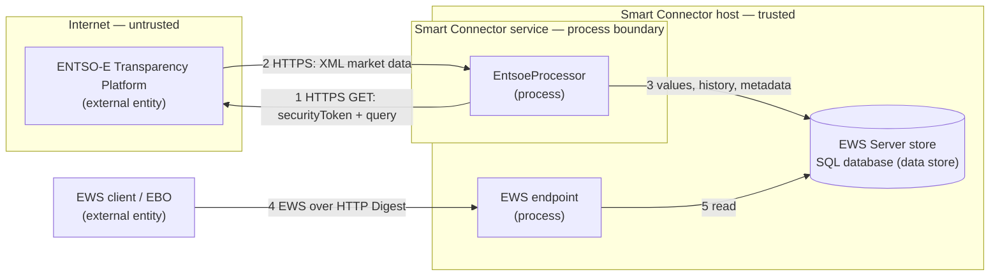

# Security

This document describes the security posture of the ENTSO-E Extension for Smart Connector. It covers credential handling, network security, input validation, and logging practices in accordance with Schneider Electric secure coding requirements.

## Credential Management

| Credential | Storage | Attribute | Notes |
| --- | --- | --- | --- |
| EWS Password | SmartConnector database | `[EncryptedString]` | Encrypted at rest; never logged or exported in plain text |
| ENTSO-E API Token | SmartConnector database | `[EncryptedString]` | Encrypted at rest; transmitted as query parameter over TLS |
| EWS UserName | SmartConnector database | `[Required]` | Validated not equal to Password |

- No hardcoded credentials exist anywhere in the source code.
- No default passwords are used. All credentials must be configured by the operator during Portal setup.
- The `[EncryptedString]` attribute stores the value encrypted in the database. Portal users can display it, so grant Portal access only to people trusted with the credentials it holds.

## Network Security

| Connection | Protocol | Minimum TLS | Authentication |
| --- | --- | --- | --- |
| ENTSO-E Transparency Platform | HTTPS | TLS 1.2 | API security token (query parameter) |
| EWS Server | HTTP, or HTTPS with a certificate binding | TLS 1.2 or higher when HTTPS | HTTP Digest (realm + username + password) |

- The client leaves `ServicePointManager.SecurityProtocol` at the .NET Framework 4.8 default, so it uses the TLS versions Windows allows. Switch TLS 1.0 and 1.1 off in the SChannel settings of the host.
- The ENTSO-E API endpoint (`https://web-api.tp.entsoe.eu/api`) enforces TLS. Plain HTTP is not supported.
- The EWS Server is created at the configured `EwsAddress`. Its listener accepts connections on every network interface of the host, whatever host name `EwsAddress` uses, so allow the port in the Windows Firewall only for the EBO servers and other EWS clients that need it. It uses HTTP Digest authentication with a configurable realm.
- `HttpWebRequest.Timeout` is set to 30 seconds to prevent indefinite blocking on network failures.

## Input Validation

### Attribute-Based Validation

| Property | Constraint | Attribute |
| --- | --- | --- |
| ServerName | Non-empty | `[Required]` |
| UserName | Non-empty | `[Required]` |
| Password | Non-empty, encrypted | `[Required]`, `[EncryptedString]` |
| ApiToken | Non-empty, encrypted | `[Required]`, `[EncryptedString]` |
| Country | Selected from the supported list (enum) | `[Required]`, `[DefaultValue]` |
| EwsAddress | Non-empty | `[Required]` |
| CheapPercentile | 1–49 | `[Range(1, 49)]` |
| ExpensivePercentile | 51–99 | `[Range(51, 99)]` |
| BackfillDays | 0–90 | `[Range(0, 90)]`, `[DefaultValue(30)]` |

### Semantic Validation (Validate Override)

The following cross-property constraints are enforced:

- `UserName` must not equal `Password`
- `CheapPercentile` must be less than `ExpensivePercentile`
- The selected `Country` must resolve to at least one bidding zone (via `AreaMapping`)

Validation failures are reported as `ValidationResult` errors, preventing the processor from executing.

The country is chosen from a fixed `SupportedCountry` enumeration rather than free-text input, so an unrecognised or malformed country value cannot be supplied through the Portal.

### External Data Validation

- API responses are parsed using `System.Xml.Linq` with namespace-aware element selection.
- ENTSO-E error responses (`Acknowledgement_MarketDocument`) are detected and reported without crashing.
- Numeric values from the API are extracted via `double.TryParse` with `InvariantCulture` — malformed values are skipped rather than throwing.
- Resolution strings (`PT15M`, `PT30M`, `PT60M`, `P1D`) are validated against known formats.

## Error Handling

| Condition | Behaviour |
| --- | --- |
| HTTP 401/403 | Reported as configuration error. No retry. API token misconfigured. |
| Network timeout | `HttpWebRequest.Timeout` = 30s. Exception caught and logged. |
| Partial failure | Each data group (prices, load, generation) fails independently per zone. A failure in one does not block others. |
| All groups failed | `DataHealthy` set to `false`. Last good values retained. Error message written to `Meta/LastError`. |
| ENTSO-E error document | Acknowledgement error code and reason extracted and logged. |
| Overlapping triggers | A re-entrancy guard skips a new trigger while a previous cycle (typically a long backfill) is still running; a stale lock releases after 30 minutes. |

Error messages logged via `Logger.LogError` contain the exception type and message but never include credentials, API tokens, or raw request/response bodies.

## Logging Practices

- No `Logger.Log*` call includes `Password`, `ApiToken`, or any credential value.
- Log messages include: country code, bidding zone, price values, load values, and health status.
- Stack traces are logged at `LogError` level only for unexpected exceptions.
- The `Meta/DataHealthy` EWS point stores the current health status for operator visibility via the EWS client.

## Resource Management

- `EwsServerDataAdapter` implements `IDisposable` and is cleaned up in the processor's `Dispose(bool)` override.
- `EntsoeApiClient` wraps `HttpWebRequest` in `IDisposable` with proper stream disposal.
- The `ConnectNew → Dispose → ConnectExisting` pattern ensures clean database context on every run.

## Threat Model

This threat model follows the STRIDE methodology used by the Microsoft Threat Modeling Tool: the data-flow diagram identifies the elements and the trust boundaries they cross, and the STRIDE table enumerates the threats per element with their mitigations. Revisit it whenever a new API, data store, credential, or network path is added (see [Developer Guide — Threat Modelling](../../docs/developer-guide/smartconnector-developers-guide.md#51-threat-modelling)).

### Data Flow Diagram

### Trust Boundaries

- **Internet boundary** — between the processor and the ENTSO-E API (flows 1–2). Every crossing is HTTPS/TLS 1.2 with certificate validation; the API security token authenticates the processor to ENTSO-E.
- **Network boundary** — between the EWS client/EBO and the EWS endpoint (flow 4). Authenticated with HTTP Digest over the configured realm.
- **Process / machine boundary** — between the processor and the EWS data store (flows 3, 5), mediated by the Smart Connector runtime on the same host.

### STRIDE Analysis

| Category | Threat (element / flow) | Mitigation | Status |
| --- | --- | --- | --- |
| **Spoofing** | A spoofed ENTSO-E endpoint (DNS/MITM) feeds false data (2); an unauthorised EWS client reads or writes data (4) | TLS 1.2 with certificate validation rejects spoofed endpoints; the EWS endpoint requires HTTP Digest authentication | Mitigated |
| **Tampering** | API response or EWS values modified in transit (2, 4) | TLS protects integrity in transit; parsed values are validated and bounded before persisting (3) | Mitigated |
| **Repudiation** | An action cannot be traced to a cause | The Smart Connector application log records failed Portal sign-ins when the `Portal` log category is included, and syslog forwarding retains it; the processor records cycle count, last update, and last error to `Meta/*` | Partly mitigated |
| **Information Disclosure** | The API security token or EWS password leaks via logs, configuration export, or the network (1, 4) | `[EncryptedString]` at rest; no credential in any `Logger` call; the token is sent only over TLS inside the client | Mitigated |
| **Denial of Service** | Excessive API calls or a long backfill saturate the host or upstream; a malformed or oversized response exhausts memory (2) | `BackfillDays` cap (≤ 90), per-zone query isolation, re-entrancy guard against overlapping runs, 30 s HTTP timeout, namespace-aware XML parsing with error-document detection | Mitigated |
| **Elevation of Privilege** | The extension runs with the Smart Connector service account; a malicious dependency or crafted response could act with those rights | No dynamic code loading; only trusted SDK NuGet packages; all external data treated as untrusted and validated; run the service under a least-privilege account | Mitigated (deployment) |

## Compliance

This extension follows the security practices documented in the [Smart Connector Developer Guide — Security Advisory for Production Deployments](../../docs/developer-guide/smartconnector-developers-guide.md#5-security-advisory-for-production-deployments).
