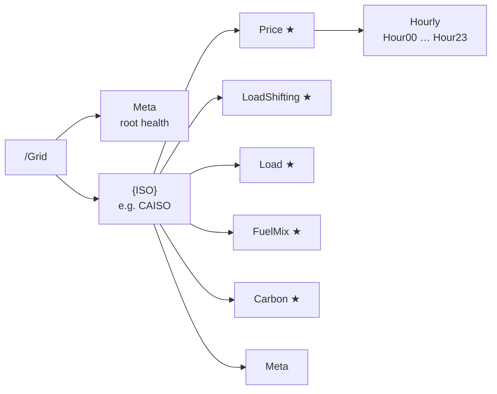
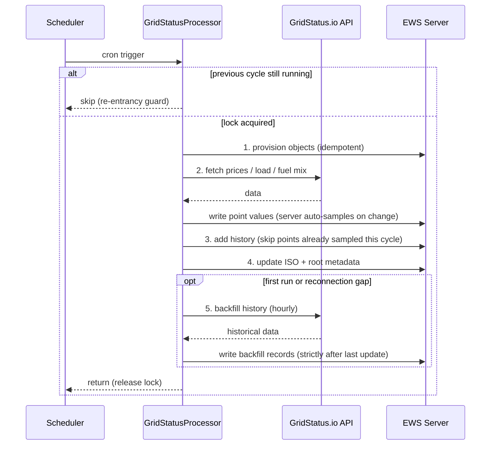
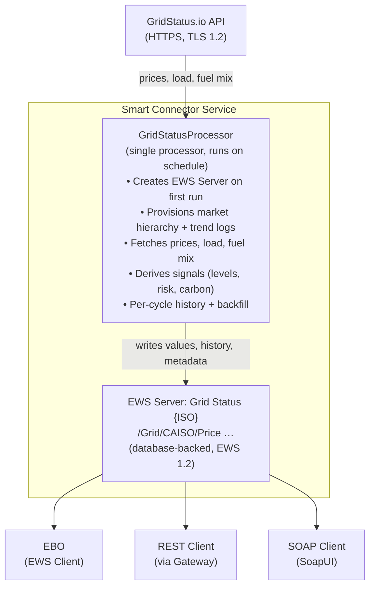

# Grid Status Extension for Smart Connector

A Smart Connector extension that integrates with [GridStatus.io](https://www.gridstatus.io/) to provide real-time North American electricity grid signals to EWS clients, including EcoStruxure™ Building Operation (EBO).

## What This Extension Does

The extension fetches wholesale grid data from the GridStatus.io API and publishes decision-ready signals to a Smart Connector EWS Server:

| Data Category | Values Published | Use Case |
| --- | --- | --- |
| **Real-Time Prices** | Current LMP, day-ahead current/next hour | Cost monitoring, energy reporting |
| **Price Statistics** | DayMinimum, DayMaximum, DayAverage | Daily price envelope tracking |
| **Price Classification** | Cheap/Normal/Expensive level, rank, percentile, negative price flag | Load shifting, demand response |
| **Load Shifting** | IsCurrentlyCheap, IsCurrentlyExpensive, HoursUntilCheap, HoursUntilExpensive, CheapHoursToday, ExpensiveHoursToday, RenewablePercent | BMS automation triggers |
| **System Load** | Current load, forecast peak, peak hour, peak risk level | Peak demand avoidance |
| **Fuel Mix** | Renewable %, solar/wind/gas MW | Renewable energy following |
| **Carbon Intensity** | Grid intensity (gCO₂/kWh), clean/normal/dirty level | Carbon-aware scheduling |
| **Trend Logs** | 14 trend logs with per-cycle sampling plus historical backfill | Historical analysis, EBO trend viewer |

**Supported markets:** CAISO, ERCOT, PJM, MISO, NYISO, ISO-NE, SPP, IESO (Ontario), AESO (Alberta). Switch market by configuration only — no code change required.

## Use Cases

1. **Load Shifting** — Schedule flexible loads (HVAC preheating, water heating, EV charging) during cheap price hours.
2. **Peak Shaving** — Shed non-critical loads when peak risk level is high.
3. **Renewable Following** — Align consumption with periods of high wind/solar generation.
4. **Carbon-Aware Scheduling** — Defer loads to periods when the grid is clean (low gCO₂/kWh).
5. **Demand Response** — React to real-time LMP signals in the BMS control strategy.
6. **Energy Reporting** — Provide live electricity market data and trend histories on BMS dashboards.

## Prerequisites

| Item | Version | Notes |
| --- | --- | --- |
| Windows | 10 / 11 / Server 2019+ | 64-bit |
| Visual Studio | 2019 or later | Community edition is sufficient |
| .NET Framework | 4.8 SDK | Required by all Smart Connector extensions |
| Smart Connector | 2.6 or later | Installed locally; the service must be running |
| GitHub PAT | `read:packages` scope | For the Smart Connector NuGet feed |
| GridStatus.io API Key | — | Free tier available at [gridstatus.io/settings/api](https://www.gridstatus.io/settings/api) |

### Obtain a GridStatus.io API Key

1. Navigate to <https://www.gridstatus.io> and create an account.
2. Go to **Settings → API** (<https://www.gridstatus.io/settings/api>).
3. Click **Generate API Key** and copy the key.

The free tier provides 1,000,000 rows per month — sufficient for most single-market deployments.

> **Security:** The API key is stored encrypted in the Smart Connector database via the `[EncryptedString]` attribute. It never appears in plain text in logs, configuration exports, or the Portal UI.

## Build

1. Configure the Smart Connector NuGet feed ([instructions](../../docs/developer-guide/smartconnector-developers-guide.md#32-configure-the-nuget-feed-90-seconds)):

   ```powershell
   dotnet nuget add source `
       https://nuget.pkg.github.com/SchneiderElectricBuildings/index.json `
       --name SmartConnector `
       --username YOUR_GITHUB_USERNAME `
       --password YOUR_GITHUB_PAT
   ```

2. Build the extension:

   ```powershell
   dotnet restore
   dotnet build --configuration Release
   ```

## Deploy

1. **Stop** the Smart Connector service (if updating an existing deployment):

   ```powershell
   sc stop "Smart Connector"
   ```

2. Copy `bin\Release\net48\SmartConnector.GridStatusExtension.dll` to `C:\ProgramData\SmartConnector\Extensions`.
3. **Start** the Smart Connector service:

   ```powershell
   sc start "Smart Connector"
   ```

## Portal Configuration

### Step 1 — Configure the Processor

1. Open the Smart Connector Portal (`http://localhost:8082`).
2. Authenticate with your portal credentials.
3. Navigate to **Configurations → Processor → Add New**.
4. Select **SmartConnector.GridStatusExtension**.
5. Select **GridStatusProcessor**.
6. Click **Finish**.
7. Click the **Details** tab and configure:

   | Property | Value | Description |
   | --- | --- | --- |
   | **ServerName** | `Grid Status` | Base name of the EWS Server. The market code is appended automatically (e.g., `Grid Status CAISO`) to avoid name collisions when multiple markets are configured on the same Smart Connector |
   | **Realm** | `SmartConnectorRealm` | HTTP authentication realm |
   | **EwsAddress** | `http://localhost:5300/GridStatus` | EWS endpoint address |
   | **UserName** | *(choose a username)* | EWS server authentication |
   | **Password** | *(choose a strong password)* | Stored encrypted |
   | **Market** | `CAISO` | Dropdown — select the ISO/RTO market. See [Supported Markets](#supported-markets) |
   | **ApiKey** | *(your GridStatus.io API key)* | Stored encrypted |
   | **PriceLocation** | *(leave empty for default)* | Optional pricing node override. Each market has a sensible default trading hub (e.g., `TH_NP15_GEN-APND` for CAISO). Only set this to target a specific node |
   | **RowLimit** | `100` | Max rows per API request (conserves budget) |
   | **CheapPercentile** | `25` | Bottom 25% of prices = Cheap |
   | **ExpensivePercentile** | `75` | Top 25% of prices = Expensive |
   | **BackfillDays** | `30` | Days of history to backfill into trend logs on first run. `0` disables backfill |
   | **UpdatePrices** | `True` | Enable price data updates |
   | **UpdateLoad** | `True` | Enable load data updates |
   | **UpdateFuelMix** | `True` | Enable fuel mix data updates |

8. Click **Save** → **Validate**.

### Step 2 — Create a Schedule

1. Navigate to **Setup → Configuration Schedules**.
2. Click **Add New**.
3. Enter a **Description** (e.g., `Runs every 5 minutes`).
4. Set the **Start Date** to the current date/time or a future date.
5. In the **Type** section, select **Cron**.
6. Enter the cron expression: `*/5 * * * *`.
7. Click **Save**.

### Step 3 — Assign the Schedule and Start

To ensure the extension actually runs on the schedule, you must enable **Runs On Schedule** on the processor's **Control** sub-tab — creating the schedule in Step 2 alone is not enough.

1. Navigate back to **Configurations → Processor** and select the Grid Status Processor.
2. Click the **Control** sub-tab.
3. Set **Runs On Schedule** to `True`. *(Required — without this the processor will not run on the schedule.)*
4. Select the schedule created in Step 2.
5. Click **Save** → **Start**.

On the first run, the processor creates the EWS Server (if it does not already exist), provisions the data hierarchy with trend logs, backfills trend history (see [Trend Logs](#trend-logs)), and starts fetching data. Subsequent runs fetch and update values, with automatic gap backfill on reconnection.

### Step 4 — Verify

1. Wait for the first scheduled execution (or click **Start** to run immediately).
2. Navigate to **EWS Servers** → click the edit icon for `Grid Status CAISO` (or your configured market).
3. Browse the value tree. You should see (where `{ISO}` is your market code):
   - `/Grid/Meta/DataHealthy` = `True`
   - `/Grid/{ISO}/Price/RealTimeLMP` = a numeric value
   - `/Grid/{ISO}/Carbon/Level` = `0`, `1`, or `2`

## EWS Data Structure

The extension provisions a single-market tree under `/Grid/{ISO}/`, with a root-level `/Grid/Meta` container for overall integration health.



Containers marked ★ hold trend logs. The points in each container are listed below.

Table – Root observability (/Grid/Meta)

| Point | Type | Description |
| --- | --- | --- |
| LastUpdate | DateTime | Last successful cycle |
| NextUpdate | DateTime | Estimated next scheduled run |
| DataHealthy | Bool | True if the last cycle succeeded |
| LastError | String | Most recent error message (empty if healthy) |
| CycleCount | Long | Completed cycles since service start |
| RowsConsumed | Long | Total API rows consumed |
| TimeZone | String | Processor system timezone ID |

Table – Per-ISO points (/Grid/{ISO}); ★ marks trend logs

| Point | Type | Description |
| --- | --- | --- |
| Price/RealTimeLMP | Analog ($/MWh) | Latest real-time LMP |
| Price/RealTimeLMPHistory ★ | Trend | Per-cycle + backfilled |
| Price/CurrentPrice | Analog ($/MWh) | Day-ahead price, current hour |
| Price/CurrentPriceHistory ★ | Trend | Per-cycle sampled |
| Price/NextHour | Analog ($/MWh) | Day-ahead price, next hour |
| Price/Level | Int (0-2) | 0=cheap, 1=normal, 2=expensive |
| Price/PriceCategory | String | "Cheap", "Normal", or "Expensive" |
| Price/RankToday | Int (1..N) | Rank among today's hours |
| Price/PercentileToday | Analog (0-100) | Percentile of the current hour |
| Price/NegativeActive | Bool | True if RT LMP < 0 |
| Price/CheapThreshold | Analog ($/MWh) | Computed cheap boundary |
| Price/ExpensiveThreshold | Analog ($/MWh) | Computed expensive boundary |
| Price/Currency | String | "USD" |
| Price/Unit | String | "MWh" |
| Price/DayMinimum | Analog ($/MWh) | Lowest day-ahead price today |
| Price/DayMinimumHistory ★ | Trend | Per-cycle sampled |
| Price/DayMaximum | Analog ($/MWh) | Highest day-ahead price today |
| Price/DayMaximumHistory ★ | Trend | Per-cycle sampled |
| Price/DayAverage | Analog ($/MWh) | Average day-ahead price today |
| Price/DayAverageHistory ★ | Trend | Per-cycle sampled |
| Price/Hourly/Hour00 … Hour23 | Analog ($/MWh) | Day-ahead price for each hour |
| LoadShifting/IsCurrentlyCheap | Bool | True if the current hour is cheap |
| LoadShifting/IsCurrentlyCheapHistory ★ | Trend | Per-cycle sampled |
| LoadShifting/IsCurrentlyExpensive | Bool | True if the current hour is expensive |
| LoadShifting/IsCurrentlyExpensiveHistory ★ | Trend | Per-cycle sampled |
| LoadShifting/HoursUntilCheap | Int | Hours until next cheap window, -1 if none |
| LoadShifting/HoursUntilExpensive | Int | Hours until next expensive window, -1 if none |
| LoadShifting/CheapHoursToday | String | Comma-separated cheap hours (e.g. "00,01,05") |
| LoadShifting/ExpensiveHoursToday | String | Comma-separated expensive hours |
| LoadShifting/RenewablePercent | Analog (%) | Current renewable generation share |
| LoadShifting/RenewablePercentHistory ★ | Trend | Per-cycle sampled |
| Load/Current | Analog (MW) | Latest actual system load |
| Load/CurrentHistory ★ | Trend | Per-cycle + backfilled |
| Load/ForecastPeakToday | Analog (MW) | Today's forecast peak |
| Load/ForecastPeakHour | DateTime | Hour of the forecast peak |
| Load/PeakRiskLevel | Int (0-2) | 0=low, 1=medium, 2=high |
| FuelMix/RenewablePct | Analog (%) | Renewable / total generation |
| FuelMix/RenewablePctHistory ★ | Trend | Per-cycle + backfilled |
| FuelMix/Solar | Analog (MW) | Solar generation |
| FuelMix/SolarHistory ★ | Trend | Per-cycle + backfilled |
| FuelMix/Wind | Analog (MW) | Wind generation |
| FuelMix/WindHistory ★ | Trend | Per-cycle + backfilled |
| FuelMix/Gas | Analog (MW) | Gas generation |
| FuelMix/GasHistory ★ | Trend | Per-cycle + backfilled |
| Carbon/GridIntensity | Analog (gCO₂/kWh) | Weighted-average grid intensity |
| Carbon/GridIntensityHistory ★ | Trend | Per-cycle + backfilled |
| Carbon/Level | Int (0-2) | 0=clean, 1=normal, 2=dirty |
| Meta/LastUpdate | DateTime | Per-ISO last update |
| Meta/NextUpdate | DateTime | Per-ISO estimated next run |
| Meta/DataHealthy | Bool | Per-ISO health status |
| Meta/TimeZone | String | Market timezone ID (e.g. America/Los_Angeles) |

Items marked ★ are **Trend Logs**: the processor adds the current value of each linked point every cycle and seeds history on first run (see [Trend Logs](#trend-logs)). Trend logs can be queried via the REST API or consumed directly from EBO.

## OpenADR 3.0 Signal Mapping

The Standard Energy Market Interface aligns EWS points with [OpenADR 3.0](https://www.openadr.org/) signal semantics. This mapping enables EBO programs and graphics to use consistent signal types across the GridStatus (North America) and ENTSO-E (Europe) extensions.

| EWS Point | OpenADR Signal Type | OpenADR Event Type | QUDT Unit URI | Notes |
| --- | --- | --- | --- | --- |
| Price/CurrentPrice | `ELECTRICITY_PRICE` | `PRICE` | `qudt:USD-PER-MegaW-HR` | Day-ahead LMP for current hour |
| Price/NextHour | `ELECTRICITY_PRICE` | `PRICE` | `qudt:USD-PER-MegaW-HR` | Day-ahead LMP for next hour |
| Price/RealTimeLMP | `ELECTRICITY_PRICE` | `PRICE` | `qudt:USD-PER-MegaW-HR` | Real-time locational marginal price |
| Price/Level | `SIMPLE` | `SIMPLE` | — | 0=cheap, 1=normal, 2=expensive (OpenADR SimpleLevel) |
| Price/PriceCategory | — | — | — | Human-readable label for Level |
| Price/NegativeActive | — | — | — | True when real-time price < 0 |
| Price/CheapThreshold | `ELECTRICITY_PRICE` | `PRICE` | `qudt:USD-PER-MegaW-HR` | Computed percentile boundary |
| Price/ExpensiveThreshold | `ELECTRICITY_PRICE` | `PRICE` | `qudt:USD-PER-MegaW-HR` | Computed percentile boundary |
| Price/Hourly/Hour00..23 | `ELECTRICITY_PRICE` | `PRICE` | `qudt:USD-PER-MegaW-HR` | Full 24-hour price curve |
| LoadShifting/IsCurrentlyCheap | `LOAD_DISPATCH` | `DISPATCH_SETPOINT` | — | Boolean DR trigger |
| LoadShifting/RenewablePercent | — | — | `qudt:PERCENT` | Renewable generation share |
| Load/Current | `LOAD_DISPATCH` | `DISPATCH_SETPOINT` | `qudt:MegaW` | Actual system load |
| Load/ForecastPeakToday | `LOAD_DISPATCH` | `DISPATCH_SETPOINT` | `qudt:MegaW` | Forecast peak demand |
| Carbon/GridIntensity | `GHG` | `GHG` | — | gCO₂/kWh (no standard QUDT URI) |
| Carbon/Level | `SIMPLE` | `SIMPLE` | — | 0=clean, 1=normal, 2=dirty |
| FuelMix/Solar | — | — | `qudt:MegaW` | Solar generation |
| FuelMix/Wind | — | — | `qudt:MegaW` | Wind generation |
| FuelMix/Gas | — | — | `qudt:MegaW` | Gas generation |

**QUDT unit notes:**

- `qudt:USD-PER-MegaW-HR` is a composed unit — QUDT defines `qudt:MegaW-HR` and currency units separately. The composite follows QUDT's unit composition pattern.
- `gCO₂/kWh` has no standard QUDT URI. Carbon intensity is reported as a raw numeric value.
- Full QUDT unit catalogue: <https://qudt.org/doc/DOC_VOCAB-UNITS.html>

**Brick Schema note:** Brick Schema defines building-side equipment and point classes (`brick:Electrical_Meter`, `brick:Power_Sensor`) but does not model grid-market signals. The OpenADR mapping applies at the SmartConnector extension level; Brick applies at the EBO consumption side when mapping EWS points to equipment models.

## Trend Logs

The extension provisions 14 trend logs that capture historical data for timeline analysis and BMS dashboards:

| Trend Log | Linked Value | Data Type | Use Case |
| --- | --- | --- | --- |
| RealTimeLMPHistory | RealTimeLMP | Analog | Electricity price timeline |
| CurrentPriceHistory | CurrentPrice | Analog | Day-ahead price tracking |
| DayMinimumHistory | DayMinimum | Analog | Daily price floor tracking |
| DayMaximumHistory | DayMaximum | Analog | Daily price peak tracking |
| DayAverageHistory | DayAverage | Analog | Average price over time |
| CurrentHistory | Current (Load) | Analog | Grid load pattern analysis |
| RenewablePctHistory | RenewablePct | Analog | Renewable share trend |
| GridIntensityHistory | GridIntensity | Analog | Carbon intensity timeline |
| SolarHistory | Solar | Analog | Solar generation tracking |
| WindHistory | Wind | Analog | Wind generation tracking |
| GasHistory | Gas | Analog | Gas generation tracking |
| IsCurrentlyCheapHistory | IsCurrentlyCheap | Bool | Cheap window occurrence |
| IsCurrentlyExpensiveHistory | IsCurrentlyExpensive | Bool | Expensive window occurrence |
| RenewablePercentHistory | RenewablePercent (LoadShifting) | Analog | Renewable % for load shifting |

### How Trend Logs Are Populated

Trend logs are filled two ways:

1. **Per-cycle sample.** Every cycle, after updating the point values, the processor writes the current value of each trended point as a history record at the cycle timestamp (Phase 3 below), so the trends grow on every run rather than only when a value happens to change. The EWS Server already auto-samples a trend whenever the linked value *changes*, so the processor skips its manual write for any point the server has already sampled this cycle — this avoids a duplicate record with the same value and timestamp.
2. **Historical backfill.** On first run, the processor backfills the price, load, and fuel-mix/carbon trends with up to `BackfillDays` days (default 30) of hourly history fetched from GridStatus.io, written at their original timestamps via `AddHistoryRecordsManually`. After a reconnection gap of more than about an hour, only the missed window is backfilled. The window is derived from the persisted `Meta/LastUpdate` timestamp, so a service restart does not re-backfill data that already exists. Set `BackfillDays` to `0` to disable backfill.

### Cycle Data Strategy

Each cycle runs in five explicit phases so the long-running backfill always happens last, after live data and metadata are already committed:

1. **Provision** — create all folders, points, and history items (idempotent).
2. **Update point values** — fetch prices, load, and fuel mix; write every point.
3. **Add history samples** — append the current value of each point to its trend.
4. **Update metadata** — stamp `Meta/LastUpdate`, `DataHealthy`, `CycleCount`, and the other observability points.
5. **Backfill** — seed/repair historical trend data (may take minutes).

Because backfill can exceed a short schedule interval, a re-entrancy guard prevents overlap: if the schedule re-triggers while a previous cycle is still running (typically inside a backfill), the new trigger logs a message and returns immediately. A stale lock is released automatically after 30 minutes so a crashed run cannot block the processor permanently.



### Accessing Trend Data in EBO

In EcoStruxure Building Operation WorkStation:

1. Navigate to the EWS Data Source configured for the Smart Connector.
2. Browse to the container of the value you want to trend (e.g., `/Grid/CAISO/Price`).
3. The trend log object (e.g., `RealTimeLMPHistory`) appears as a sibling of the value.
4. Right-click the trend log and select **View Trend** to open the graphical trend viewer.
5. Use trend logs in **Reports** or **Schedules** for energy cost analysis.

### Accessing Trend Data via REST API

Retrieve trend samples using the Smart Connector REST API:

```bash
# Get the last 50 price samples (most recent first)
curl -X GET "http://YOUR_HOST:YOUR_PORT/TrendSamples?trendId=TREND_ID&take=50&orderBy=1" \
  -H "Authorization: Bearer YOUR_ACCESS_TOKEN" \
  -H "Accept: application/json"

# Get samples for a specific date range
curl -X GET "http://YOUR_HOST:YOUR_PORT/TrendSamples?trendId=TREND_ID&sampleOnOrAfter=2026-06-01T00:00:00Z&sampledBefore=2026-06-02T00:00:00Z" \
  -H "Authorization: Bearer YOUR_ACCESS_TOKEN" \
  -H "Accept: application/json"
```

> **Note:** The `trendId` must include the `03` DataType prefix (e.g., `03/Grid/CAISO/Price/RealTimeLMPHistory`). Double URL encode the ID for REST API calls. See the [RESTful EWS Gateway Guide](../../docs/developer-guide/smartconnector-restful-ews-gateway.md#10-api-reference--trends-and-trend-samples) for the full Trend and TrendSample API reference.

## Consuming from EcoStruxure™ Building Operation

Once the EWS Server is running with data, provision an EWS Interface in EBO WorkStation and enable trend log polling.

### Step 1 — Create the EWS Interface

1. In WorkStation, right-click the top server and select **Create New Object**.
2. Select **Interface**, then **Web Service**, then **EcoStruxure Web Service**.
3. Click **Edit in Wizard**.
4. In the EWS Server section, configure:
   - **Server:** `localhost` (or the hostname of the Smart Connector machine).
   - **Protocol:** `HTTP`.
   - **Port:** The communication port from the EWS Address (e.g., `5300`).
   - **EWS Path:** The path segment after the port number in the EWS Address (e.g., `GridStatus`).
   - **Username:** The username configured in the processor.
   - **Password:** The password configured in the processor.
5. Click **Create**.

### Step 2 — Host the EWS Objects

1. Navigate to your top server → **System** → **Hardware** → **EcoStruxure Web Services**.
2. Expand the object with the same name as the EWS Interface you created.
3. Right-click the EWS Container Item named **Grid Status** and select **Host EWS Objects...**.
4. Select the EWS Interface you created in Step 1.

### Step 3 — Enable Trend Log Polling

The trend log objects provisioned by the processor require History Polling to be enabled manually in EBO.

1. Navigate to the EWS Interface in your system tree.
2. Search for all History Items (trend log objects).
3. For each trend log, open its properties and set **History Polling** to **Enabled**.

### Step 4 — Map Values to Control Strategies

Browse the value tree under the EWS Interface and map values to your control strategy:

- Use `LoadShifting/IsCurrentlyCheap` = `True` to enable flexible loads (HVAC preheating, EV charging).
- Use `LoadShifting/IsCurrentlyExpensive` = `True` to shed non-critical loads.
- Use `LoadShifting/HoursUntilCheap` to schedule deferred loads for the next cheap window.
- Use `Price/DayMinimum` and `Price/DayMaximum` to monitor the daily price envelope.
- Use `Carbon/Level` (0=clean) for carbon-aware scheduling.
- Use `Load/PeakRiskLevel` (2=high) for peak demand shedding.
- Use trend logs (e.g., `DayAverageHistory`, `IsCurrentlyCheapHistory`) for historical analysis and reporting.

## Supported Markets

The **Market** property is rendered as a dropdown in the Portal. Each market has a default pricing location used when **PriceLocation** is left empty:

| Code | Market / Zone | Default Price Location |
| --- | --- | --- |
| `CAISO` | California ISO | `TH_NP15_GEN-APND` |
| `ERCOT` | Electric Reliability Council of Texas | `HB_HOUSTON` |
| `PJM` | PJM Interconnection | `PJM_WESTERN_HUB` |
| `MISO` | Midcontinent ISO | `MISO.INDIANA_HUB` |
| `NYISO` | New York ISO | `N.Y.C.` |
| `ISONE` | ISO New England | `.H.INTERNAL_HUB` |
| `SPP` | Southwest Power Pool | `SPS` |
| `IESO` | Ontario (Canada) | `ONTARIO` |
| `AESO` | Alberta (Canada) | `ALBERTA` |

> **Tip:** To target a specific pricing node (e.g., a particular generator or load zone), set **PriceLocation** to the node ID. The default hubs are suitable for most building energy management use cases.

## Free-Tier Budget Optimization

The GridStatus.io free plan allows 1,000,000 rows per month. This extension minimizes consumption:

1. **Priority ordering:** Prices fetched first (highest value, lowest cost: 1–25 rows), then load (1–100 rows), then fuel mix (1 row).
2. **Targeted queries:** Always filters by location for price data. Requests only needed columns.
3. **Row limit cap:** Configurable `RowLimit` (default 100) prevents runaway queries.
4. **Latest-only for real-time:** Uses `time=latest` for current values (1 row each).
5. **Exponential backoff:** Retries on HTTP 429 without wasting requests.

At default settings with a 5-minute schedule:
- Per cycle: ~27 rows (1 RT price + 24 DA prices + 1 load + 1 fuel mix)
- Per day: ~7,776 rows
- Per month: ~233,280 rows (23% of free budget)

## Per-Market Dataset Mapping

| Market | Day-Ahead Price | Real-Time Price | Load | Fuel Mix |
| --- | --- | --- | --- | --- |
| CAISO | caiso_lmp_day_ahead_hourly | caiso_lmp_real_time_5_min | caiso_load | caiso_fuel_mix |
| ERCOT | ercot_spp_day_ahead_hourly | ercot_spp_real_time_15_min | ercot_load | ercot_fuel_mix |
| PJM | pjm_lmp_day_ahead_hourly | pjm_lmp_real_time_5_min | pjm_load | pjm_fuel_mix |
| MISO | miso_lmp_day_ahead_hourly | miso_lmp_real_time_5_min | miso_load | miso_fuel_mix |
| NYISO | nyiso_lmp_day_ahead_5_min | nyiso_lmp_real_time_5_min | nyiso_load | nyiso_fuel_mix |
| ISONE | isone_lmp_day_ahead_hourly | isone_lmp_real_time_5_min | isone_load | isone_fuel_mix |
| SPP | spp_lmp_day_ahead_hourly | spp_lmp_real_time_5_min | spp_load | spp_fuel_mix |
| IESO | ieso_lmp_day_ahead_hourly | ieso_lmp_real_time_5_min | ieso_load | ieso_fuel_mix |
| AESO | aeso_lmp_day_ahead_hourly | aeso_lmp_real_time_5_min | aeso_load | aeso_fuel_mix |

> **Note:** Dataset IDs are defaults based on GridStatus.io naming conventions. Verify availability for your market at <https://www.gridstatus.io/datasets>.

## Carbon Intensity

Grid intensity is computed as a weighted average of fuel-mix MW by emission factors (gCO₂/kWh):

| Fuel | Factor | Fuel | Factor |
| --- | --- | --- | --- |
| Coal | 980 | Nuclear | 12 |
| Gas | 410 | Hydro | 24 |
| Oil/Petroleum | 650 | Wind | 11 |
| Biomass | 230 | Solar | 45 |

This is an approximation. For production use, consider a dedicated carbon intensity API (e.g., WattTime, Electricity Maps) as an alternative data source.

## Observability

The root `/Grid/Meta/` container provides health signals visible to all EWS consumers:

- **LastUpdate / NextUpdate:** Timestamps of the last completed cycle and the estimated next run. NextUpdate is derived from the interval between the two most recent runs (defaults to 5 minutes on the first run) and is clamped to a sane range, so a long idle gap cannot project it far into the future.
- **DataHealthy:** Set to `false` if the last fetch cycle failed. Use this for EBO alarms.
- **LastError:** Contains the error message from the most recent failure.
- **CycleCount / RowsConsumed:** Track operational metrics and API budget usage.
- **TimeZone:** The processor's system timezone (root level) and the market's timezone (per-ISO level, e.g., `America/Los_Angeles` for CAISO). These may differ when the Smart Connector host is in a different timezone than the market being monitored.

## Error Handling

| Condition | Behaviour |
| --- | --- |
| Network failure | Keeps last good values, sets `DataHealthy` to `false`, logs error |
| HTTP 401/403 | Reports as configuration error (invalid API key). Does not retry |
| HTTP 429 (rate limit) | Retries with exponential backoff (2s, 4s, 8s). Max 3 retries |
| Partial failure | Each data group (prices, load, fuel mix) fails independently |
| Missing datasets | Points remain in uncertain state if dataset unavailable for market |
| Initial setup | Backfills up to `BackfillDays` (default 30) of hourly trend history |
| Gap on reconnection | Backfills only the missed window, capped at `BackfillDays` |
| Overlapping triggers | A re-entrancy guard skips a new trigger while a previous cycle (typically a long backfill) is still running; a stale lock releases after 30 minutes |

## Running Tests

The test project includes two categories of tests:

### Unit Tests (no Smart Connector required)

These test the pure logic components (signal derivation, market registry, validation). Integration tests are marked `[Explicit]` and excluded from default runs:

```powershell
dotnet test
```

### Integration Tests (Smart Connector required)

These test the processor lifecycle (`ExecuteTest`, `CancelTest`) and require a running Smart Connector instance:

1. Install Smart Connector on your development machine.
2. Copy `Mongoose.Service.exe.config` connection strings and encryption key to the test project's `app.config`.
3. Update the `CreateTestableProcessor()` method with valid EWS and GridStatus.io credentials.
4. Run explicitly:
   ```powershell
   dotnet test --filter "FullyQualifiedName~ExecuteTest|FullyQualifiedName~CancelTest"
   ```

## Architecture



## Security

This extension follows all security practices from the [Developer Guide — Security Advisory for Production Deployments](../../docs/developer-guide/smartconnector-developers-guide.md#5-security-advisory-for-production-deployments):

- API key and EWS password are marked with `[EncryptedString]` — stored encrypted, never logged.
- All public properties have `[Required]`, `[Range]`, or `[StringLength]` validation.
- No credentials appear in any `Logger.Log*` call.
- `EwsServerDataAdapter` is wrapped in a `Dispose` pattern.
- TLS 1.2 is enforced for GridStatus.io API communication.
- Input from the GridStatus.io API is validated and bounded before writing to the EWS Server.

For a detailed security analysis including threat model, credential management, and compliance mapping, see [SECURITY.md](SECURITY.md).

## What This Demonstrates

- Standard Energy Market Interface aligned with Entsoe extension (same paths, types, semantics)
- OpenADR 3.0 signal semantics: Price → `EventType.Price`, Level → `EventType.Simple`, Carbon → `EventType.GHG`
- Single `Processor` combining setup and scheduled updates (eliminates configuration mismatch)
- `SupportedMarket` enum for Portal dropdown selection with default price locations
- Automatic server name uniqueness (market code appended to `ServerName`)
- Load-shifting signals derived from day-ahead price classification
- Single-market architecture with per-market configuration (switch ISO by dropdown only)
- `EwsServerDataAdapter.ConnectNew` and `ConnectExisting` for EWS server management
- Five-phase cycle (provision → values → history → metadata → backfill) that defers the long-running backfill to the end
- Static re-entrancy guard that skips overlapping triggers when a backfill outlasts the schedule interval
- Per-cycle history sampling via `AddHistoryRecordsManually` for deterministic trend population
- Trend history backfill (initial + gap) made idempotent via the persisted `Meta/LastUpdate` timestamp
- `NextUpdate` interval clamped so a long idle gap cannot project an absurd future time
- `AddHistoryItem` for trend log provisioning
- `[EncryptedString]` for secure credential storage
- `[Required]`, `[Range]`, `[DefaultValue]`, `[Tooltip]` configuration attributes
- Semantic validation via `Validate` override
- `IsCancellationRequested` for responsive cancellation handling
- `PromptSeverity.MayNotContinue` and `MayContinue` for error reporting
- `IProcessorTestFixture<T>` for unit testing
- Exponential backoff and retry for API resilience
- Dispose pattern for resource cleanup
- Proper logging with `Logger` (no credential exposure)

## Project Structure

Table – Extension source (`SmartConnector.GridStatusExtension/`)

| File | Responsibility |
| --- | --- |
| `GridStatusProcessor.cs` | Main processor — five-phase cycle, provisioning, history, backfill, observability, re-entrancy guard |
| `GridStatusProcessorBase.cs` | Configuration properties, semantic validation, `EwsServerDataAdapter` lifecycle |
| `GridStatusClient.cs` | REST API client with retry/backoff and TLS 1.2 |
| `GridStatusResponseParser.cs` | Parses GridStatus.io JSON into typed `DataRow`s |
| `SignalDerivation.cs` | Pure derivation functions (price level, peak risk, carbon) |
| `BackfillPlanner.cs` | Backfill window decision and row filtering |
| `EwsStructure.cs` | Per-ISO EWS AlternateId paths, root Meta constants, trend definitions |
| `MarketRegistry.cs` | `SupportedMarket` enum and per-ISO dataset/location config |
| `nuget.config.template` | NuGet feed template (no credentials committed) |
| `SmartConnector.GridStatusExtension.csproj` | SDK-style project targeting `net48` |
| `README.md` / `SECURITY.md` | Usage documentation and security posture |

Table – Test project (`SmartConnector.GridStatusExtension.Tests/`)

| File | Coverage |
| --- | --- |
| `SignalDerivationFixture.cs` | Price level, rank, peak risk, carbon, fuel mix derivation |
| `ResponseParserFixture.cs` | JSON parsing into `DataRow`s |
| `EwsStructureFixture.cs` | EWS path generation and trend definitions |
| `BackfillPlannerFixture.cs` | Backfill window decision and row filtering |
| `NextUpdateFixture.cs` | `NextUpdate` interval clamping |
| `ProcessorFixture.cs` | Validation, market checks, and `[Explicit]` integration tests |

## References

- [GridStatus.io API Documentation](https://docs.gridstatus.io/developers)
- [GridStatus.io Dataset Catalog](https://www.gridstatus.io/datasets)
- [SmartConnector Developer Guide](../../docs/developer-guide/smartconnector-developers-guide.md)
- [RESTful EWS Gateway Guide](../../docs/developer-guide/smartconnector-restful-ews-gateway.md)
