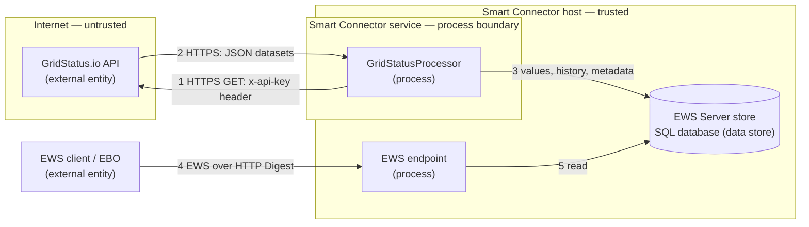

# Security

This document describes the security posture of the GridStatus Extension for Smart Connector. It covers credential handling, network security, input validation, and logging practices in accordance with Schneider Electric secure coding requirements.

## Credential Management

| Credential | Storage | Attribute | Notes |
| --- | --- | --- | --- |
| EWS Password | SmartConnector database | `[EncryptedString]` | Encrypted at rest; never logged or exported in plain text |
| GridStatus.io API Key | SmartConnector database | `[EncryptedString]` | Encrypted at rest; transmitted via `x-api-key` HTTP header over TLS |
| EWS UserName | SmartConnector database | `[Required]` | Validated not equal to Password |

- No hardcoded credentials exist anywhere in the source code.
- No default passwords are used. All credentials must be configured by the operator during Portal setup.
- The `[EncryptedString]` attribute stores the value encrypted in the database. Portal users can display it, so grant Portal access only to people trusted with the credentials it holds.

## Network Security

| Connection | Protocol | Minimum TLS | Authentication |
| --- | --- | --- | --- |
| GridStatus.io API | HTTPS | TLS 1.2 | API key via `x-api-key` header |
| EWS Server | HTTP, or HTTPS with a certificate binding | TLS 1.2 or higher when HTTPS | HTTP Digest (realm + username + password) |

- The default API base URL (`https://api.gridstatus.io/v1`) enforces TLS. Plain HTTP URLs are not supported by the GridStatus.io API.
- The EWS Server is created at the configured `EwsAddress`. Its listener accepts connections on every network interface of the host, whatever host name `EwsAddress` uses, so allow the port in the Windows Firewall only for the EBO servers and other EWS clients that need it. It uses HTTP Digest authentication with a configurable realm.
- `HttpClient.Timeout` is set to 30 seconds to prevent indefinite blocking on network failures.

## Input Validation

### Attribute-Based Validation

| Property | Constraint | Attribute |
| --- | --- | --- |
| ServerName | Non-empty | `[Required]` |
| UserName | Non-empty | `[Required]` |
| Password | Non-empty, encrypted | `[Required]`, `[EncryptedString]` |
| ApiKey | Non-empty, encrypted | `[Required]`, `[EncryptedString]` |
| Market | Enum value | `[Required]` (Portal dropdown) |
| EwsAddress | Non-empty | `[Required]` |
| RowLimit | 10–10,000 | `[Range(10, 10000)]` |
| CheapPercentile | 1–49 | `[Range(1, 49)]` |
| ExpensivePercentile | 51–99 | `[Range(51, 99)]` |
| PeakRiskMediumThreshold | 0.5–1.0 | `[Range(0.5, 1.0)]` |
| PeakRiskHighThreshold | 0.5–1.0 | `[Range(0.5, 1.0)]` |
| CarbonCleanThreshold | 0–500 | `[Range(0, 500)]` |
| CarbonDirtyThreshold | 100–1500 | `[Range(100, 1500)]` |
| BackfillDays | 0–90 | `[Range(0, 90)]`, `[DefaultValue(30)]` |

### Semantic Validation (Validate Override)

The following cross-property constraints are enforced:

- `UserName` must not equal `Password`
- `CheapPercentile` must be less than `ExpensivePercentile`
- `PeakRiskMediumThreshold` must be less than `PeakRiskHighThreshold`
- `CarbonCleanThreshold` must be less than `CarbonDirtyThreshold`

Validation failures are reported as `PromptSeverity.MayNotContinue`, preventing the processor from executing.

### External Data Validation

- API responses are parsed using `JavaScriptSerializer` with a 10 MB `MaxJsonLength` cap.
- Numeric values from the API are extracted via `double.TryParse` with `InvariantCulture` — malformed values fall back to `0.0` rather than throwing.
- Timestamps are parsed with `DateTimeStyles.AdjustToUniversal | AssumeUniversal`. Invalid timestamps default to `DateTime.MinValue` and are skipped during processing.
- Backfill history is capped at `BackfillDays` (default 30, maximum 90) to prevent excessive API consumption, and is idempotent across restarts (the window is derived from the persisted `Meta/LastUpdate` timestamp).

## Error Handling

| Condition | Behaviour |
| --- | --- |
| HTTP 401/403 | Reported as configuration error. No retry. API key or permissions misconfigured. |
| HTTP 429 (rate limit) | Exponential backoff: 2s, 4s, 8s. Maximum 3 retries. |
| Network timeout | `HttpClient.Timeout` = 30s. Exception caught and logged. |
| Partial failure | Each data group (prices, load, fuel mix) fails independently. A failure in one does not block others. |
| All groups failed | `DataHealthy` set to `false`. Last good values retained. Error message written to `Meta/LastError`. |
| Overlapping triggers | A re-entrancy guard skips a new trigger while a previous cycle (typically a long backfill) is still running; a stale lock releases after 30 minutes. |

Error messages logged via `Logger.LogError` contain the exception type and message but never include credentials, API keys, or raw request/response bodies.

## Logging Practices

- No `Logger.Log*` call includes `Password`, `ApiKey`, or any credential value.
- Log messages include: market ID, row counts, price values, load values, and health status.
- Stack traces are logged at `LogError` level only for unexpected exceptions.
- The `Meta/LastError` EWS point stores the most recent error message for operator visibility via the EWS client.

## Resource Management

- `EwsServerDataAdapter` implements `IDisposable` and is cleaned up in the processor's `Dispose(bool)` override.
- `GridStatusClient` wraps `HttpClient` in `IDisposable` with proper disposal.
- `HttpClient` is scoped to the processor lifecycle — created in `Execute_Subclass` via `using`, disposed after each cycle.

## Threat Model

This threat model follows the STRIDE methodology used by the Microsoft Threat Modeling Tool: the data-flow diagram identifies the elements and the trust boundaries they cross, and the STRIDE table enumerates the threats per element with their mitigations. Revisit it whenever a new API, data store, credential, or network path is added (see [Developer Guide — Threat Modelling](../../docs/developer-guide/smartconnector-developers-guide.md#51-threat-modelling)).

### Data Flow Diagram

### Trust Boundaries

- **Internet boundary** — between the processor and the GridStatus.io API (flows 1–2). Every crossing is HTTPS/TLS 1.2 with certificate validation; the API key (sent in the `x-api-key` header) authenticates the processor.
- **Network boundary** — between the EWS client/EBO and the EWS endpoint (flow 4). Authenticated with HTTP Digest over the configured realm.
- **Process / machine boundary** — between the processor and the EWS data store (flows 3, 5), mediated by the Smart Connector runtime on the same host.

### STRIDE Analysis

| Category | Threat (element / flow) | Mitigation | Status |
| --- | --- | --- | --- |
| **Spoofing** | A spoofed GridStatus.io endpoint (DNS/MITM) feeds false data (2); an unauthorised EWS client reads or writes data (4) | TLS 1.2 with certificate validation rejects spoofed endpoints; the EWS endpoint requires HTTP Digest authentication | Mitigated |
| **Tampering** | API response or EWS values modified in transit (2, 4) | TLS protects integrity in transit; parsed values use fallback defaults and are bounded before persisting (3) | Mitigated |
| **Repudiation** | An action cannot be traced to a cause | The Smart Connector application log records failed Portal sign-ins when the `Portal` log category is included, and syslog forwarding retains it; the processor records cycle count, rows consumed, last update, and last error to `Meta/*` | Partly mitigated |
| **Information Disclosure** | The API key or EWS password leaks via logs, configuration export, or the network (1, 4) | `[EncryptedString]` at rest; no credential in any `Logger` call; the key is sent only over TLS in the `x-api-key` header | Mitigated |
| **Denial of Service** | Excessive API calls exhaust the plan quota or saturate the host; a long backfill overlaps runs; an oversized response exhausts memory (2) | `RowLimit` and `BackfillDays` (≤ 90) caps, re-entrancy guard, exponential backoff on HTTP 429, 30 s timeout, `MaxJsonLength` cap; 403 plan-limit errors are surfaced distinctly so operators can slow the schedule | Mitigated |
| **Elevation of Privilege** | The extension runs with the Smart Connector service account; a malicious dependency or crafted response could act with those rights | No dynamic code loading; only trusted SDK NuGet packages; all external data treated as untrusted and validated; run the service under a least-privilege account | Mitigated (deployment) |

## Compliance

This extension follows the security practices documented in the [Smart Connector Developer Guide — Security Advisory for Production Deployments](../../docs/developer-guide/smartconnector-developers-guide.md#5-security-advisory-for-production-deployments).
