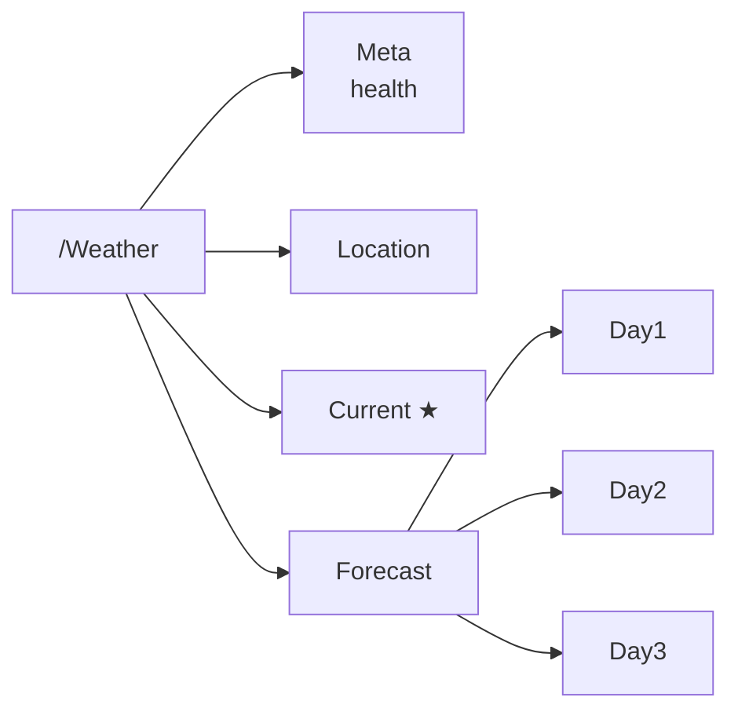
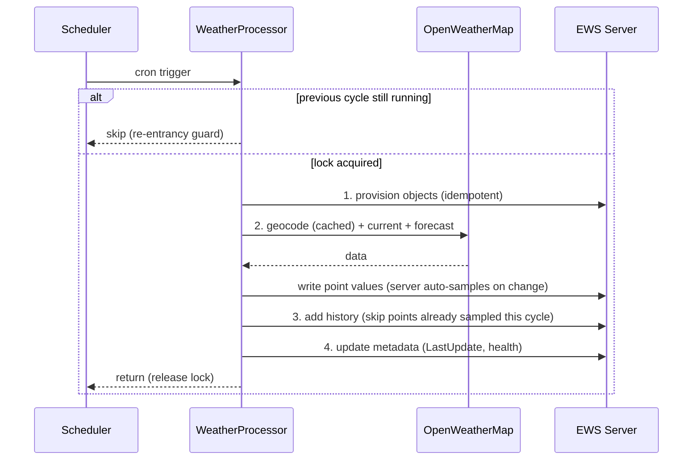
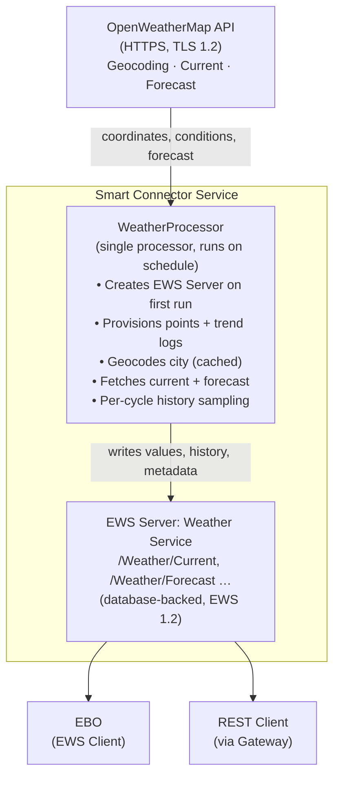

# Weather Extension for Smart Connector

A Smart Connector extension that integrates with the [OpenWeatherMap API](https://openweathermap.org/api) to publish current conditions and a 3-day forecast for a configured city to EWS clients, including EcoStruxure™ Building Operation (EBO).

This is the worked example built in [Developer Guide — Develop an Extension](../../docs/developer-guide/smartconnector-developers-guide.md#7-develop-an-extension): a single self-provisioning processor with idempotent provisioning, per-cycle trend sampling, a phased cycle, and a re-entrancy guard.

## What This Extension Does

| Data Category | Values Published | Use Case |
| --- | --- | --- |
| **Current Conditions** | Temperature, FeelsLike, Pressure, Humidity, WindSpeed, Description, ObservedAt | Live environmental monitoring |
| **3-Day Forecast** | Per day: Date, HighTemp, LowTemp, Pressure, Humidity, Description | Predictive scheduling, pre-conditioning |
| **Location** | Resolved name, country, latitude, longitude | Confirming the geocoded target |
| **Trend Logs** | Temperature, Pressure, Humidity history (per-cycle sampled) | Historical analysis, EBO trend viewer |

**Geocoding:** the configured city is resolved to coordinates via the OpenWeatherMap Geocoding API, then weather is fetched by latitude/longitude (city-name weather queries are deprecated by OpenWeatherMap).

## Use Cases

1. **Free-Cooling / Economizer** — Use outdoor temperature and humidity to drive economizer logic.
2. **Pre-Conditioning** — Use the 3-day forecast highs/lows to pre-cool or pre-heat ahead of extreme days.
3. **Weather-Compensated Setpoints** — Shift setpoints with outdoor conditions.
4. **Dashboards** — Show live conditions and a forecast on BMS graphics.
5. **Historical Analysis** — Trend outdoor temperature/pressure/humidity over time.

## Prerequisites

| Item | Version | Notes |
| --- | --- | --- |
| Windows | 10 / 11 / Server 2019+ | 64-bit |
| Visual Studio | 2019 or later | Community edition is sufficient |
| .NET Framework | 4.8 SDK | Required by all Smart Connector extensions |
| Smart Connector | 2.6 or later | Installed locally; the service must be running |
| GitHub PAT | `read:packages` scope | For the Smart Connector NuGet feed |
| OpenWeatherMap API Key | — | Free tier; see below |

### Obtain an OpenWeatherMap API Key

1. Create a free account at <https://home.openweathermap.org/users/sign_up>.
2. Open the **API keys** tab (<https://home.openweathermap.org/api_keys>) and copy your key (a default key is created for you).
3. **Allow time for activation.** A newly created key can take up to a couple of hours to activate; until then the API returns HTTP 401. The free tier covers the Geocoding, Current Weather, and 5-day/3-hour Forecast endpoints this extension uses.

> **Security:** The API key is stored encrypted via the `[EncryptedString]` attribute. The extension never writes it to a log. Portal users can display it, so grant Portal access only to people trusted with it.

## Build

1. Configure the Smart Connector NuGet feed ([instructions](../../docs/developer-guide/smartconnector-developers-guide.md#32-configure-the-nuget-feed-90-seconds)):

   ```powershell
   dotnet nuget add source `
       https://nuget.pkg.github.com/SchneiderElectricBuildings/index.json `
       --name SmartConnector `
       --username YOUR_GITHUB_USERNAME `
       --password YOUR_GITHUB_PAT
   ```

2. Build the extension:

   ```powershell
   dotnet restore
   dotnet build --configuration Release
   ```

## Deploy

1. **Stop** the Smart Connector service (if updating an existing deployment):

   ```powershell
   Stop-Service SmartConnectorService
   ```

2. Copy `bin\Release\net48\SmartConnector.WeatherExtension.dll` to the SmartConnector installation folder, next to `Mongoose.Service.exe` (by default `C:\Program Files (x86)\Schneider Electric\SmartConnector`). The Portal lists the extensions it finds in that folder.
3. **Start** the Smart Connector service:

   ```powershell
   Start-Service SmartConnectorService
   ```

## Portal Configuration

### Step 1 — Configure the Processor

1. Open the Smart Connector Portal (`http://localhost:8082`).
2. Authenticate with your portal credentials.
3. Navigate to **Configurations → Processor → Add New**.
4. Select **SmartConnector.WeatherExtension**.
5. Select **WeatherProcessor**.
6. Click **Finish**.
7. Click the **Details** tab and configure:

   | Property | Value | Description |
   | --- | --- | --- |
   | **ServerName** | `Weather Service` | Name of the EWS Server (created on first run) |
   | **Realm** | `SmartConnectorRealm` | HTTP authentication realm |
   | **EwsAddress** | `http://localhost:5300/WeatherService` | EWS endpoint address |
   | **UserName** | *(choose a username)* | EWS server authentication |
   | **Password** | *(choose a strong password)* | Stored encrypted |
   | **ApiKey** | *(your OpenWeatherMap key)* | Stored encrypted |
   | **City** | `London,GB` | `City`, `City,CountryCode`, or `City,StateCode,CountryCode` (US) |
   | **Units** | `Metric` | `Metric` (°C, m/s), `Imperial` (°F, mph), or `Standard` (K, m/s) |
   | **UpdateForecast** | `True` | Enable the 3-day forecast |

8. Click **Save** → **Validate**.

### Step 2 — Create a Schedule

1. Navigate to **Setup → Configuration Schedules**.
2. Click **Add New**.
3. Enter a **Description** (e.g., `Runs every 15 minutes`).
4. Set the **Start Date** to the current date/time.
5. In the **Type** section, select **Cron**.
6. Enter the cron expression: `*/15 * * * *`.
7. Click **Save**.

> **Budget tip:** The free OpenWeatherMap tier allows 60 calls/minute and ~1,000,000 calls/month. This extension makes at most three calls per cycle (geocode + current + forecast), and the geocode result is cached so it is only re-fetched when the City changes. A 15-minute schedule uses roughly 200 calls/day.

### Step 3 — Assign the Schedule and Start

To ensure the extension actually runs on the schedule, you must enable **Runs On Schedule** on the processor's **Control** sub-tab — creating the schedule in Step 2 alone is not enough.

1. Navigate back to **Configurations → Processor** and select the Weather Processor.
2. Click the **Control** sub-tab.
3. Set **Runs On Schedule** to `True`. *(Required — without this the processor will not run on the schedule.)*
4. Select the schedule created in Step 2.
5. Click **Save** → **Start**.

On the first run, the processor creates the EWS Server (if it does not already exist), provisions the data hierarchy with trend logs, geocodes the city, and starts fetching data.

### Step 4 — Verify

1. Wait for the first scheduled execution (or click **Start** to run immediately).
2. Navigate to **EWS Servers** → click the edit icon for `Weather Service`.
3. Browse the value tree. You should see:
   - `/Weather/Meta/DataHealthy` = `True`
   - `/Weather/Location/ResolvedName` = `London`
   - `/Weather/Current/Temperature` = a numeric value
   - `/Weather/Forecast/Day1/HighTemp` = a numeric value

## EWS Data Structure

The tree is organised under `/Weather`, with a root-level `/Weather/Meta` container for integration health.



Container `Current ★` holds the trend logs. The points in each container:

Table – Observability (/Weather/Meta)

| Point | Type | Description |
| --- | --- | --- |
| LastUpdate | DateTime | Last successful cycle |
| NextUpdate | DateTime | Estimated next run (clamped) |
| DataHealthy | Bool | True if the last cycle succeeded |
| LastError | String | Most recent error message |
| CycleCount | Long | Completed cycles since service start |
| ApiCallsTotal | Long | Total OpenWeatherMap calls made |
| TimeZone | String | Service local timezone |

Table – Location (/Weather/Location)

| Point | Type | Description |
| --- | --- | --- |
| ConfiguredCity | String | The City property as entered |
| ResolvedName | String | Geocoded city name |
| Country | String | ISO country code |
| Latitude | Double | Resolved latitude |
| Longitude | Double | Resolved longitude |

Table – Current conditions (/Weather/Current); ★ marks trend logs

| Point | Type | Description |
| --- | --- | --- |
| Temperature | Analog (°C/°F/K) | Current temperature |
| TemperatureHistory ★ | Trend | Per-cycle sampled |
| FeelsLike | Analog (°C/°F/K) | Apparent temperature |
| Pressure | Analog (hPa) | Atmospheric pressure |
| PressureHistory ★ | Trend | Per-cycle sampled |
| Humidity | Analog (%) | Relative humidity |
| HumidityHistory ★ | Trend | Per-cycle sampled |
| WindSpeed | Analog (m/s or mph) | Wind speed |
| Description | String | e.g. "broken clouds" |
| ObservedAt | DateTime | Observation timestamp (UTC) |

Table – Forecast (/Weather/Forecast/Day{1..3})

| Point | Type | Description |
| --- | --- | --- |
| Date | DateTime | Forecast local date |
| HighTemp | Analog (°C/°F/K) | Day's forecast high |
| LowTemp | Analog (°C/°F/K) | Day's forecast low |
| Pressure | Analog (hPa) | Day's average pressure |
| Humidity | Analog (%) | Day's average humidity |
| Description | String | Conditions near local noon |

## Trend Logs

The extension provisions 3 trend logs for the current conditions:

| Trend Log | Linked Value | Use Case |
| --- | --- | --- |
| Current/TemperatureHistory | Current/Temperature | Outdoor temperature timeline |
| Current/PressureHistory | Current/Pressure | Pressure trend (weather-front indicator) |
| Current/HumidityHistory | Current/Humidity | Humidity timeline |

### How Trend Logs Are Populated

Every cycle, after updating the point values, the processor writes the current value of each trended point as a history record at the cycle timestamp, so the trends grow on every run rather than only when a value happens to change. The EWS Server already auto-samples a trend whenever the linked value *changes*, so the processor skips its manual write for any point the server has already sampled this cycle — this avoids a duplicate record with the same value and timestamp.

> **No historical backfill.** OpenWeatherMap's free tier has **no historical-weather endpoint**, so there is nothing to backfill — the trends accumulate from the first run forward via per-cycle sampling. (Seeding past history would require the paid *One Call 3.0* "timemachine" endpoint, which is out of scope for this free-tier example.) This is the one place this example differs from the GridStatus and ENTSO-E extensions, whose data sources do provide history.

### Cycle Data Strategy

Each cycle runs in four explicit phases:

1. **Provision** — create all folders, points, and history items (idempotent).
2. **Update point values** — geocode the city (cached), fetch current conditions and the forecast, write every point.
3. **Add history samples** — append the current value of each trended point to its trend.
4. **Update metadata** — stamp `Meta/LastUpdate`, `DataHealthy`, counters.

A re-entrancy guard prevents overlap: if the schedule re-triggers while a previous cycle is still running, the new trigger logs a message and returns immediately. A stale lock releases automatically after 30 minutes.



There is no backfill phase: OpenWeatherMap's free tier has no historical endpoint, so the trends accumulate from per-cycle samples (see [Trend Logs](#trend-logs)).

## Consuming from EcoStruxure™ Building Operation

1. In WorkStation, add a new EWS Data Source pointing at the `EwsAddress` value (e.g. `http://<host>:5300/WeatherService`) with the configured credentials.
2. Browse the value tree and map points to your control strategy:
   - `Current/Temperature` and `Current/Humidity` for economizer/free-cooling logic.
   - `Forecast/Day1/HighTemp` for next-day pre-conditioning.
   - The `*History` trend logs for graphical trends and reports.

## Observability

The `/Weather/Meta` container exposes integration health for EBO alarms:

- **DataHealthy** — `False` if the last cycle failed; use this for an alarm.
- **LastError** — the most recent error message.
- **LastUpdate / NextUpdate** — last completed cycle and the estimated next run (the interval is clamped so a long idle gap cannot project it far into the future).
- **CycleCount / ApiCallsTotal** — operational counters; `ApiCallsTotal` helps track free-tier budget.

## Error Handling

| Condition | Behaviour |
| --- | --- |
| HTTP 401 (invalid/inactive key) | Reported as a configuration error; not retried. New keys can take hours to activate. |
| HTTP 429 (rate limit) | Exponential backoff (2s, 4s, 8s), max 3 retries |
| City not found | Reports a `MayNotContinue` prompt; values remain unchanged |
| Network failure | Keeps last good values, sets `DataHealthy` to `False`, logs the error |
| Overlapping triggers | A re-entrancy guard skips a new trigger while a previous cycle is still running |

## Running Tests

### Unit Tests (no Smart Connector required)

These cover the response parser, the forecast aggregator, EWS paths, and the NextUpdate clamp:

```powershell
dotnet test --filter "TestCategory!=Integration"
```

### Integration Tests (Smart Connector + activated key required)

`ExecuteTest` and `CancelTest` are marked `[Explicit]` and require a running Smart Connector instance and an activated API key:

```powershell
dotnet test --filter "FullyQualifiedName~ExecuteTest"
```

## Architecture



## Security

This extension follows the practices in [Developer Guide — Security Advisory for Production Deployments](../../docs/developer-guide/smartconnector-developers-guide.md#5-security-advisory-for-production-deployments). See [SECURITY.md](SECURITY.md) for the full posture.

Summary:

- API key and EWS password are `[EncryptedString]` — stored encrypted, never logged.
- All public properties are validated (`[Required]`, `Validate` override; UserName ≠ Password; City required).
- TLS 1.2 is enforced for OpenWeatherMap calls.
- API calls are bounded (≤ 3 per cycle, geocode cached) and the processor is guarded against overlapping runs.
- `EwsServerDataAdapter` and `HttpClient` are disposed via the `Dispose` pattern.

## What This Demonstrates

- Single self-provisioning processor combining setup and scheduled updates
- Idempotent provisioning with `EnsureFolder` / `EnsureValue` / `EnsureHistoryItem`
- `ConnectNew → Dispose → ConnectExisting` lifecycle with `DbUpdateException` handling
- Four-phase cycle (provision → values → history → metadata) with per-cycle history sampling
- Static re-entrancy guard and a clamped `NextUpdate`
- Geocoding-then-coordinates flow (the current, non-deprecated OpenWeatherMap pattern), with the geocode result cached to conserve API budget
- `[EncryptedString]` credentials, TLS 1.2 enforcement, and bounded resource use
- Pure, unit-tested logic (`OpenWeatherMapResponseParser`, `ForecastAggregator`, `ComputeNextUpdate`)

## Project Structure

Table – Extension source (`SmartConnector.WeatherExtension/`)

| File | Responsibility |
| --- | --- |
| `WeatherProcessor.cs` | Main processor — four-phase cycle, provisioning, history, observability, re-entrancy guard |
| `WeatherProcessorBase.cs` | Configuration properties, validation, unit labels, adapter lifecycle |
| `OpenWeatherMapClient.cs` | HTTPS client (TLS 1.2, retry) for geocoding, current, and forecast |
| `OpenWeatherMapResponseParser.cs` | Parses OpenWeatherMap JSON into typed results |
| `ForecastAggregator.cs` | Rolls 3-hour steps into daily highs/lows in the location timezone |
| `EwsStructure.cs` | EWS AlternateId paths and trend definitions |
| `nuget.config.template` | NuGet feed template (no credentials committed) |
| `SmartConnector.WeatherExtension.csproj` | SDK-style project targeting `net48` |
| `README.md` / `SECURITY.md` | Usage documentation and security posture |

Table – Test project (`SmartConnector.WeatherExtension.Tests/`)

| File | Coverage |
| --- | --- |
| `ResponseParserFixture.cs` | Geocoding, current, and forecast JSON parsing |
| `ForecastAggregatorFixture.cs` | Daily roll-up, timezone bucketing, day-count cap |
| `EwsStructureFixture.cs` | EWS path generation and trend definitions |
| `NextUpdateFixture.cs` | `NextUpdate` interval clamping |
| `ProcessorFixture.cs` | Validation and `[Explicit]` integration tests |

## References

- [OpenWeatherMap API overview](https://openweathermap.org/api)
- [Current Weather Data](https://openweathermap.org/current) · [5 Day / 3 Hour Forecast](https://openweathermap.org/forecast5) · [Geocoding API](https://openweathermap.org/api/geocoding-api)
- [OpenWeatherMap pricing](https://openweathermap.org/price)
- [Developer Guide — Develop an Extension](../../docs/developer-guide/smartconnector-developers-guide.md#7-develop-an-extension)
