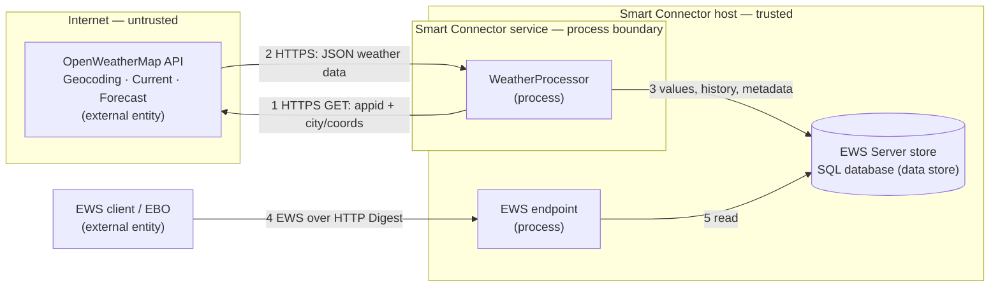

# Security

This document describes the security posture of the Weather Extension for Smart Connector. It covers credential handling, network security, input validation, and logging practices in accordance with Schneider Electric secure coding requirements.

## Credential Management

| Credential | Storage | Attribute | Notes |
| --- | --- | --- | --- |
| EWS Password | SmartConnector database | `[EncryptedString]` | Encrypted at rest; never logged or exported in plain text |
| OpenWeatherMap API Key | SmartConnector database | `[EncryptedString]` | Encrypted at rest; transmitted as the `appid` query parameter over TLS |
| EWS UserName | SmartConnector database | `[Required]` | Validated not equal to Password |

- No hardcoded credentials exist anywhere in the source code.
- No default passwords are used. All credentials must be configured by the operator during Portal setup.
- The `[EncryptedString]` attribute stores the value encrypted in the database. Portal users can display it, so grant Portal access only to people trusted with the credentials it holds.

## Network Security

| Connection | Protocol | Minimum TLS | Authentication |
| --- | --- | --- | --- |
| OpenWeatherMap API | HTTPS | TLS 1.2 | API key via `appid` query parameter |
| EWS Server | HTTP, or HTTPS with a certificate binding | TLS 1.2 or higher when HTTPS | HTTP Digest (realm + username + password) |

- TLS 1.2 is enforced via `ServicePointManager.SecurityProtocol` before the first outbound request.
- All OpenWeatherMap endpoints are called over `https://`. Plain HTTP is not used.
- The EWS Server is created at the configured `EwsAddress`. Its listener accepts connections on every network interface of the host, whatever host name `EwsAddress` uses, so allow the port in the Windows Firewall only for the EBO servers and other EWS clients that need it. It uses HTTP Digest authentication with a configurable realm.
- `HttpClient.Timeout` is 30 seconds to prevent indefinite blocking on network failures.

## Input Validation

### Attribute-Based Validation

| Property | Constraint | Attribute |
| --- | --- | --- |
| ServerName | Non-empty | `[Required]` |
| UserName | Non-empty | `[Required]` |
| Password | Non-empty, encrypted | `[Required]`, `[EncryptedString]` |
| ApiKey | Non-empty, encrypted | `[Required]`, `[EncryptedString]` |
| City | Non-empty | `[Required]` |
| Units | Enum value | `[Required]`, `[DefaultValue]` |
| EwsAddress | Non-empty | `[Required]` |

### Semantic Validation (Validate Override)

- `UserName` must not equal `Password`.
- `City` must not be empty.

The `Units` property is a fixed enumeration, so an unrecognised measurement system cannot be supplied through the Portal.

### External Data Validation

- API responses are parsed with `JavaScriptSerializer` (8 MB `MaxJsonLength` cap).
- Numeric values are extracted with `double.TryParse` and `InvariantCulture`; missing or malformed values fall back to `0.0` rather than throwing.
- Timestamps are Unix epoch seconds converted via `DateTimeOffset.FromUnixTimeSeconds`; invalid values become `DateTime.MinValue` and are skipped.
- Forecast steps with no timestamp are ignored during daily aggregation.

## Error Handling

| Condition | Behaviour |
| --- | --- |
| HTTP 401/403 | Reported as a configuration error. No retry. The key may be invalid or not yet activated. |
| HTTP 429 (rate limit) | Exponential backoff (2s, 4s, 8s), maximum 3 retries. |
| City not found | Reports a `MayNotContinue` prompt; existing values are retained. |
| Network timeout | `HttpClient.Timeout` = 30s. Exception caught and logged. |
| Cycle failure | `DataHealthy` set to `false`; error message written to `Meta/LastError`. |
| Overlapping triggers | A re-entrancy guard skips a new trigger while a previous cycle is still running; a stale lock releases after 30 minutes. |

Error messages logged via `Logger.LogError` contain the exception type and message but never include credentials, the API key, or raw request/response bodies.

## Logging Practices

- No `Logger.Log*` call includes `Password`, `ApiKey`, or any credential value.
- Log messages include: city, resolved coordinates are not logged, temperature/humidity values, and health status.
- The API key is appended to request URLs only inside the client and is never written to a log.
- The `Meta/DataHealthy` and `Meta/LastError` points expose health status for operator visibility via the EWS client.

## Resource Management

- `EwsServerDataAdapter` implements `IDisposable` and is cleaned up in the processor's `Dispose(bool)` override.
- `OpenWeatherMapClient` wraps `HttpClient` in `IDisposable` and is created/disposed within each cycle via `using`.
- The `ConnectNew → Dispose → ConnectExisting` pattern ensures a clean database context on every run.
- API usage is bounded: at most three calls per cycle (geocode + current + forecast), with the geocode result cached and re-fetched only when the City changes.

## Threat Model

This threat model follows the STRIDE methodology used by the Microsoft Threat Modeling Tool: the data-flow diagram identifies the elements and the trust boundaries they cross, and the STRIDE table enumerates the threats per element with their mitigations. Revisit it whenever a new API, data store, credential, or network path is added (see [Developer Guide — Threat Modelling](../../docs/developer-guide/smartconnector-developers-guide.md#51-threat-modelling)).

### Data Flow Diagram

### Trust Boundaries

- **Internet boundary** — between the processor and the OpenWeatherMap API (flows 1–2, covering geocoding, current weather, and forecast). Every crossing is HTTPS/TLS 1.2 with certificate validation; the API key (the `appid` query parameter) authenticates the processor.
- **Network boundary** — between the EWS client/EBO and the EWS endpoint (flow 4). Authenticated with HTTP Digest over the configured realm.
- **Process / machine boundary** — between the processor and the EWS data store (flows 3, 5), mediated by the Smart Connector runtime on the same host.

### STRIDE Analysis

| Category | Threat (element / flow) | Mitigation | Status |
| --- | --- | --- | --- |
| **Spoofing** | A spoofed OpenWeatherMap endpoint (DNS/MITM) feeds false data (2); an unauthorised EWS client reads or writes data (4) | TLS 1.2 with certificate validation rejects spoofed endpoints; the EWS endpoint requires HTTP Digest authentication | Mitigated |
| **Tampering** | API response or EWS values modified in transit (2, 4) | TLS protects integrity in transit; parsed values use fallback defaults and are bounded before persisting (3) | Mitigated |
| **Repudiation** | An action cannot be traced to a cause | The Smart Connector application log records failed Portal sign-ins when the `Portal` log category is included, and syslog forwarding retains it; the processor records cycle count, API-call count, last update, and last error to `Meta/*` | Partly mitigated |
| **Information Disclosure** | The API key or EWS password leaks via logs, configuration export, or the network (1, 4) | `[EncryptedString]` at rest; no credential in any `Logger` call; the key is sent only over TLS as the `appid` parameter, built inside the client | Mitigated |
| **Denial of Service** | Excessive API calls exhaust the free-tier quota or saturate the host; an oversized response exhausts memory (2) | ≤ 3 calls per cycle, geocode result cached, re-entrancy guard against overlapping runs, exponential backoff on HTTP 429, 30 s timeout, `MaxJsonLength` cap | Mitigated |
| **Elevation of Privilege** | The extension runs with the Smart Connector service account; a malicious dependency or crafted response could act with those rights | No dynamic code loading; only trusted SDK NuGet packages; all external data treated as untrusted and validated; run the service under a least-privilege account | Mitigated (deployment) |

## Compliance

This extension follows the security practices documented in the [Smart Connector Developer Guide — Security Advisory for Production Deployments](../../docs/developer-guide/smartconnector-developers-guide.md#5-security-advisory-for-production-deployments).
